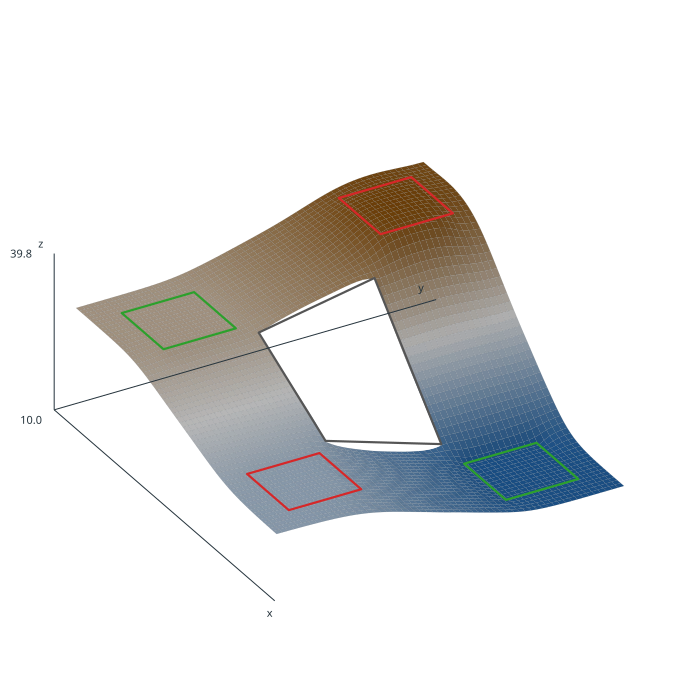

# surfit

[English](README.md) | [Русский](https://cfdbwrbq.github.io/surfit/ru/) | [中文](README.zh.md)

**Regular-grid interpolation and approximation from scattered data, under
gridding rules.**

[](https://github.com/cfdbwrbq/surfit/actions/workflows/ci.yml)
[](https://github.com/cfdbwrbq/surfit/actions/workflows/wps.yml)
[](https://github.com/cfdbwrbq/surfit/releases)



surfit builds a regular 2.5D grid from points, curves, contours, areas,
surfaces, trends and masks.  Rules and inequalities are applied in a defined
order with a penalty loop; the result can be validated, stacked, sliced,
exported and checked.

The C++ engine (2002–2015) is driven by a Python package and by the original
Tcl front end.  Both use the same solver and the tests compare them
byte-for-byte.

## Install

Linux x86_64 wheels (CPython 3.9–3.13) are attached to each
[release](https://github.com/cfdbwrbq/surfit/releases).  Pick the wheel for
your interpreter, for example CPython 3.12:

```bash
pip install https://github.com/cfdbwrbq/surfit/releases/download/v3.7.2/surfit-3.7.2-cp312-cp312-manylinux2014_x86_64.manylinux_2_17_x86_64.whl
```

From source, with CMake and a C++ compiler:

```bash
pip install .
```

Optional extras:

```bash
pip install ".[geoparquet]"   # pyarrow + shapely
pip install ".[mesh]"         # PyVista
```

## Quick start

```python
import surfit
import numpy as np

x = np.array([0.0, 1.0, 0.0, 1.0, 0.5])
y = np.array([0.0, 0.0, 1.0, 1.0, 0.5])
z = np.array([1.0, 2.0, 3.0, 4.0, 2.5])

task = surfit.Session(map_name="demo", tol=1e-7)
task.add_points(x, y, z, name="wells")
task.grid(0, 1, 0.05, 0, 1, 0.05)
task.points("wells")
task.completer(1, 1.6)
task.solve()

grid = task.values()          # (count_y, count_x), row 0 is min_y
print(grid.shape, np.nanmin(grid), np.nanmax(grid))
```

Undefined nodes carry `surfit.UNDEF_VALUE` (`FLT_MAX`); select them with
`surfit.defined_mask(grid)`.

## Features

- **Rules beyond a variogram.** Points, curves, contours, areas, surfaces,
  trends, masks, inequalities and `completer` are applied in a defined order.
- **Solver.** CMOFS: sequential minimisation, a penalty loop and a
  8×8 multilevel ladder; `cg`, `jcg`, `rf`, `jacobi` and `ssor`.
- **Quality workflow.** Residuals, spatial cross-validation, block bootstrap,
  variograms, per-node support, declustering, typed diagnostics and provenance.
- **Layered surfaces.** `SurfaceStack` with DAG relations, thickness,
  pinch-outs, persistence, uncertainty intervals and cross-sections.
- **Interoperability.** GeoTIFF (including rotated input), GeoParquet, xarray,
  Zarr, shapefile/BLN/Surfer/GMT/Grass/ArcGIS, and glTF/OBJ/STL mesh export.
- **Reproducibility.** JSON/YAML recipes and `surfit run recipe.json`.

## Documentation

- [English documentation](https://cfdbwrbq.github.io/surfit/en/)
- [Russian documentation](https://cfdbwrbq.github.io/surfit/ru/)
- [Release docs archive](https://github.com/cfdbwrbq/surfit/releases)
- [Capabilities, English](CAPABILITIES.en.md)
- [Capabilities, Russian](CAPABILITIES.md)
- [Python guide](docs/en/python.rst)
- [How the solver works](docs/en/how_it_works.rst)

The docs are built with Sphinx from `docs/en` and `docs/ru`; the two trees are
checked for structural parity by `docs/check_docs.py`.  GitHub Pages deploys
the built trees from `.github/workflows/docs.yml`.

## Interoperability

```python
# GeoParquet points, curves or areas, without GDAL
surfit.add_geoparquet(task, "points.parquet", kind="points")

# 3D visualisation, without a required dependency
extent = {"min_x": 0, "min_y": 0, "step_x": 0.05, "step_y": 0.05}
mesh = surfit.grid_mesh(task.values(), extent)
surfit.export_gltf("surface.gltf", mesh)

# stack layers as one glTF/OBJ, or PyVista when installed
stack.export_gltf("stack.gltf")
stack.to_pyvista()
```

Known limitations: GeoParquet uses polygon exteriors; FlatGeobuf is not
included because the Python package has no writer; mesh export is
visualisation-only, not CAD; GCV is not implemented.

## Build and test

```bash
mkdir -p build && cd build
cmake ../src
make -j"$(nproc)"
export LD_LIBRARY_PATH="$PWD/bin:$LD_LIBRARY_PATH"
```

```bash
# Fast self-check: docs, skills, Python API
python3 ci/selfcheck.py

# Full gate: examples, parity, docs, WPS, wheel smoke test
ci/check.sh --full
```

The Tcl front end is optional:

```bash
cmake -DSURFIT_BUILD_TCL=ON ../src
make -j"$(nproc)"
cd examples/surfit/tests && tclsh area.tcl
```

## Project

- Original engine and Tcl front end: M. V. Dmitrievsky and V. N. Kutrunov,
  2002–2015.
- The 2026 Python port, packaging, tests and documentation were produced with
  an AI coding agent under human direction and review.  The maintainer is
  responsible for the result.
- License: GNU GPL-2. See [LICENSE](LICENSE) and [AI_DISCLOSURE.md](AI_DISCLOSURE.md).
- Vendored [CDT](https://github.com/artem-ogre/CDT) triangulation is MPL-2.0.
