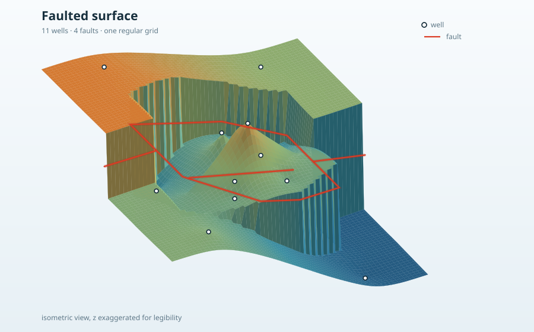
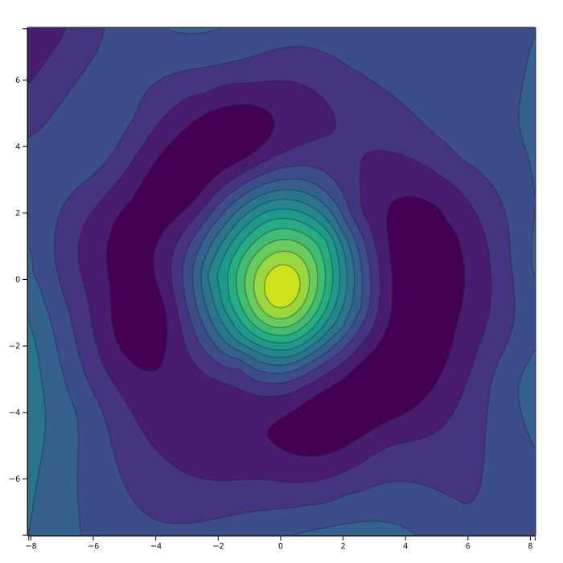
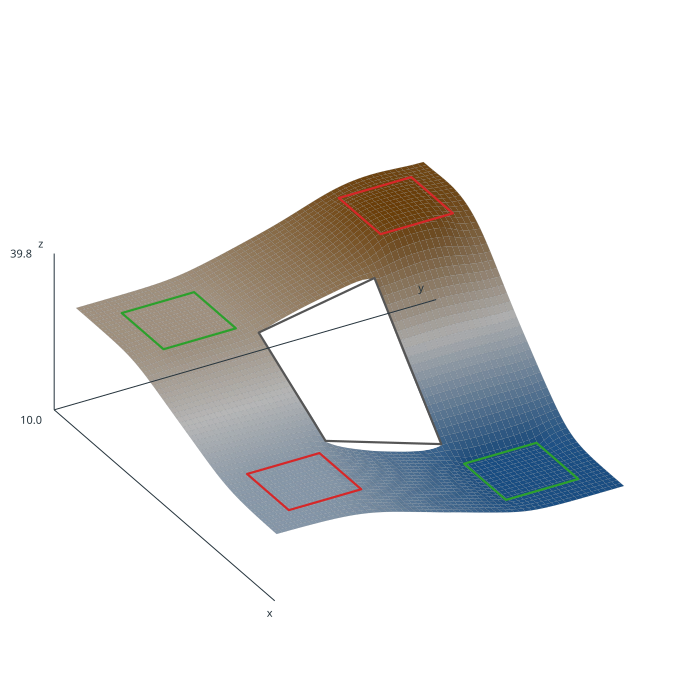

# surfit

**English** | [Русский](README.ru.md) | [中文](README.zh.md)

## Build a surface that keeps the geology

**Faults stay faults. Wells stay tied. Bounds stay bounds. Layers stay ordered.**

[](https://github.com/cfdbwrbq/surfit/actions/workflows/ci.yml)
[](https://github.com/cfdbwrbq/surfit/actions/workflows/wps.yml)
[](https://github.com/cfdbwrbq/surfit/releases)



*Eleven wells, four faults, one regular grid. The faults are explicit breaks in
the grid, not a smoothed trend through the data; the wells stay tied to their
measurements. Isometric view, z exaggerated for legibility.*

surfit builds a regular 2.5D surface from wells, curves, contours, polygons,
trends and faults. The rules you set stay visible in the result.
Cross-validation, bootstrap ensembles and calibrated intervals show where the
surface is supported by the data, and where it is not.

## Who it is for

- **Geologist.** Wells, faults, horizons and structural maps: the surface steps
  across a fault and stays tied to the wells.
- **Geophysicist.** Seismic picks, contour maps and fault traces on a regular
  grid, with explicit rules instead of one global smoothing trend.
- **Reservoir / development geologist.** Thickness, volumes, stacked horizons,
  pinch-outs and calibrated uncertainty.
- **GIS specialist.** CRS-aware exchange through GeoTIFF, GeoParquet, shapefile,
  BLN, glTF and OBJ.

The Python API and the C++ core are documented under `Under the hood`; they are
integration tools, not a separate audience.

## Install

Linux x86_64 wheels (CPython 3.9–3.13) are attached to each
[release](https://github.com/cfdbwrbq/surfit/releases). Pick the wheel for your
interpreter, for example CPython 3.12:

```bash
pip install https://github.com/cfdbwrbq/surfit/releases/download/v3.7.4/surfit-3.7.4-cp312-cp312-manylinux2014_x86_64.manylinux_2_17_x86_64.whl
```

From source, with CMake and a C++ compiler:

```bash
pip install .
```

Optional extras:

```bash
pip install ".[geoparquet]"   # pyarrow + shapely
pip install ".[mesh]"         # PyVista
```

## Quick start

```python
import surfit
import numpy as np

x = np.array([0.0, 1.0, 0.0, 1.0, 0.5])
y = np.array([0.0, 0.0, 1.0, 1.0, 0.5])
z = np.array([1.0, 2.0, 3.0, 4.0, 2.5])

task = surfit.Session(map_name="demo", tol=1e-7)
task.add_points(x, y, z, name="wells")
task.grid(0, 1, 0.05, 0, 1, 0.05)
task.points("wells")
task.completer(1, 1.6)
task.solve()

grid = task.values()          # (count_y, count_x), row 0 is min_y
print(grid.shape, np.nanmin(grid), np.nanmax(grid))
```

Undefined nodes are stored as `surfit.UNDEF_VALUE` (`FLT_MAX`); use
`surfit.defined_mask(grid)` to select the solved nodes.

Faults, bounds and areas use the same task: read the data, add the rule, solve.
The [Python guide](docs/en/python.rst) has a fault-aware example.

## Capabilities

### What you give it

Wells, curves, contours, polygon boundaries, surfaces, trends, masks and fault
lines. You say what each one means:

- this well is a measurement;
- this fault is a break;
- this polygon is a constant;
- this bound must hold;
- this area must stay smooth.

### What you get

A regular surface on the grid you asked for. Not a smoothed cloud: the rules
remain visible in the result.

- **Faults.** The surface can jump across a fault line instead of averaging
  through it.
- **Data.** Wells and curves stay tied to their values; approximations carry
  their own weight.
- **Limits.** Values can be held above, below or between bounds inside
  polygons and masks.
- **Layers.** `SurfaceStack` checks thickness, ordering and pinch-outs across
  several horizons.
- **Uncertainty.** Cross-validation, bootstrap ensembles and calibrated
  intervals describe what the data supports, and what it does not.
- **Exchange.** GeoTIFF (including rotated grids) and GeoParquet; Surfer, GMT,
  Grass, ArcGIS, xyz, shapefile and BLN; glTF/OBJ/STL for viewing; JSON/YAML
  recipes for repeatable runs.

### The rules stay visible

|  |  |
|---|---|
| **Data and limits.** Wells tie to measurements; bounds hold where you put them. | **Many rules, one surface.** Five polygons in one solve: two constants, two weighted areas, and a hole that stays `undef` by design. |

## Documentation

- [English guide](https://cfdbwrbq.github.io/surfit/en/)
- [Russian guide](https://cfdbwrbq.github.io/surfit/ru/)
- [Capabilities, English](CAPABILITIES.en.md)
- [Capabilities, Russian](CAPABILITIES.md)
- [Python guide](docs/en/python.rst)
- [How the solver works](docs/en/how_it_works.rst)
- [Python examples](examples/python)

The docs are built with Sphinx from `docs/en` and `docs/ru`; the two trees are
checked for structural parity by `docs/check_docs.py`.

## What it will not do

- It is a 2.5D surface engine, not a 3D voxel model or a CAD editor.
- It will not invent a geological interpretation: you still choose the faults,
  bounds and rules.
- It will not hide a bad input. Missing files, unmatched names and impossible
  bounds are reported.
- It does not claim GCV, kriging or a posterior. The uncertainty tools say what
  they measure.
- GeoParquet polygons keep the exterior ring only; 3D mesh export is for
  viewing, not CAD.

## Under the hood

The C++ engine (2002–2015) is driven by a Python package and by the original
Tcl front end. It uses CMOFS: ordered functionals, a penalty loop for
constraints, and an 8×8 multilevel ladder. The solver is `cg`, `jcg`, `rf`,
`jacobi` or `ssor`; `tol` is a step tolerance, not a guaranteed error bound.

The test suite compares the Python front end with the original Tcl outputs
byte-for-byte, runs 35 Tcl/Python test scripts, 49 Python examples and 29
realworld pipelines, and includes a physics/invariance set: translation,
rotation, linear fields, point order and degenerate inputs. The Tcl front end
is deprecated; 3.7.x is its last line and 3.8 removes it.

```bash
# Fast self-check: docs, skills, Python API
python3 ci/selfcheck.py

# Full gate: examples, parity, docs, WPS, wheel smoke test
ci/check.sh --full
```

## License

GNU General Public License, version 2. See [LICENSE](LICENSE) and
[AI_DISCLOSURE.md](AI_DISCLOSURE.md).

The original engine and Tcl front end are by M. V. Dmitrievsky and
V. N. Kutrunov (2002–2015). The 2026 Python port was written by AI coding
agents under human direction; the maintainer is responsible for the result.
The vendored CDT triangulation is MPL-2.0.
