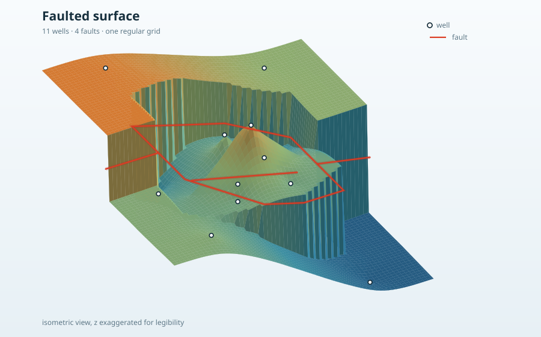
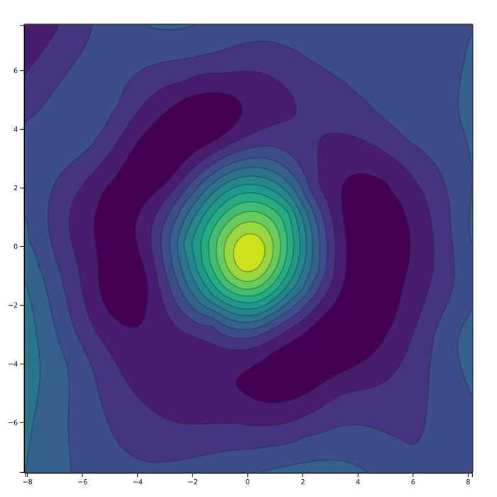
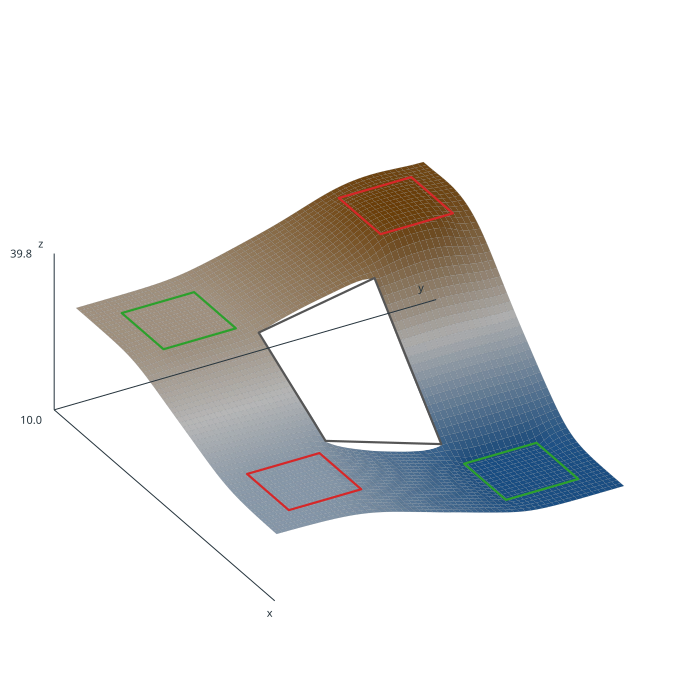

# surfit

[English](README.md) | **Русский** | [中文](README.zh.md)

## Поверхность, которая сохраняет геологию

**Разломы остаются разломами. Скважины привязаны к замерам. Границы стоят на месте. Слои сохраняют порядок.**

[](https://github.com/cfdbwrbq/surfit/actions/workflows/ci.yml)
[](https://github.com/cfdbwrbq/surfit/releases)



*Одиннадцать скважин, четыре разлома, одна регулярная сетка. Разломы — это явные
разрывы сетки, а не сглаженный тренд по данным; скважины остаются привязанными к
замерам. Изометрия, масштаб по z увеличен для наглядности.*

surfit строит регулярную 2.5D-поверхность по скважинам, кривым, изолиниям,
полигонам, трендам и линиям разломов. Заданные правила остаются видны в
результате. Кросс-валидация, bootstrap-ансамбли и калиброванные интервалы
показывают, где поверхность опирается на данные, а где — нет.

## Для кого

- **Геолог.** Скважины, разломы, горизонты и структурные карты: поверхность
  прыгает через разлом и остаётся привязанной к скважинам.
- **Геофизик.** Сейсмические пикеты, изолинии и следы разломов на регулярной
  сетке — с явными правилами вместо одного глобального сглаживания.
- **Геолог-разработчик.** Толщины, объёмы, слоистые горизонты, выклинивание и
  калиброванная неопределённость.
- **GIS-специалист.** Обмен с учётом CRS: GeoTIFF, GeoParquet, shapefile, BLN,
  glTF и OBJ.

Python API и CLI — интерфейс для агента; ядро на C++ — реализация, описанная
в `Как это устроено`.

## Один движок. Два способа работать.

**Человеку — workbench. Агенту — детерминированный Python и JSON.**
Один движок, одни правила, одни файлы.

| | Человеку | Агенту |
|---|---|---|
| Интерфейс | локальный браузерный workbench | Python API, `surfit run` |
| Что видно | карта, 3D-поверхность, отчёт по правилам | JSON-результат, нативные файлы |
| Стиль | интерактивно | скриптуемо, воспроизводимо |

### Workbench — для человека

Загрузите скважины, изолинии, разломы и полигоны, задайте правила, посмотрите
карту, решите задачу, изучите поверхность в 3D и сохраните проект. Без сборки,
облака и аккаунта.

[Руководство workbench](workbench/README.md).

Workbench живёт в `workbench/` исходного репозитория и не является зависимостью wheel.

### Python и JSON-рецепты — для агента

**Готов для ИИ-агента из коробки:** без автоматизации браузера и скрытого
состояния GUI. Установите wheel, вызывайте Python API или запускайте
декларативный рецепт:

```bash
surfit run recipe.json --summary --json
surfit run recipe.json --result-json result.json
```

В результате будут форма, число defined/undefined, min, max и mean; ошибка
вернёт `{"ok": false, "error": ...}` и ненулевой код возврата. Python API нужен,
когда агенту требуются cross-validation, ансамбли или собственные правила.

## Установка

К каждому [релизу](https://github.com/cfdbwrbq/surfit/releases) прилагаются
wheel-пакеты для Linux x86_64 (CPython 3.9–3.13). Выберите подходящий wheel,
например, для CPython 3.12:

```bash
pip install https://github.com/cfdbwrbq/surfit/releases/download/v3.7.4/surfit-3.7.4-cp312-cp312-manylinux2014_x86_64.manylinux_2_17_x86_64.whl
```

Из исходников, с CMake и компилятором C++:

```bash
pip install .
```

Дополнительные зависимости:

```bash
pip install ".[geoparquet]"   # pyarrow + shapely
pip install ".[mesh]"         # PyVista
```

## Быстрый старт

```python
import surfit
import numpy as np

x = np.array([0.0, 1.0, 0.0, 1.0, 0.5])
y = np.array([0.0, 0.0, 1.0, 1.0, 0.5])
z = np.array([1.0, 2.0, 3.0, 4.0, 2.5])

task = surfit.Session(map_name="demo", tol=1e-7)
task.add_points(x, y, z, name="wells")
task.grid(0, 1, 0.05, 0, 1, 0.05)
task.points("wells")
task.completer(1, 1.6)
task.solve()

grid = task.values()          # (count_y, count_x), строка 0 — это min_y
print(grid.shape, np.nanmin(grid), np.nanmax(grid))
```

Неопределённые узлы хранятся как `surfit.UNDEF_VALUE` (`FLT_MAX`);
`surfit.defined_mask(grid)` выбирает решённые узлы.

Разломы, границы и площади задаются в той же задаче: прочитать данные,
добавить правило, решить. Пример с разломами есть в
[руководстве по Python](docs/ru/python.rst).

## Возможности

### Что вы даёте

Скважины, кривые, изолинии, границы полигонов, поверхности, тренды, маски и
линии разломов. Вы задаёте смысл каждого объекта:

- эта скважина — измерение;
- этот разлом — разрыв;
- этот полигон — константа;
- эта граница должна выполняться;
- эта область должна оставаться гладкой.

### Что вы получаете

Регулярную поверхность на заданной сетке. Не размытое облако точек: правила
остаются видны в результате.

- **Разломы.** Поверхность разрывается на линии разлома, а не усредняет её.
- **Данные.** Скважины и кривые привязаны к значениям; приближения имеют свой
  вес.
- **Границы.** Значения удерживаются выше, ниже или между границами внутри
  полигонов и масок.
- **Слои.** `SurfaceStack` проверяет толщины, порядок и выклинивания по
  нескольким горизонтам.
- **Неопределённость.** Кросс-валидация, bootstrap-ансамбли и калиброванные
  интервалы показывают, что данные подтверждают, а что нет.
- **Обмен.** GeoTIFF (включая повёрнутые сетки) и GeoParquet; Surfer, GMT, Grass,
  ArcGIS, xyz, shapefile и BLN; glTF/OBJ/STL для просмотра; JSON/YAML-рецепты для
  воспроизводимых прогонов.

### Правила видны в результате

|  |  |
|---|---|
| **Данные и границы.** Скважины привязаны к замерам; границы стоят там, где вы их поставили. | **Много правил — одна поверхность.** Пять полигонов в одном решении: две константы, две взвешенные площади и дыра, которая намеренно остаётся `undef`. |

## Workbench

В репозитории есть локальный браузерный workbench для интерактивной работы с
сетками: загрузить точки, изолинии или разломы, посмотреть исходники на карте,
решить задачу и изучить поверхность в 3D. Это отдельное приложение, оно не
входит в wheel и не требуется для Python API.

- [Руководство workbench](workbench/README.md)
- запуск из checkout: `cd workbench && ./run.sh`

## Документация

- [Руководство на русском](https://cfdbwrbq.github.io/surfit/ru/)
- [English guide](https://cfdbwrbq.github.io/surfit/en/)
- [Возможности (русский)](CAPABILITIES.md)
- [Capabilities (English)](CAPABILITIES.en.md)
- [Руководство по Python](docs/ru/python.rst)
- [Как устроен решатель](docs/ru/how_it_works.rst)
- [Примеры на Python](examples/python)

Документация собирается Sphinx из `docs/en` и `docs/ru`; совпадение структуры
двух деревьев проверяет `docs/check_docs.py`.

## Чего он не делает

- Это 2.5D-движок поверхностей, а не 3D-воксельная модель и не CAD-редактор.
- Он не придумывает геологическую интерпретацию: разломы, границы и правила
  выбираете вы.
- Он не скрывает плохие входные данные: сообщает об отсутствующих файлах,
  несовпавших именах и противоречивых границах.
- Он не заявляет GCV, кригинг или апостериорное распределение. Инструменты
  неопределённости говорят, что именно они измеряют.
- В GeoParquet у полигонов сохраняется только внешнее кольцо; 3D-экспорт сетки
  предназначен для просмотра, а не для CAD.

## Как это устроено

WPS запускается с явными исключениями по файлам в `.flake8`; это линт-политика
проекта, а не заявление о 100% соответствии WPS.


Движок на C++ (2002–2015) управляется пакетом Python и исходным
Tcl-фронтендом. В основе CMOFS: упорядоченные функционалы, цикл штрафов для
ограничений и многоуровневая лестница 8×8. Решатель: `cg`, `jcg`, `rf`, `jacobi`
или `ssor`; `tol` — допуск по шагу, а не гарантированная граница ошибки.

Набор тестов сравнивает Python-фронтенд с исходными выводами Tcl побайтово,
прогоняет 35 Tcl/Python-сценариев, 49 примеров на Python и 29 пайплайнов на
реальных данных, а также проверки физики и инвариантности: перенос, поворот,
линейные поля, порядок точек и вырожденные входы. Tcl-фронтенд устарел; 3.7.x —
последняя ветка, в 3.8 он удаляется.

```bash
# Быстрая самопроверка: документация, skills, Python API
python3 ci/selfcheck.py

# Полный прогон: примеры, паритет, документация, WPS, smoke-тест wheel
ci/check.sh --full
```

## Лицензия

GNU General Public License, версия 2. См. [LICENSE](LICENSE) и
[AI_DISCLOSURE.md](AI_DISCLOSURE.md).

Исходный движок и Tcl-фронтенд написаны М. В. Дмитриевским и В. Н. Кутруновым в
2002–2015 годах; Python-порт 2026 года сделан AI-агентами под руководством
человека, ответственность за результат несёт сопровождающий. Встроенная
триангуляция CDT распространяется по MPL-2.0.
