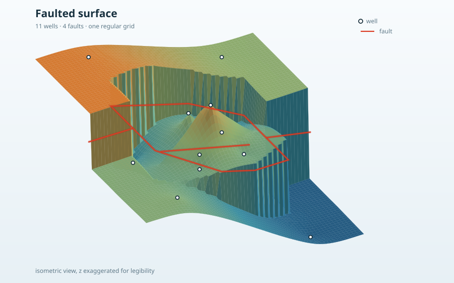
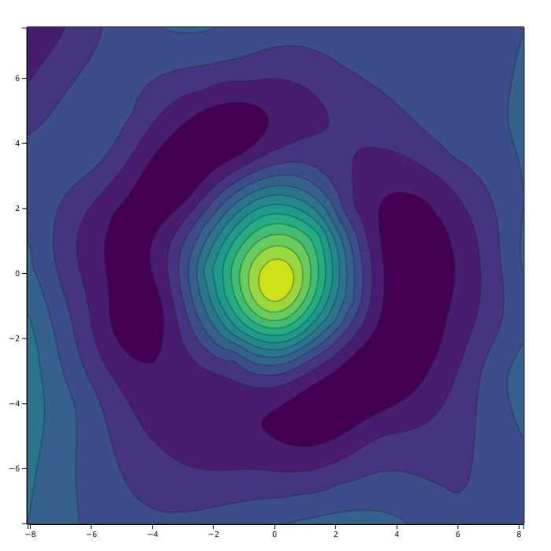
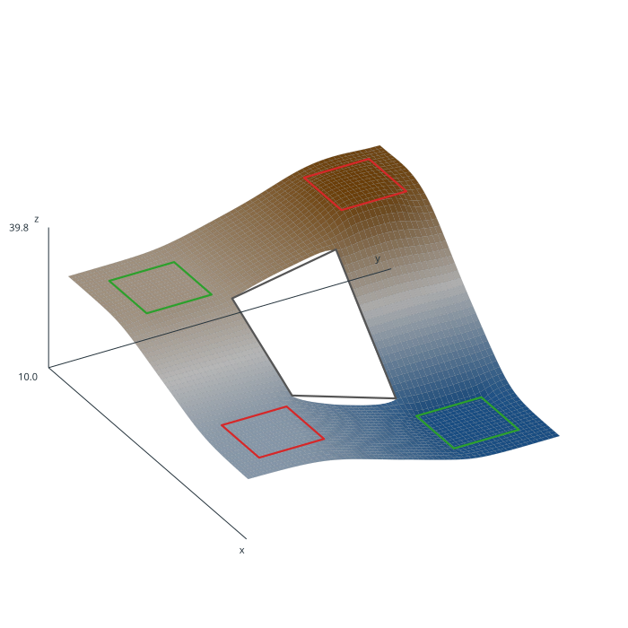

# surfit

[English](README.md) | [Русский](README.ru.md) | **中文**

## 不要把地质平滑掉。

**断层不被抹平，井仍绑在实测值上，边界守得住，层序不乱。**

[](https://github.com/cfdbwrbq/surfit/actions/workflows/ci.yml)
[](https://github.com/cfdbwrbq/surfit/releases)



*十一口井、四条断层、一套规则网格。断层是网格中真实的断开，不是穿过数据的平滑趋势；井始终绑在实测值上。等轴测视图，z 方向做了夸张以便阅读。*

surfit 从井、曲线、等值线、多边形、趋势面和断层线构建规则的 2.5D 曲面。你设定的规则会留在结果里。交叉验证、bootstrap 集成和校准区间说明：哪些地方有数据支撑，哪些地方没有。

## 面向谁

- **地质人员。** 井、断层、层位和构造图：曲面在断层处断开，并始终绑定到井。
- **地球物理人员。** 规则网格上的地震解释点、等值线和断层迹线，用明确规则
  代替一个全局平滑趋势。
- **油藏/开发地质人员。** 厚度、体积、叠置层位、尖灭和校准后的不确定性。
- **GIS 专业人员。** 考虑 CRS 的数据交换：GeoTIFF、GeoParquet、shapefile、
  BLN、glTF 和 OBJ。

Python API 与 CLI 是面向智能体的接口；C++ 内核是 `实现细节` 中的实现。

## 一个引擎，两种工作方式。

**人使用 workbench，智能体使用确定性的 Python 和 JSON 接口。**
同一个引擎、同一套规则、同一批文件。

| | 面向人 | 面向智能体 |
|---|---|---|
| 界面 | 本地浏览器 workbench | Python API、`surfit run` |
| 看到什么 | 地图、3D 曲面、规则报告 | JSON 结果、原生文件 |
| 方式 | 交互式 | 可脚本化、可复现 |

### Workbench — 面向人

拖入井、等值线、断层和多边形，设置规则，查看地图，求解，在 3D 中检查曲面
并保存项目。无需构建、云服务或账号。

[Workbench 指南](workbench/README.md)。

Workbench 位于源码仓库的 `workbench/`，不是 wheel 的依赖。

### Python 与 JSON recipe — 面向智能体

**开箱即用的智能体接口：** 不需要浏览器自动化，也没有隐藏的 GUI 状态。
安装 wheel 后直接调用 Python API，或运行声明式 recipe：

```bash
surfit run recipe.json --summary --json
surfit run recipe.json --result-json result.json
```

结果包含形状、defined/undefined 数量、min、max 和 mean。使用
`--result-json` 时，失败会返回 `{"ok": false, "error": ...}` 和非零退出码。
需要交叉验证、集成或自定义规则时，使用 Python API。
仓库包含面向编码智能体的使用 skill：`.agents/skills/surfit/`。

## 安装

每次 [release](https://github.com/cfdbwrbq/surfit/releases) 都附带 Linux x86_64 wheel（CPython 3.9–3.13）。选择对应解释器的 wheel，例如 CPython 3.12：

```bash
pip install https://github.com/cfdbwrbq/surfit/releases/download/v3.7.5/surfit-3.7.5-cp312-cp312-manylinux2014_x86_64.manylinux_2_17_x86_64.whl
```

从源码安装需要 CMake 和 C++ 编译器：

```bash
pip install .
```

可选依赖：

```bash
pip install ".[geoparquet]"   # pyarrow + shapely
pip install ".[mesh]"         # PyVista
```

## 快速开始

```python
import surfit
import numpy as np

x = np.array([0.0, 1.0, 0.0, 1.0, 0.5])
y = np.array([0.0, 0.0, 1.0, 1.0, 0.5])
z = np.array([1.0, 2.0, 3.0, 4.0, 2.5])

task = surfit.Session(map_name="demo", tol=1e-7)
task.add_points(x, y, z, name="wells")
task.grid(0, 1, 0.05, 0, 1, 0.05)
task.points("wells")
task.completer(1, 1.6)
task.solve()

grid = task.values()          # (count_y, count_x)，第 0 行是 min_y
print(grid.shape, np.nanmin(grid), np.nanmax(grid))
```

未定义节点保存为 `surfit.UNDEF_VALUE`（`FLT_MAX`）；用 `surfit.defined_mask(grid)` 选出已求解的节点。

断层、边界和区域都放在同一个任务里：读数据、加规则、求解。[Python 指南](docs/en/python.rst) 里有一个带断层的例子。

## 能力

### 你给它什么

井、曲线、等值线、多边形边界、曲面、趋势面、掩膜和断层线。每类数据代表什么，由你定义：

- 这口井是一个实测点；
- 这条线是断层；
- 这个多边形内取常数；
- 这个边界必须成立；
- 这片区域要保持平滑。

### 你得到什么

在你指定的网格上得到规则曲面。它不是一团被抹平的点云：规则在结果里仍然看得见。

- **断层。** 曲面可以在断层线两侧错断，而不是把断层平均掉。
- **数据。** 井和曲线绑在实测值上；近似项各自带权重。
- **边界。** 在多边形和掩膜内，值可以按上界、下界或区间被约束住。
- **层序。** `SurfaceStack` 检查多层位的厚度、顺序和尖灭。
- **不确定性。** 交叉验证、bootstrap 集成和校准区间说明数据支持什么、不支持什么。
- **数据交换。** GeoTIFF（含旋转栅格）、GeoParquet；Surfer、GMT、Grass、ArcGIS、xyz、shapefile、BLN；glTF/OBJ/STL 用于查看；JSON/YAML recipe 让结果可复现。

### 规则留在结果里

|  |  |
|---|---|
| **数据与边界。** 井绑在实测值上，边界放在哪里就守在哪里。 | **多规则，一张面。** 五个多边形一次求解：两个取常数、两个按权重逼近，中间刻意保留 `undef`。 |

## Workbench

仓库还包含一个本地浏览器 workbench：拖入点、等值线或断层，先在地图上查看
原始数据，再求解并在 3D 中检查曲面。它是独立的配套应用，不包含在 wheel 中，
使用 Python API 也不需要它。

- [Workbench 指南](workbench/README.md)
- 从 checkout 启动：`cd workbench && ./bootstrap.sh && ./run.sh`

## 文档

- [英文指南](https://cfdbwrbq.github.io/surfit/en/)
- [俄文指南](https://cfdbwrbq.github.io/surfit/ru/)
- [能力清单（英文）](CAPABILITIES.en.md)
- [能力清单（俄文）](CAPABILITIES.md)
- [Python 指南](docs/en/python.rst)
- [求解器原理](docs/en/how_it_works.rst)
- [Python 示例](examples/python)

文档由 Sphinx 从 `docs/en` 和 `docs/ru` 构建；两棵文档树的结构一致性由 `docs/check_docs.py` 检查。

中文文档尚未翻译，Python 指南与求解器原理指向英文页面。

## 它不会做什么

- 它是 2.5D 曲面引擎，不是 3D 体元模型，也不是 CAD 编辑器。
- 它不会替你做地质解释：断层、边界和规则仍由你决定。
- 它不会掩盖坏输入：文件缺失、名称对不上、边界矛盾都会报出来。
- 它不声称 GCV、克里金或后验分布；不确定性工具只说明自己度量了什么。
- GeoParquet 多边形只保留外环；3D 网格导出用于查看，不是 CAD。

## 实现细节

WPS 使用 `.flake8` 中列出的逐文件例外运行；这是项目的 lint 策略，不代表
100% 符合 WPS。


引擎是 C++（2002–2015），由 Python 包和原始 Tcl 前端驱动。核心是 CMOFS：有序泛函、约束的惩罚项迭代，以及 8×8 多重网格逐级加密。求解器可选 `cg`、`jcg`、`rf`、`jacobi`、`ssor`；`tol` 是步长容差，不是保证的误差界。

测试套件把 Python 前端与原 Tcl 输出逐字节对比，运行 35 个 Tcl/Python 测试脚本、49 个 Python 示例和 29 条真实数据流水线，并做一组物理/不变量检查：平移、旋转、线性场、点序和退化输入。Tcl 前端已弃用；3.7.x 是最后一条支持线，3.8 会移除它。

```bash
# 快速自检：文档、skills、Python API
python3 ci/selfcheck.py

# 完整门禁：示例、一致性、文档、WPS、wheel 冒烟测试
ci/check.sh --full
```

## 许可证

GNU General Public License，第 2 版。见 [LICENSE](LICENSE) 和 [AI_DISCLOSURE.md](AI_DISCLOSURE.md)。

原始引擎和 Tcl 前端由 M. V. Dmitrievsky 与 V. N. Kutrunov 在 2002–2015 年编写；2026 年的 Python 移植由 AI 编码代理在人工指导下完成，维护者对结果负责。内置 CDT 三角剖分使用 MPL-2.0。
