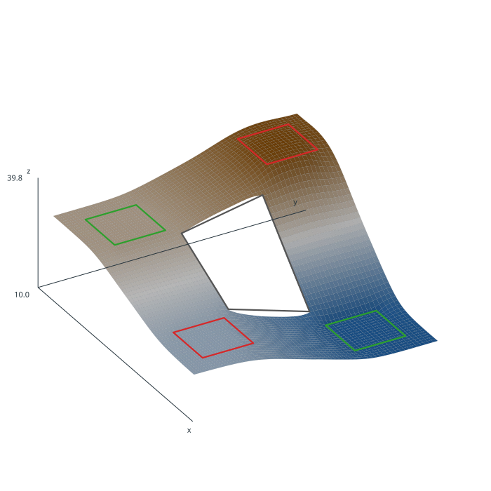

# surfit

[English](README.md) | **中文**

**在网格规则约束下，由离散数据构建规则网格的插值与近似。**

[](https://github.com/cfdbwrbq/surfit/actions/workflows/ci.yml)
[](https://github.com/cfdbwrbq/surfit/actions/workflows/wps.yml)
[](https://github.com/cfdbwrbq/surfit/releases)



surfit 从点、曲线、等值线、区域、曲面、趋势和掩膜构建规则 2.5D 网格。规则和
不等式按明确顺序应用，并带有 penalty 循环；结果可以验证、分层、切片、导出和检查。

C++ 引擎（2002–2015）由 Python 包和原始 Tcl 前端驱动。两者使用同一求解器，
测试会逐字节比较结果。

## 安装

每次 [Release](https://github.com/cfdbwrbq/surfit/releases) 都会附带 Linux
x86_64 wheel（CPython 3.9–3.13）。选择对应解释器的 wheel，例如 CPython 3.12：

```bash
pip install https://github.com/cfdbwrbq/surfit/releases/download/v3.7.2/surfit-3.7.2-cp312-cp312-manylinux2014_x86_64.manylinux_2_17_x86_64.whl
```

从源码安装需要 CMake 和 C++ 编译器：

```bash
pip install .
```

可选依赖：

```bash
pip install ".[geoparquet]"   # pyarrow + shapely
pip install ".[mesh]"         # PyVista
```

## 快速开始

```python
import surfit
import numpy as np

x = np.array([0.0, 1.0, 0.0, 1.0, 0.5])
y = np.array([0.0, 0.0, 1.0, 1.0, 0.5])
z = np.array([1.0, 2.0, 3.0, 4.0, 2.5])

task = surfit.Session(map_name="demo", tol=1e-7)
task.add_points(x, y, z, name="wells")
task.grid(0, 1, 0.05, 0, 1, 0.05)
task.points("wells")
task.completer(1, 1.6)
task.solve()

grid = task.values()          # (count_y, count_x)，第 0 行是 min_y
print(grid.shape, np.nanmin(grid), np.nanmax(grid))
```

未定义节点保存为 `surfit.UNDEF_VALUE`（`FLT_MAX`）；用 `surfit.defined_mask(grid)`
选择已定义节点。

## 功能

- **规则。** 点、曲线、等值线、区域、曲面、趋势、掩膜、不等式和 `completer`
  按顺序应用。
- **求解器。** CMOFS：顺序最小化、penalty 循环、8×8 多级网格；
  `cg`、`jcg`、`rf`、`jacobi`、`ssor`。
- **质量检查。** 残差、空间交叉验证、block bootstrap、变差函数、节点支撑、
  去丛聚、类型化诊断和 provenance。
- **分层曲面。** `SurfaceStack`：DAG 关系、厚度、pinch-out、持久化、
  不确定区间和剖面。
- **互操作。** GeoTIFF（包括旋转栅格）、GeoParquet、xarray、Zarr、
  shapefile/BLN/Surfer/GMT/Grass/ArcGIS，以及 glTF/OBJ/STL 网格导出。
- **可复现。** JSON/YAML recipe 和 `surfit run recipe.json`。

## 文档

- [英文文档](https://cfdbwrbq.github.io/surfit/en/)
- [俄文文档](https://cfdbwrbq.github.io/surfit/ru/)
- [英文 capability 列表](CAPABILITIES.en.md)
- [Python 指南](docs/en/python.rst)

本页只是中文快速入口；完整、最新的技术细节以英文文档为准。

## 互操作

```python
# 无需 GDAL 的 GeoParquet 点/曲线/区域
surfit.add_geoparquet(task, "points.parquet", kind="points")

# 3D 可视化，不强制 PyVista
extent = {"min_x": 0, "min_y": 0, "step_x": 0.05, "step_y": 0.05}
mesh = surfit.grid_mesh(task.values(), extent)
surfit.export_gltf("surface.gltf", mesh)

# 将 stack 图层导出为 glTF/OBJ，或使用 PyVista
stack.export_gltf("stack.gltf")
stack.to_pyvista()
```

已知限制：GeoParquet 只保留多边形外环；不包含 FlatGeobuf（Python 包没有
writer）；网格导出只用于可视化，不是 CAD；GCV 未实现。

## 构建与测试

```bash
mkdir -p build && cd build
cmake ../src
make -j"$(nproc)"
export LD_LIBRARY_PATH="$PWD/bin:$LD_LIBRARY_PATH"
```

```bash
python3 ci/selfcheck.py       # 快速检查
ci/check.sh --full            # 完整门禁
```

## 项目

- 原始引擎和 Tcl 前端：M. V. Dmitrievsky、V. N. Kutrunov，2002–2015。
- 2026 Python 移植、打包、测试和文档由 AI 编码代理在人工指导下完成；
  维护者对结果负责。
- 许可证：GNU GPL-2。见 [LICENSE](LICENSE) 和
  [AI_DISCLOSURE.md](AI_DISCLOSURE.md)。
- 内置 CDT 三角剖分使用 MPL-2.0。
