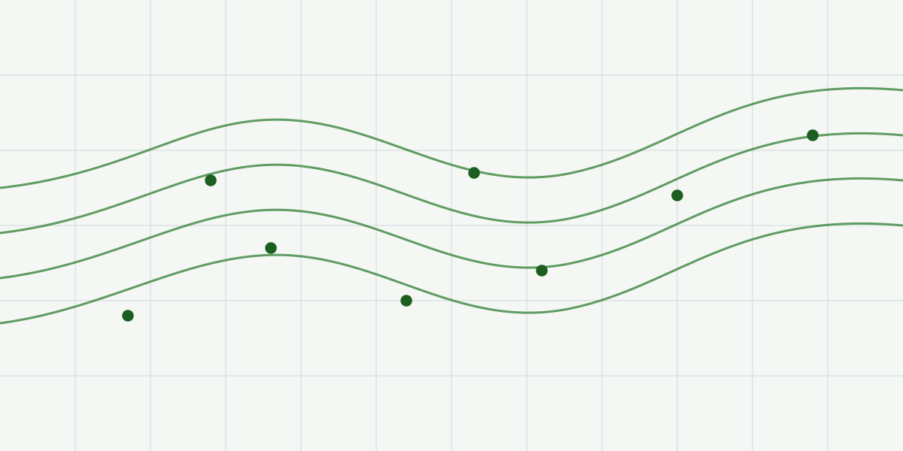

surfit
======

**surfit** calculates a regular grid from scattered data — points, curves,
contours, surfaces and areas — under conditions called *gridding rules*.

The rules are what makes it more than an interpolator. A task can say that the
surface must equal a value inside a polygon, stay between two bounds elsewhere,
follow a trend, respect fault lines, match a histogram, and stay smooth in
between — all at once, each with its own weight and priority.

Features
--------

* Interpolation and approximation of scattered points, 2D curves, 3D contours,
  surfaces and polygonal areas.
* Fault lines, trend surfaces, anisotropy, inequalities, average and weighted
  average conditions, histogram matching, masks.
* Fast multithreaded solver with several iterative methods.
* Many data formats: the native surfit data file, Surfer grids, GMT, Grass,
  ArcGIS, xyz, shapefile, BLN, JPEG and BMP.
* Two front ends over the same engine: the original Tcl commands and a Python
  package with numpy in and out.

---

Getting started
---------------

Start with these documents to get you up and running:

.. toctree::
   :maxdepth: 2

   installation
   first_steps
   python
   terrain
   flows

Advanced use
------------

The two front ends call the same engine: the Python bindings call the C++
functions the Tcl commands are generated from, so the two agree by construction.
That is not a claim, it is checked — the test suite runs every Tcl example
through the Python front end and compares the resulting data files byte for
byte.

.. toctree::
   :maxdepth: 2

   how_it_works
   data_types
   tcl
   formats
   commands
   references
   development

License
-------

surfit is distributed under the GNU General Public License, version 2. See
:doc:`development` for the one third-party file whose licence differs.
