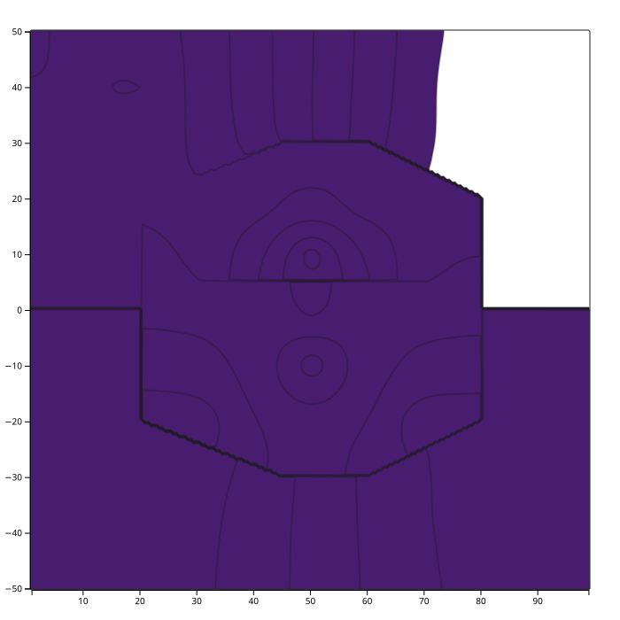
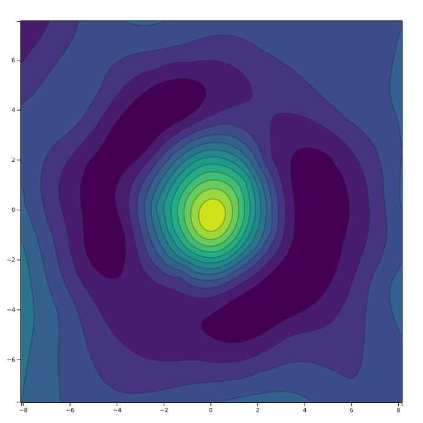
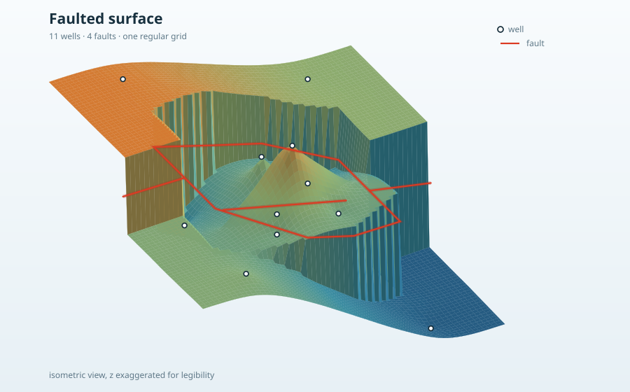

surfit
======

**surfit** calculates a regular grid from scattered data — points, curves,
contours, surfaces and areas — under conditions called *gridding rules*.

The rules are what makes it more than an interpolator. A task can say that the
surface must equal a value inside a polygon, stay between two bounds elsewhere,
follow a trend, respect fault lines, match a histogram, and stay smooth in
between — all at once, each with its own weight and priority.

Features
--------

* Interpolation and approximation of scattered points, 2D curves, 3D contours,
  surfaces and polygonal areas.
* Fault lines, trend surfaces, anisotropy, inequalities, average and weighted
  average conditions, histogram matching, masks.
* Fast multithreaded solver with several iterative methods.
* Parallel Python Sessions: the engine state and the installed task are
  thread-local, so independent tasks can solve at the same time.
* Quality workflow: spatial cross-validation, block bootstrap, variograms,
  per-node support, PSF measurement, typed point diagnostics and provenance.
* Many data formats: the native surfit data file, Surfer grids, GMT, Grass,
  ArcGIS, xyz, shapefile, BLN, JPEG and BMP.
* Python package with numpy in and out.  The original Tcl front end is
  deprecated and removed in 3.8.

---

What the result can show
------------------------

   Data and limits: wells stay tied, bounds stay where they are.

   Faults and wells: the surface steps across explicit fault lines.

Getting started
---------------

Installation and one complete task:

.. toctree::
   :maxdepth: 2

   installation
   first_steps

Guides
------

Task-oriented pages:

.. toctree::
   :maxdepth: 2

   python
   terrain
   flows

Concepts
--------

What the terms mean and how the engine works:

.. toctree::
   :maxdepth: 2

   basics
   how_it_works

Reference
---------

Data types, commands, file formats, and the deprecated Tcl front end:

.. toctree::
   :maxdepth: 2

   data_types
   commands
   formats
   migration
   tcl

Background
----------

References and development notes:

.. toctree::
   :maxdepth: 2

   references
   development

License
-------

surfit is distributed under the GNU General Public License, version 2. See
:doc:`development` for the vendored CDT triangulation (MPL-2.0).
