Python
======

The Python package drives the same engine as the Tcl front end: one
``Session`` per task, the same command names, and numpy arrays in and out.
This page is the API reference; the worked tasks are in ``examples/python/``
and on the :doc:`terrain` and :doc:`flows` pages.

.. code-block:: python

   import surfit

   task = surfit.Session(map_name="map_area", tol=5.01187e-06)

   for name in ("area1", "area2", "area3", "area4", "area5"):
       task.read_areas("data/%s.txt" % name, name)

   task.grid(-12, 12, 0.2, -12, 12, 0.2)

   task.area(10, "area1")             # equal to 10 inside area1
   task.area(30, "area3")
   task.area("undef", "area5")        # leave area5 undefined
   task.completer(1, 1.6)             # tend to a constant or a plane
   task.area_add(20, 0.07, "area2")   # approximate, with a weight
   task.area_add(40, 0.07, "area4")

   task.solve()
   task.save("area.dat")

   grid = task.values()               # numpy, (count_y, count_x), float64

The shape of the API
--------------------

A task has three phases, and they must happen in this order:

#. **Load data.** ``read_areas``, ``read_points``, ``read_curves``,
   ``read_contours``, ``surf_load``, ``mask_load``, or an array through
   ``add_surface``.
#. **Set the grid** with ``grid`` for an explicit extent, or ``grid_auto`` to fit
   it to the loaded data (Tcl's ``grid``), and then add rules.
#. **Solve** with ``solve``, then read or save the result.

The types behind the first phase are described in :doc:`data_types`; the method
behind the third, in :doc:`how_it_works`.

Every command of the Tcl front end is also a method on the session, under the
same name, so ``task.points("wells")`` means the same as ``points("wells")``.
The one exception is ``grid``: the method of that name builds an explicit grid
(Tcl's ``grid_get``), and ``grid_auto`` is Tcl's ``grid``.

Terms
-----

**Spatial cross-validation (CV).** Hold out points by a spatial rule, build the
model without them, and report the error on those points.  Random CV is
optimistic for clustered samples; block CV is the honest default.

**Block bootstrap.** Resample whole spatial blocks, not individual points, so
the dependence between neighbours survives.  It reports ensemble spread, not a
posterior.

**Variogram.** The semivariance of the field as a function of separation.  The
range is the distance where it flattens, the sill is its plateau and the nugget
is the discontinuity at zero.  surfit uses it as a diagnostic and to seed the
anisotropy arguments; it is not a kriging solver.

**Support.** The data that constrain a grid node: sample count, distance to
the nearest sample and summed weights.  Low support means the value is mostly
interpolation, however small the residual looks.

**PSF.** Point-spread width of an impulse response: how far one observation
smears over the grid.  ``psf_report`` measures a field you supply; it is not a
covariance model.

**Collar.** A grid larger than the area of interest, solved and then cropped,
so the natural boundary is farther from the data.

**Declustering.** Replacing a dense block of samples by one representative so a
cluster does not dominate the fit.  The original points remain available for
residuals.

**Provenance.** The engine/solver/version, input hashes, CRS and units recorded
next to the result.  It makes a run auditable; it does not validate the CRS.

Point weights
-------------

``read_points`` accepts an optional ``weights`` sequence, one positive value
per point::

    task.read_points("wells.txt", "wells", weights=sigma_inv)

or, after reading, ``task.pnts_set_weights("wells", sigma_inv)``.  Points that
fall into the same grid cell are then averaged with these weights instead of
arithmetically; a zero weight drops a point.  A vector of the wrong length is
rejected.  This is a Python-side extension; the Tcl reader has no per-point
weights.  Weights are not a statistical error map: the solver still returns a
single surface and no covariance.


Arrays and tables
-----------------

Data does not have to arrive through a file.  A Session can register arrays
directly::

    task.add_points(x, y, z, weights=sigma_inv, name="wells")
    task.add_curves(x, y, name="line")
    task.add_areas(x, y, name="zone")
    task.add_contours(x, y, z, name="iso")

The methods construct the engine objects directly from numpy arrays; no
temporary columned file is involved.  This is the shortest path from pandas,
Arrow or a database cursor, and it keeps the caller's provenance mapping.  The
existing ``add_surface`` remains the array path for a raster/trend.

Residual diagnostics
--------------------

``task.residuals(x, y, z, weights=None, surface=None)`` compares sample points
with the solved surface at their nearest nodes::

    stats = task.residuals(x, y, z, weights=sigma_inv)
    stats["rmse"], stats["bias"], stats["chi2"], stats["n"]

It returns ``n``, ``residuals``, ``rmse``, ``bias``, ``weighted_mse``, ``chi2``
and ``dof``.  Points outside the grid or on undefined nodes are skipped; zero
weights are skipped too.  ``chi2`` is the sum of weighted squared residuals, so
use inverse-variance weights if you want it to mean the usual chi-square.  This
is a diagnostic, not an error map: the engine still returns one surface and no
covariance.

``task.outliers(x, y, z, threshold=3.5)`` returns a boolean mask for residuals
farther than ``threshold`` scaled MADs from the median.  It is a suggestion,
not a robust loss: zero the weights of the flagged points and solve again.


Robust reweighting
------------------

``surfit.diagnostics.robust_weights(residuals, loss="huber")`` returns IRLS
weights for the residuals: Huber keeps a down-weighted point, Tukey drops it
beyond the tuning constant.  The engine still solves least squares; rebuild the
task with the new weights and solve again, a few times::

    from surfit.diagnostics import robust_weights

    weights = base_weights
    for iteration in range(4):
        task = build_task(weights)       # your loader/rule setup
        task.solve()
        stats = task.residuals(x, y, z, weights=weights)
        weights[stats["used"]] = base_weights[stats["used"]] * \
            robust_weights(stats["residuals"], loss="huber")

This is a robust **workflow**, not a robust solver: the engine's inner solve is
still least squares.


The lower-level ``surfit.diagnostics.point_residuals(values, extent, x, y, z)``
takes the array and the ``surf_extent`` dict directly.


Spatial cross-validation
------------------------

Random k-fold is optimistic for clustered samples: neighbouring points leak
between training and validation.  ``surfit.cross_validate`` makes the fold
design explicit and evaluates held-out points::

    from surfit import cross_validate

    def build(train, train_weights):
        task = make_task(x[train], y[train], z[train], weights=train_weights)
        task.solve()
        return task

    result = cross_validate(
        build, x, y, z, folds=5, mode="block", block=2.0
    )
    result["rmse"], result["bias"], result["fold_details"]

For grouped data (a well, site, campaign or instrument) use
``mode="group"`` and pass one group id per point.  ``folds=None`` means
leave-one-group-out; no group can appear in both training and validation::

    result = surfit.cross_validate(
        build, x, y, z, mode="group", groups=well_id)

``result["group_details"]`` contains per-group RMSE, bias, MAE and counts.
``select_parameter`` accepts the same ``groups`` argument.

``mode="random"`` is the cheap check; ``mode="block"`` assigns whole
rectangular blocks to folds, and ``mode="kfold"`` preserves the input order.
Choose the block size from the variogram range when one is available.  The
callback receives only training indices; the test points are never passed to
it.  The result is point error under the chosen design, not a map of
uncertainty.  The callback may also return ``(values, extent)`` or an array
when ``extent=`` is supplied.

Per-node support and declustering
---------------------------------

``task.quality_attributes(x, y, weights=None)`` returns arrays on the grid:
``count`` (samples in the cell), ``sum_weights``, ``negative_weights``,
``min_distance`` and ``mean_distance`` to the cell centre.  The quality report
also sets ``grid.covered``, ``grid.uncovered`` and
``grid.negative_weight_cells``.  These are support diagnostics, not an error
map.

Dense lines and clusters can dominate a global fit.  ``decluster_points``
reduces rectangular blocks to one representative::

    from surfit import decluster_points

    reduced = decluster_points(
        x, y, z, weights=sigma_inv, method="mean", block=10.0
    )
    reduced["x"], reduced["y"], reduced["z"], reduced["weights"]

``method`` is ``mean``, ``nearest``, ``idw``, ``min`` or ``max``.  The original
points stay available for residuals; blocks with zero total weight are
dropped.

Typed point diagnostics
-----------------------

``task.diagnostic_points(x, y, z, weights=None)`` returns one record per
sample with a code: 0 used, 1 outlier, 2 undefined cell, 3 outside the grid,
4 zero weight.  It also reports ``residual``, ``predicted``, ``scale`` (local
cell spacing divided by the sample count) and ``scaled_residual``::

    document = task.diagnostic_points(x, y, z, weights=sigma_inv)
    document["code_name"]
    task.save_diagnostics("qc.geojson", x, y, z)
    task.save_diagnostics("qc.csv", x, y, z)

GeoJSON and CSV are the intended hand-off to a GIS or a review spreadsheet.
Contour-label and fault-direction codes are not invented here; this layer
classifies the point support it can actually see.

Polygonal declustering
~~~~~~~~~~~~~~~~~~~~~~

``surfit.voronoi_weights(x, y, bounds=None)`` returns weights whose mean is 1:
a point's weight is proportional to the inverse area of its Voronoi cell
clipped to ``bounds``.  ``bounds`` is a mapping with
``min_x/max_x/min_y/max_y`` or ``(xmin, xmax, ymin, ymax)``; the default is the
point bounding box.  ``backend="auto"`` uses SciPy when it is installed and
falls back to pure half-plane clipping; ``"clip"`` never imports SciPy, and
``"scipy"`` requires it.  The result has mean 1.

```python
weights = surfit.voronoi_weights(x, y, bounds=extent)
task.pnts_set_weights("wells", weights)
```

Use this for **2D sample locations**; in a surfit surface ``z`` is the measured
value, not a spatial coordinate.  Duplicates share their cell area, boundary
cells are clipped rather than dropped, and the helper raises on collinear or
too few points.  ``decluster_points`` is the different operation that reduces
blocks to representatives.

Provenance metadata
-------------------

CRS, units and source do not fit in a ``.dat`` or ``.grd`` file, so keep them
on the task and write a JSON sidecar::

    task = surfit.Session(
        map_name="result",
        metadata={"crs": "EPSG:32637", "x_units": "m", "y_units": "m"})

    task.set_metadata(z_units="m", source="campaign 2026")
    task.save("result.dat")
    task.save_metadata("result.meta.json")

``task.metadata`` returns a copy; ``set_metadata`` adds fields; the sidecar
contains those fields plus ``map_name``.  It records provenance, it does not
reproject the grid or validate the CRS.  The sidecar also carries
``provenance``: engine/Python/NumPy versions, UTC creation time, platform, CRS,
units and optional source hashes.  ``report(..., sources=["wells.txt"])`` puts
the same SHA-256 map into the quality report.


Variogram diagnostics
---------------------

``surfit.experimental_variogram(x, y, z, bins=20, direction=None)`` returns
lag centres, semivariance and pair counts.  ``direction`` selects pairs within
``tolerance`` degrees; ``estimator="robust"`` uses Cressie-Hawkins instead of
the classical mean.  ``surfit.fit_variogram`` fits a spherical, exponential or
Gaussian model and returns range, nugget and partial sill::

    experimental = surfit.experimental_variogram(x, y, z, bins=16)
    fit = surfit.fit_variogram(
        experimental["lag"], experimental["gamma"], model="spherical"
    )
    fit["range"], fit["nugget"], fit["sill"]

``surfit.anisotropy`` fits directional variograms and returns a coarse angle
and long/short range ratio for the existing rule::

    direction = surfit.anisotropy(x, y, z, angles=(0, 45, 90, 135))
    task.completer(1, 2, alpha=direction["angle"], w=direction["ratio"])

These are diagnostics and starting values, not kriging and not a covariance
model.  The engine still solves one surface.

Dip and azimuth
---------------

Points with local gradients can constrain derivatives directly::

    task.add_dip_points(x, y, dip_degrees, azimuth_degrees, name="dip")
    task.gradient("dip")

    task.add_gradient_points(x, y, dzdx, dzdy, name="grad")

``azimuth`` is measured clockwise from +Y; ``gx = tan(dip)*sin(azimuth)``,
``gy = tan(dip)*cos(azimuth)``.  The core functional adds finite-difference
derivative equations at the nearest nodes, so the absolute level is still set
by points, areas or ``completer``.  This is a soft data condition, not a
kriging model.

Slope and curvature bounds
--------------------------

Local bounds are penalty conditions in the solver::

    task.slope_max(5.0)                    # whole grid
    task.slope_max(5.0, area_name="zone")  # inside an area
    task.curvature_max(0.5, mask_name="m") # second difference bound
    task.completer(1, 1.6)                 # the condition attaches here

``slope_max`` takes degrees and bounds ``|dZ/dx|`` and ``|dZ/dy|``;
``curvature_max`` bounds the absolute second difference in the same units.
With both names empty the condition is global.  The solver performs a base
solve before building the condition, then runs the normal penalty loop; the
condition must be added before the functional it should attach to, normally
``completer``.  ``rule_report`` exposes the conditional ``residual``.

Spatial residual diagnostics
----------------------------

Global RMSE hides structure.  These helpers make it visible::

    surfit.morans_i(values, mask=None)       # rook grid autocorrelation
    surfit.residual_variogram(x, y, residuals, bins=16)
    distance = surfit.distance_to_data(x, y, data_x, data_y)
    surfit.error_by_distance(distance, residuals, bins=10)
    surfit.error_by_group(residuals, groups)

``morans_i`` is a regular-grid diagnostic with four-neighbour weights;
``residual_variogram`` is the experimental variogram of residuals;
``error_by_distance`` reports bias/MAE/RMSE per distance band; and
``error_by_group`` does the same per group.  These are diagnostics, not a
covariance model or a second solver.

Uncertainty by ensemble
-----------------------

``surfit.diagnostics.ensemble(fields)`` returns the mean, standard deviation,
5th/95th percentiles and per-cell defined count of several surface arrays.
``bootstrap_uncertainty(build, count, replicates=100, seed=0)`` draws
``count`` point indices with replacement and calls ``build(sample)``; the
callback must return a solved task or an array::

    from surfit.diagnostics import bootstrap_uncertainty

    def build(sample):
        task = make_task(x[sample], y[sample], z[sample])
        task.solve()
        return task

    stats = bootstrap_uncertainty(build, len(x), replicates=100, seed=7)
    stats["std"], stats["p05"], stats["p95"]

This is ensemble spread under resampling, not a covariance matrix or a
posterior.  It costs one full solve per replicate.  For clustered samples use
block resampling, which keeps whole spatial blocks together::

    labels = surfit.block_labels(x, y, block=10.0)
    stats = bootstrap_uncertainty(
        build, len(x), replicates=100, seed=7, blocks=labels
    )

or pass ``x=x, y=y, block_size=10.0`` and the labels are derived for you.


Split-conformal calibration
~~~~~~~~~~~~~~~~~~~~~~~~~~~

``surfit.conformal_quantile(residuals, level=0.9)`` returns the finite-sample
absolute-residual quantile.  ``surfit.calibrated_interval(center, residuals,
level=0.9)`` broadcasts a symmetric calibrated interval around a scalar or an
array::

    interval = surfit.calibrated_interval(mean, held_out_residuals, 0.9)
    interval["lower"], interval["upper"], interval["quantile"]

Calibrate on held-out residuals, not on training residuals.  This is a
calibrated ensemble interval, not a posterior and not kriging variance.

Coverage and groups
~~~~~~~~~~~~~~~~~~~

``surfit.interval_coverage(observed, lower, upper)`` reports ``n``,
``covered``, ``fraction``, ``mean_width`` and ``median_width``.
``surfit.coverage_by_group`` does the same per group.
``surfit.group_conformal_quantiles`` returns a global and per-group quantile.
Use ``symmetric=False`` for a signed-residual interval::

    coverage = surfit.interval_coverage(
        observed, interval["lower"], interval["upper"])
    by_group = surfit.coverage_by_group(
        observed, interval["lower"], interval["upper"], groups=site_id)
    group_q = surfit.group_conformal_quantiles(residuals, site_id, 0.9)

Calibrate and report coverage on held-out residuals.

The outer IRLS driver
---------------------

``robust_solve(build, x, y, z, loss="huber", iterations=4)`` is the same loop
packaged: ``build(weights)`` must return a solved task, and the driver updates
the weights and rebuilds until the requested number of iterations::

    from surfit.diagnostics import robust_solve

    result = robust_solve(build, x, y, z, loss="huber", iterations=4)
    result["task"].values()
    result["weights"]
    result["stats"]

The model and rules stay fixed; only point weights change.  It is still an
outer IRLS loop, not a robust inner solver.


Quality report and GeoTIFF
--------------------------

``task.report(x, y, z, weights=None, sources=None)`` returns a JSON-ready
summary: grid extent, point counts, residuals, outlier flags, metadata and
provenance.  ``grid.crs``, ``grid.units`` and ``grid.nodata`` make the file
self-describing; ``provenance.sources`` is empty unless you pass ``sources``.
Write it next to the map::

    task.save_report("result.report.json", x, y, z, weights=sigma_inv,
                     sources=["wells.txt"])
    task.save_geotiff("result.tif")       # uses metadata crs
    task.save_geotiff("result.tif", crs="EPSG:32637")

``save_geotiff`` is optional: it imports GDAL lazily and raises a clear
ImportError when the system GDAL bindings are absent.  The raster is north-up,
nodes are cell centres, undefined nodes use the surfit nodata value, and the
CRS is passed to ``osr.SpatialReference.SetFromUserInput``.  When ``crs`` is
omitted, ``task.metadata["crs"]`` is used; the dataset also stores the engine
version and metadata fields.

CRS helpers
-----------

Reprojection is optional and uses ``pyproj``; the engine itself stays
Cartesian.  ``to_crs`` transforms points, and ``transform_extent`` samples the
edges and returns only new bounds — rebuild the grid at the target resolution
rather than pretending an affine grid survived::

    lon, lat = surfit.to_crs(x, y, "EPSG:4326", "EPSG:32637")
    bounds = surfit.transform_extent(extent, "EPSG:4326", "EPSG:32637")

``is_geographic_crs`` and ``require_projected`` catch degree units where
anisotropy or distances would be meaningless.  These helpers raise a clear
ImportError when pyproj is not installed.

Grid collars, resolution and parameter search
---------------------------------------------

A collar is a larger grid solved around the area of interest and cropped back;
it moves the natural boundary away from the data.  The helpers preserve the
node spacing::

    padded = surfit.pad_extent(extent, margin=20.0)
    # build the task on padded, solve, then:
    values, extent = surfit.crop_surface(values, padded, original_extent)

``surfit.resolution_report(extent, x=x, y=y, values=values)`` reports the
Nyquist limit (``2 * step``), samples per cell, covered fraction and a coarse
data spacing.  It warns when the grid is much finer than the sample support;
this is a support diagnostic, not a point-spread-function inversion.

``surfit.psf_report(values, extent, center=(x, y))`` measures an impulse
response you already have: it returns ``half_width``, a Gaussian ``sigma`` and
``resolved_features = 2 * half_width``.  ``surfit.estimate_psf(build, x0, y0,
extent)`` calls ``build(x0, y0)`` once and applies the same measurement.  The
callback constructs the impulse; this is not a covariance model.

``surfit.select_parameter`` runs spatial CV for each candidate and returns the
best one.  The callback receives the candidate, so it can rebuild point
weights, ``completer`` arguments or a tolerance::

    result = surfit.select_parameter(
        build, x, y, z,
        parameters=[0.5, 1.0, 2.0],
        folds=5, mode="block", block=10.0,
    )
    result["parameter"], result["scores"]

Quality workflow
----------------

The full workflow is a runnable example.  It solves a synthetic task, then
prints residuals, spatial CV, a variogram fit, an anisotropy hint, support,
declustering, diagnostics and provenance.  The numbers are a checklist, not a
single uncertainty claim.

.. literalinclude:: ../../examples/python/quality_workflow.py
   :language: python

Raster exchange
---------------

``surfit.read_geotiff(path, band=1)`` reads a north-up GeoTIFF and returns
``values``, ``extent``, ``crs`` and ``nodata``.  Cells are cell centres, row 0
is ``min_y``, and rotated/west-up rasters are rejected instead of silently
misaligned.

``surfit.save_geotiff_stack(directory, {name: array}, extent, crs=...)`` writes
one GeoTIFF per layer plus ``manifest.json`` with names, order, extent, CRS and
nodata.  It is an exchange format, not a private container.
A rotated raster is read through GDAL warp: pass ``target_extent`` for an
explicit regular grid, otherwise the bounding box and pixel size are used.
The result has ``rotated`` and ``resampled`` flags and records the resampling.

``save_geotiff_bands(path, {name: array}, extent, ...)`` writes one
multi-band GeoTIFF with band descriptions.  ``save_geotiff(..., cog=True)`` and
``save_geotiff_bands(..., cog=True)`` write a Cloud Optimized GeoTIFF through
GDAL's COG driver.  Without GDAL, ``tifffile`` is the fallback for pixels and
scale/tiepoint tags; a CRS or COG request raises a clear ImportError rather
than silently dropping the georeference.


Solver benchmark and prototype
------------------------------

``surfit.benchmark_solvers(build, solvers=(...))`` times fresh task builds and
solves for each solver.  ``set_solver("pcg")`` selects the diagonal-
preconditioned CG prototype.  On the 512x512 benchmark it was slower than
``cg``; it is a measurement tool, not the new default.

Strict rules
------------

By default an empty match is Tcl-compatible: ``area_leq`` returns ``[]`` and the
rule is not added.  Opt in to an error when that is more useful::

    task = surfit.Session(..., strict=True)
    task.area_geq(0, "missing")   # ValueError: area_geq matched no data


Out-of-core tiles
-----------------

``surfit.tiled.solve_point_tiles`` solves a point task tile by tile and writes
the mosaic into a ``numpy.memmap``::

    from surfit.tiled import solve_point_tiles

    result = solve_point_tiles(
        x, y, z, (-10, 10, -10, 10), 0.5,
        inner=256, halo=32, memmap_path="map.f64",
        geotiff_path="map.tif", crs="EPSG:32637")

    result["values"]       # memmap, (count_y, count_x)
    result["tiles"]

Only the inner part of each overlapping tile is copied, so seams see the same
data as the middle.  For curves, contours and areas use the generic
``solve_tiled``; its callback receives each tile and can select geometry with
``select_geometries``::

    from surfit.tiled import select_geometries, solve_tiled

    def build(tile):
        task = surfit.Session(tol=1e-7)
        task.read_curves("iso.xy", "g")
        task.grid(*tile_grid_args)     # tile["extent"] and tile["step"]
        task.curve(5, "g")
        task.solve()
        return task

    result = solve_tiled(build, (-10, 10, -10, 10), 0.5,
                         inner=64, halo=16, memmap_path="map.f64")

The callback is responsible for clipping/selecting data; a tile must have at
least eight nodes per side because the engine's first phase is 8x8.


Volumes, sections and integrations
----------------------------------

Extra utilities sit around the stack; they do not add a solver::

    surfit.volume_between(upper, lower, extent, mask=None, contact=None)
    surfit.volume_percentiles(volumes, levels=(10, 50, 90))
    surfit.volume_ensemble(upper_fields, lower_fields, extent)
    surfit.stack_volume(stack, "top", "bottom")

    section = stack.section([0, 1], [0, 0], samples=200)

    task.rule_report()        # ordered rules, types and conditions
    surfit.regression_trend(features, z, model=None)
    surfit.add_regression_residuals(task, x, y, z, features)
    surfit.add_geodataframe(task, gdf, kind="points")

``volume_between`` is deterministic.  P10/P50/P90 require coherent
realizations: per-cell interval bounds must not be summed into a volume range.
``volume_ensemble`` accepts those realizations; ``volume_percentiles`` is the
small helper on top.

``stack.section`` samples layers and calibrated intervals along a polyline.
``rule_report`` lists the ordered rule sequence and attached conditions.
Conditional rules carry ``residual`` (the norm of their last penalty system)
and recognized inequality rules also carry a ``violations`` count captured at
the end of the solve; ``None``/``-1`` means the diagnostic is not available for
that rule.

``add_geodataframe`` is an optional GeoPandas adapter: Point/LineString/Polygon
coordinates, optional Z and weights.  CRS mismatch is an error, not a silent
reprojection.  ``SurfaceStack.to_xarray()`` and ``to_zarr()`` are optional eager
exports; Dask is not promised.  ``regression_trend`` fits a trend (OLS by
default, or any scikit-learn-compatible model), returns residuals and
``add_regression_residuals`` registers them for a residual surfit task.

Coherent ensembles and recipes
------------------------------

``SurfaceEnsemble`` stores one sequence of realizations and makes arithmetic
coherent::

    ensemble = surfit.SurfaceEnsemble(
        [{"top": first}, {"top": second}], extent=extent)
    difference = ensemble_a - ensemble_b
    percentiles = difference.percentiles((10, 50, 90))

Volumes and isochores are per realization, not sums of per-cell interval
bounds.  ``SurfaceEnsemble.from_stacks([...])`` builds an ensemble from solved
layers with the same order.

A task can also be described declaratively::

    surfit run recipe.json
    surfit run recipe.json --summary --json

The recipe has ``name``, ``grid``, ``data`` (points/curves/areas/contours or a
``.npy`` surface), ordered ``rules`` and ``output``.  JSON always works; YAML
needs PyYAML.  The runner is thin and calls normal Session methods.

Layered surfaces
----------------

A ``SurfaceStack`` is an ordered set of independent Sessions on one grid.  It
adds orchestration and a report, not a second solver::

    stack = surfit.SurfaceStack("site")
    stack.add_layer("top", lambda: build_top())
    stack.add_layer("bottom", lambda: build_bottom())
    stack.solve()
    report = stack.report()
    report["crossings"]
    report["layers"][0]["thickness"]["pinchouts"]

Layers are ordered; a crossing is where a higher layer falls below the next
one, and a pinch-out is a non-positive thickness.  The stack also rejects
layers that do not share the same extent/step.  Use it when several surfaces
must be solved and checked together; keep ordinary ``Session`` for one surface.

Relations are a small DAG, not a fixed neighbour list::

    stack.add_relation("top", "bottom", min_thickness=1.0)
    stack.add_layer("lens", build_lens, above="bottom", below="top")

The stack topologically sorts the graph, rejects cycles, and passes all
conditions for a layer as one ``SurfaceRelations`` object.  ``above`` means
``this >= target + min_thickness``; ``below`` means
``this <= target - min_thickness``.

For a relation, the upper builder receives a ``SurfaceRelation`` and must
apply it before its next functional::

    def build_top(relation):
        task = surfit.Session(...)
        relation.apply(task)       # top >= lower + min_thickness
        task.points("wells")
        task.completer(1, 1.6)
        return task

    stack.add_layer("top", build_top, above="bottom", min_thickness=1.0)

The stack solves bottom-up.  A builder that does not accept the relation is an
error, not a silently ignored condition.
A solved stack can be persisted without a private binary format::

    stack.save("stack_dir")
    loaded = surfit.SurfaceStack.load("stack_dir")

The directory contains ``layers/*.npy`` and ``manifest.json`` with names,
order, extent, timings and the report.  Loading restores values, thickness and
the report; it does not recreate the original Sessions.
Uncertainty in the stack
~~~~~~~~~~~~~~~~~~~~~~~~

A solved layer can carry a calibrated interval::

    stack.set_layer_uncertainty(
        "top", residuals=held_out_residuals, level=0.9, coverage=0.88)
    interval = stack.interval("top")       # lower, center, upper
    stack.report()["layers"][0]["uncertainty"]

``set_layer_uncertainty`` also accepts explicit ``lower``/``upper`` arrays.
The optional ``coverage`` is caller-reported; the stack does not invent it.
``report()["relation_conflicts"]`` counts cells where the optimistic lower
surface still cannot clear the pessimistic upper surface.  Validate them::

    stack.validate(max_relation_conflicts=0, strict=True)

Intervals are saved under ``uncertainty/*.npy`` and restored by
``SurfaceStack.load``.

Streaming report
~~~~~~~~~~~~~~~~

``report(streaming=True)`` walks row chunks and does not build a full
thickness array::

    report = stack.report(streaming=True)
    report["streaming"], report["chunk_rows"]

Min/max/crossings/pinch-outs and coverage are exact.  The median comes from a
4096-bin histogram and is deterministic but approximate; the thickness item
sets ``median_exact=False``.  ``save()`` and ``validate()`` use this mode
automatically when layer values are memory maps.

Provenance
~~~~~~~~~~

Attach auditable metadata before saving::

    stack.set_layer_provenance(
        "top",
        sources={"wells.csv": "sha256..."},
        params={"solver": "points"},
        metadata={"crs": "EPSG:32637", "units": "m"},
    )
    stack.provenance("top")

The manifest stores the record, the engine version and the per-layer
``sources``/``params``/``metadata``.  Values are caller-supplied; the stack
does not hash files behind your back.

For large stacks, keep layer values on disk::

    stack.solve(memmap=True, memmap_dir="stack_values")
    loaded = surfit.SurfaceStack.load("stack_dir", mmap=True)

``values()`` then returns ``numpy.memmap`` arrays.  A loaded ``mmap=True``
stack is read-only: ``apply_pinchout`` would need a writable copy.  Call
``close()`` to flush and release the mappings.


``solve(parallel=True)`` builds independent layers in a thread pool.
``thickness(name)`` returns the array to the next layer and
``pinchout_mask(name)`` selects cells at or below zero thickness.
``apply_pinchout(name, mode="merge")`` sets the upper layer to the lower value
there; ``mode="undef"`` marks the upper cells undefined.  These are explicit
post-solve projections, not hidden solver constraints.  ``report()["seconds"]``
records the wall time of the stack solve.

Benchmark
---------

``surfit.benchmark_stack`` compares a direct in-memory loop, the sequential
stack and the parallel stack on the caller's builders::

    result = surfit.benchmark_stack(
        {"top": build_top, "bottom": build_bottom},
        repeats=3, workers=4)
    result["sequential"]["median"], result["parallel"]["median"]
    result["speedup_parallel"]

It reports wall time only; the numbers depend on the data, cores and build
options, so they are not a CI performance assertion.  Builders must create a
fresh Session on every call.

Validation gate
~~~~~~~~~~~~~~~~

``stack.validate`` turns the report into a policy check::

    result = stack.validate(
        max_crossings=0, min_thickness=1.0, min_coverage=0.9)
    result["ok"], result["violations"]

    stack.validate(..., strict=True)   # raises StackValidationError

Each violation has a ``code`` (``crossings``, ``thickness``, ``coverage``),
the layer when relevant, the observed value and the threshold.  This is a
check over the report, not an automatic repair.

Serial pool mode
----------------

The worker pool belongs to the task, so it is normally sized from the machine
and shared by nothing.  ``Session(serial=True)`` forces this task's pool to one
worker for that solve and restores the previous size, which is useful for
measuring a serial result or for keeping a small task off the other cores::

    task = surfit.Session(map_name="serial", serial=True)
    task.solve()

The same scope is available around module-level work::

    with surfit.serial_threads():
        surfit.surfit()

Other Sessions, in this thread or in another one, keep their own pools.


Rules
-----

A rule states something about the surface: where it passes through data, where it
equals a value, where it follows another surface, and how smooth it stays between
them. :doc:`data_types` lists the families and their variants; :doc:`commands`
has the syntax and arguments of each command.

Every command returns one flag per matched object. ``[False]`` means the name
pattern matched nothing and the rule was **not** added; the Tcl front end ignores
that silently, so check the flags when a result looks unexpected.

Sources
-------

* points — `doi:10.1016/j.envsoft.2013.12.008 <https://doi.org/10.1016/j.envsoft.2013.12.008>`_
* curve, contour — `doi:10.1007/s00477-011-0482-8 <https://doi.org/10.1007/s00477-011-0482-8>`_
* surface, trend — `doi:10.1007/978-3-030-85040-1_461 <https://doi.org/10.1007/978-3-030-85040-1_461>`_
* fault — `doi:10.1190/int-2017-0171.1 <https://doi.org/10.1190/int-2017-0171.1>`_
* leq, geq — `doi:10.1029/2007WR006645 <https://doi.org/10.1029/2007WR006645>`_
* mean, wmean — `doi:10.1007/s11004-005-9022-8 <https://doi.org/10.1007/s11004-005-9022-8>`_
* hist — `doi:10.1002/joc.2168 <https://doi.org/10.1002/joc.2168>`_
* spatial CV, block bootstrap — `doi:10.1111/ecog.02881 <https://doi.org/10.1111/ecog.02881>`_
* variogram — `doi:10.1023/A:1021728614555 <https://doi.org/10.1023/A:1021728614555>`_
* support, PSF — `doi:10.1002/2013JB010364 <https://doi.org/10.1002/2013JB010364>`_
* provenance — `CF Conventions 1.13 <https://cfconventions.org/Data/cf-conventions/cf-conventions-1.13/cf-conventions.html>`_

Arrays in and out
-----------------

``values()`` returns the most recently created surface as a
``(count_y, count_x)`` float64 array. Without a pattern that is the result of
the last solve; a trend added along the way would otherwise be picked up
instead. Pass a name pattern to select one explicitly:

.. code-block:: python

   grid = task.values()               # the result
   trend = task.values("regional")    # a named surface

Nodes outside the data are undefined and carry ``surfit.UNDEF_VALUE``, which is
``FLT_MAX``. ``surfit.defined_mask(grid)`` selects the defined ones:

.. code-block:: python

   defined = surfit.defined_mask(grid)
   print(grid[defined].min(), grid[defined].max())

An array goes the other way through ``add_surface``. It is registered as a named
surface and can then be used as a trend or as a source of inequalities:

.. code-block:: python

   import numpy as np

   trend = np.linspace(100.0, 120.0, 40 * 50).reshape(40, 50)
   task.add_surface(trend, start_x=0.0, step_x=25.0,
                    start_y=0.0, step_y=25.0, name="regional")
   task.surface("regional")

The node count comes from the array shape: the extent is computed from the
origin and the spacing, so the grid matches exactly.

File formats
------------

The loaders and savers of the format plugin are available under their Tcl
names:

.. code-block:: python

   surfit.area_load_shp("zones.shp", "zones")
   surfit.cntr_load_shp("isolines.shp", "iso")
   surfit.surf_load_grd("surface.grd", "top")
   surfit.surf_save_grd("smoothed.grd", "top")

See :doc:`formats` for the full list.

Digital elevation models and flows
----------------------------------

The two libraries the Tcl front end loads as plugins, ``globe`` (DEM) and
``freeflow`` (flows), are linked into the extension, so their commands are
there after ``import surfit``, under the same names:

.. code-block:: python

   surfit.surf_to_dem("top")            # a DEM made from a solved surface
   surfit.dem_getCountX("top")
   surfit.dem_minz("top")
   surfit.dem_save_grd("top.grd", "top")

   surfit.dem_load_hgt("N00E006.hgt")   # a DEM from an SRTM tile
   surfit.grid_get(6.4, 6.8, 0.0005, 0.0, 0.48, 0.0005)
   surfit.dem("N00E006.hgt")            # rule: follow the DEM
   surfit.completer()
   surfit.surfit()

   surfit.lcm_simple(1, 1, 1)           # rule: conservation of mass
   surfit.flow_points("wells")          # attach flow data to that rule
   surfit.surf_debit(0.0, 0.0, 1, 1, 1, "pressure")

Two things are worth knowing:

* ``dem_load_hgt_zip`` needs zlib. The CMake build enables it when
  ``find_package(ZLIB)`` succeeds; otherwise the command reports
  "zlib not detected" and returns nothing.
* DEMs belong to the task. Each Session gets a container of its own, so two
  Sessions may load different rasters under the same name and closing one leaves
  the other's DEMs alone. The module-level calls above use the library's own
  container, which is where a DEM loaded outside a Session lives; a new Session
  starts with none. The finite-element rules the ``freeflow`` commands create are
  ordinary rules and are per-Session.

The flow examples, with maps and the story of what each rule does, are on the
:doc:`flows` page; the terrain examples are on :doc:`terrain`.

More than one task
------------------

Each Session owns its state, so two tasks can live in one process and neither
disturbs the other:

.. code-block:: python

   first = surfit.Session("first")
   second = surfit.Session("second")

   first.read_areas("data/area1.txt", "area1")
   second.read_areas("data/area2.txt", "area1")

   first.solve()
   second.solve()

   first_grid = first.values()
   second_grid = second.values()

Each Session owns its state, so several tasks can share a process. Calls may be
interleaved in any order; each task's result is the same as running it alone, and
``src/pysurfit/tests/test_sessions.py`` checks that byte for byte.

The engine's globals and the installed task are thread-local, so each call
installs its task in the calling thread only. Two Sessions driven from two
threads therefore run at the same time: both solves compute in parallel, and a
solve releases the GIL. Calls on the *same* Session are serialized by one
re-entrant lock per task, because its state is shared while one thread uses it.

A Session can be created in one thread and used in another; each call copies
the task's stored snapshot into the calling thread and stores it back when the
call returns. Module-level functions such as ``surfit.area(...)`` use the
calling thread's own library state; they are not tied to any Session, so do
parallel work through Sessions rather than through module functions.

Databases
---------

``read_postgis`` reads points through the ``psql`` client, so there is no Python
driver or extra package to install. The query must return x, y and z in that
order; it can read PostGIS geometry or plain columns:

.. code-block:: python

   task.read_postgis(
       "service=surfit dbname=gis",
       """SELECT ST_X(geom), ST_Y(geom), COALESCE(ST_Z(geom), 0)
          FROM wells WHERE geom IS NOT NULL""",
       name="wells")

The call runs ``psql --no-password`` in a read-only transaction and feeds the
CSV through the same loader as ``pnts_read``. Credentials come from ``.pgpass``
or a service file; do not put a password in the connection string. The
connection must already work as ``psql -w``; if that asks for a password, fix
the passfile or the service entry first. A result
that is not exactly three numeric columns, a NULL coordinate and an empty
result are errors, not an empty load.

The whole result is fetched before the engine sees it, so read a very large
table in slices (``WHERE id BETWEEN ...``). ``psql`` must be on ``PATH``; that is
a client dependency, not a Python one. The engine has no CRS: return the
coordinates in the grid's units, or transform them in SQL with
``ST_Transform``. Called as ``task.read_postgis(...)``, the fetch runs under the
Session's state lock, so other Sessions wait while the query runs.

Progress
--------

A solve can be watched while it runs:

.. code-block:: python

   with surfit.progress():
       task.solve()

The engine reports every solve and every iteration through its logging, and the
context manager turns that into progress: the phase and the grid size, the
iteration count, and the current step error (``max|alpha·p|``) — not the
residual, as :doc:`how_it_works` explains.

``style="bar"`` draws a tqdm bar in place and needs ``pip install
surfit[progress]``; ``style="lines"`` writes one line per event, throttled by
``every`` seconds; ``style=None`` picks a bar when stderr is a terminal and lines
otherwise. Use lines when the output is captured, as in CI logs or notebooks.

In a captured stream the carriage returns collapse the frames into each other,
so the default switches to lines automatically:

.. code-block:: text

   -- cg (65536 cells)
      cg (65536 cells): iter 33, err 4.92211E-06
   -- cg (231361 cells)
      cg (231361 cells): iter 17, err 4.63839E-06

The observer sees whatever the current log level lets through, so a silent log
means silent progress.

The same hook is available directly, for logging of your own:

.. code-block:: python

   surfit.set_log_handler(lambda level, message: print(level, message))
   task.solve()
   surfit.clear_log_handler()

It is called while the solve runs with the GIL released, so it may be reached
from another thread; keep it short, because it runs inside the solver.

Viewer
------

A result can be written as a page that opens in a browser:

.. code-block:: python

   task.save_viewer("map.html", title="area example", levels=14)

The page draws a filled contour map with real coordinates on the axes, a pointer
readout showing x, y and the value, and the undefined region clipped out. The
grid is embedded in the page as float64, so the file is a lossless record of the
result and can be moved around on its own.

d3 is loaded from a CDN when the page is opened. That is the only thing the page
needs from outside; pass ``d3_url`` to point at a local copy where there is no
network.

.. code-block:: python

   task.save_viewer("map.html", d3_url="d3.v7.min.js")

The contour code is in ``surfit/viewer.js`` and is the same code the tests run,
so it is checked without a browser: ``src/pysurfit/tests/test_viewer.py`` decodes
the embedded payload back to the original grid, runs the contour computation
under node, and renders into a real DOM with jsdom.

Runnable examples
-----------------

All of these live under ``examples/python/`` and run as written. Each map is that
example's own output: ``docs/make_images.py`` imports the example and renders the
grid it produces, so a figure cannot drift from the code.

Thirty-three are ports of the scripts under ``examples/surfit/tests``; each
writes a ``.dat`` file byte-identical to the one its Tcl script writes, and
``src/pysurfit/tests/test_examples.py`` runs both and compares them. ``aniso.tcl``
and ``area_hist.tcl`` have no port; ``trend_from_numpy``, ``progress`` and
``viewer`` have no Tcl original.

Areas
~~~~~

area.py
^^^^^^^

Five polygons: the surface equals 10 inside ``area1``, 30 inside ``area3`` and
stays undefined inside ``area5``; ``area2`` and ``area4`` are approximated with a
weight, and ``completer`` smooths the space between them.

.. tabs::

   .. tab:: Python

      .. literalinclude:: ../../examples/python/area.py
         :language: python

   .. tab:: Tcl

      .. literalinclude:: ../../examples/surfit/tests/area.tcl
         :language: tcl-src

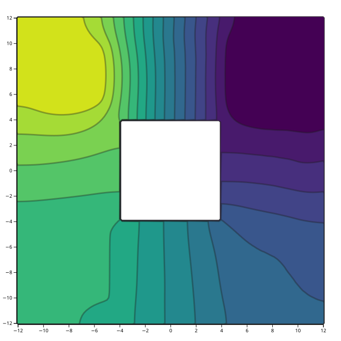

   Values run from 10 to 39.8. The white square in the middle is ``area5``,
   undefined on purpose, and the cells outside every area are undefined too.

area_completer.py
^^^^^^^^^^^^^^^^^

The same smoothing rule, applied inside one polygon: ``area_completer`` puts the
completer with anisotropy (angle 30 degrees, ``w=2``) inside ``some_area``, while
the plain ``completer`` covers the rest. Eleven points keep the surface tied to
the data.

.. tabs::

   .. tab:: Python

      .. literalinclude:: ../../examples/python/area_completer.py
         :language: python

   .. tab:: Tcl

      .. literalinclude:: ../../examples/surfit/tests/area_completer.tcl
         :language: tcl-src

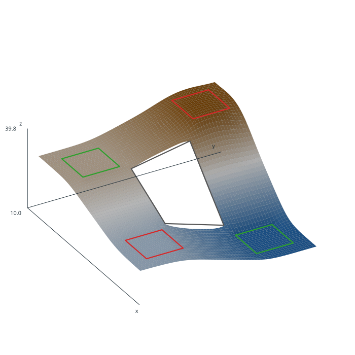

   The same area example in perspective: the shaded surface and the five areas.
   The hole in the middle is ``area5``, undefined by design. The figure is
   generated from the same payload as the map above by ``docs/surface3d.js``;
   d3 does the projection, shading and painter ordering. The area outlines are
   flat at their target values; a horizontal rectangle is a parallelogram in an
   orthographic view.

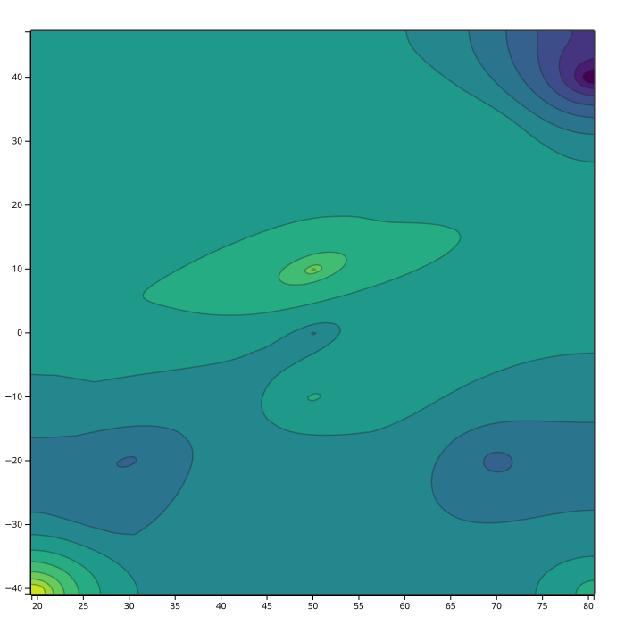

   Values run from -10 to 35.5. Inside the central area the contours stretch
   along one direction, because the smoothing there prefers it.

area_ineq.py
^^^^^^^^^^^^

The area example with bounds added: ``area6`` asks for 15 to 20, but it also
overlaps ``area1`` and ``area3``, whose exact values (10 and 30) take precedence.
The inequality bends the rest of ``area6``, and the script's own report of the
maximum inside it is 30.

.. tabs::

   .. tab:: Python

      .. literalinclude:: ../../examples/python/area_ineq.py
         :language: python

   .. tab:: Tcl

      .. literalinclude:: ../../examples/surfit/tests/area_ineq.tcl
         :language: tcl-src

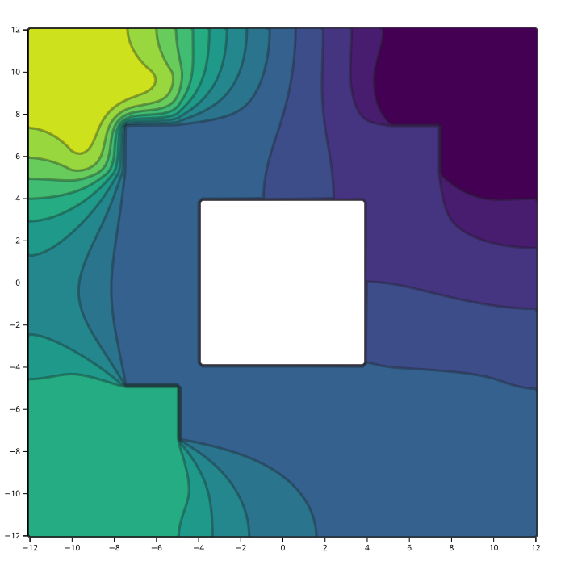

   Values run from 10 to 39.3. The banding that the inequality adds is visible
   between the exact areas, while the maximum inside ``area6`` is still set by
   ``area3``.

area_mean.py
^^^^^^^^^^^^

Averages instead of exact values: the surface should average 40 inside ``area6``
and 30 over the whole map. Both conditions leave the value at any single node
free, so the map is smoother than the exact-value version.

.. tabs::

   .. tab:: Python

      .. literalinclude:: ../../examples/python/area_mean.py
         :language: python

   .. tab:: Tcl

      .. literalinclude:: ../../examples/surfit/tests/area_mean.tcl
         :language: tcl-src

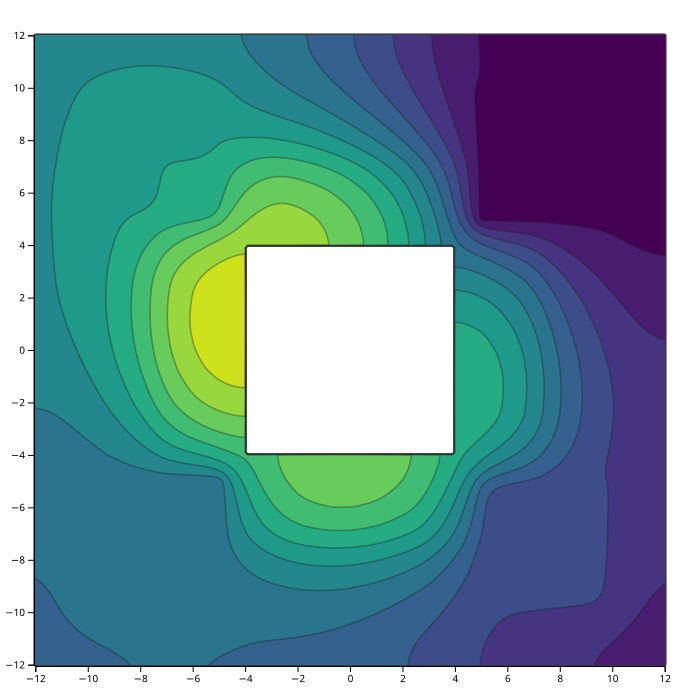

   Values run from 6.3 to 61.7. Both averages are met, and ``area6`` is no
   longer pinned to one number.

area_wmean.py
^^^^^^^^^^^^^

The same average with a weight surface: inside ``area6`` the surface averages 30
with ``test_func`` as the weight, so the average is biased towards the places
where that surface is high.

.. tabs::

   .. tab:: Python

      .. literalinclude:: ../../examples/python/area_wmean.py
         :language: python

   .. tab:: Tcl

      .. literalinclude:: ../../examples/surfit/tests/area_wmean.tcl
         :language: tcl-src

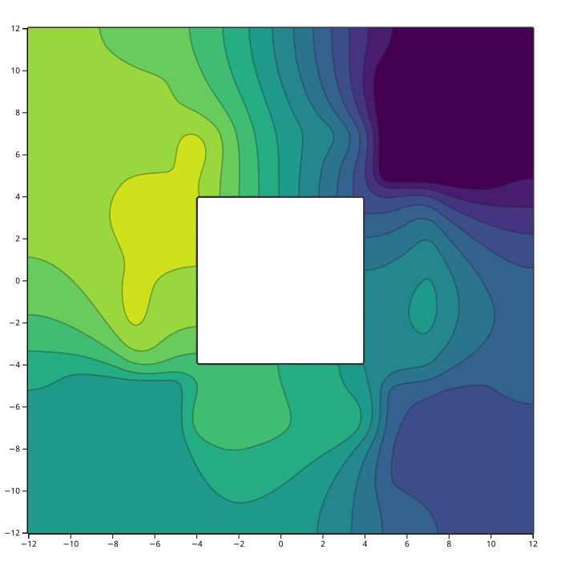

   Values run from 10 to 45.2; the weighted average sits lower than the
   unweighted one because the weight is large where ``test_func`` is high.

area_surf.py
^^^^^^^^^^^^

A surface as data inside areas: the result follows ``test_func`` exactly inside
``area6`` and approximately inside areas 1 to 4, with a separate weight for each
polygon.

.. tabs::

   .. tab:: Python

      .. literalinclude:: ../../examples/python/area_surf.py
         :language: python

   .. tab:: Tcl

      .. literalinclude:: ../../examples/surfit/tests/area_surf.tcl
         :language: tcl-src

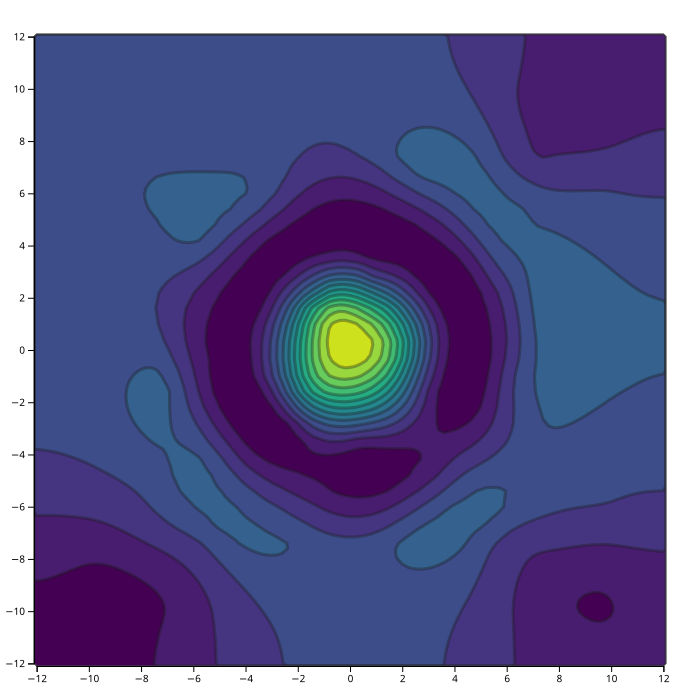

   Values run from -22.7 to 82.3, the range of ``test_func`` itself.

area_surf_ineq.py
^^^^^^^^^^^^^^^^^

Brackets the surface between two copies of ``test_func``: above it in areas 1, 3
and 5, below it in areas 2, 4 and 6. The result lies inside that sandwich and is
smooth between the areas.

.. tabs::

   .. tab:: Python

      .. literalinclude:: ../../examples/python/area_surf_ineq.py
         :language: python

   .. tab:: Tcl

      .. literalinclude:: ../../examples/surfit/tests/area_surf_ineq.tcl
         :language: tcl-src

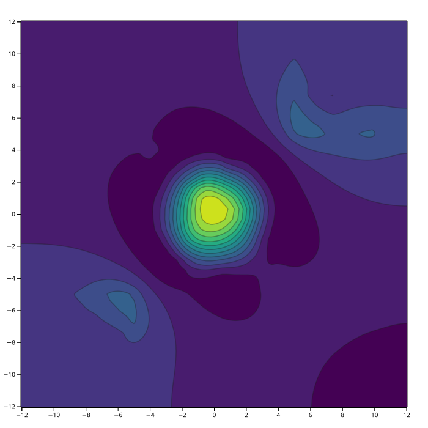

   Values run from -22.8 to 82.9. The two halves of the map are pushed in
   opposite directions, and the completer joins them.

Contours
~~~~~~~~

contour.py
^^^^^^^^^^

Three contours: the small one and the centre one are honoured exactly, the big
one follows with a weight of 0.5. A contour carries its value along the line,
which is what separates it from a curve.

.. tabs::

   .. tab:: Python

      .. literalinclude:: ../../examples/python/contour.py
         :language: python

   .. tab:: Tcl

      .. literalinclude:: ../../examples/surfit/tests/contour.tcl
         :language: tcl-src

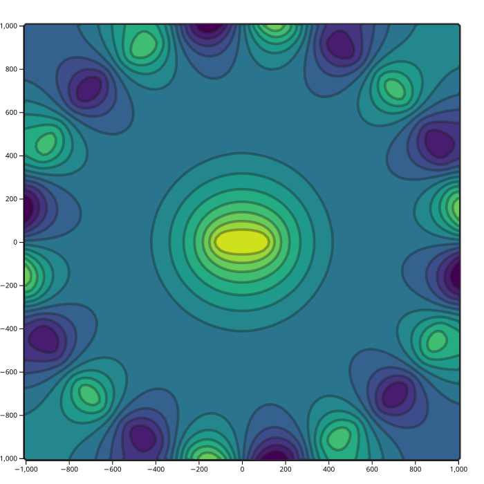

   Values run from -0.7 to 1. The three rings are the contours themselves; the
   space between them is filled in by ``completer``.

contour_ineq.py
^^^^^^^^^^^^^^^

Two sets of contours instead of one: the lower set is a lower bound and the upper
set, shifted by 0.2, an upper bound, so the surface only has to stay between them
rather than touch either.

.. tabs::

   .. tab:: Python

      .. literalinclude:: ../../examples/python/contour_ineq.py
         :language: python

   .. tab:: Tcl

      .. literalinclude:: ../../examples/surfit/tests/contour_ineq.tcl
         :language: tcl-src

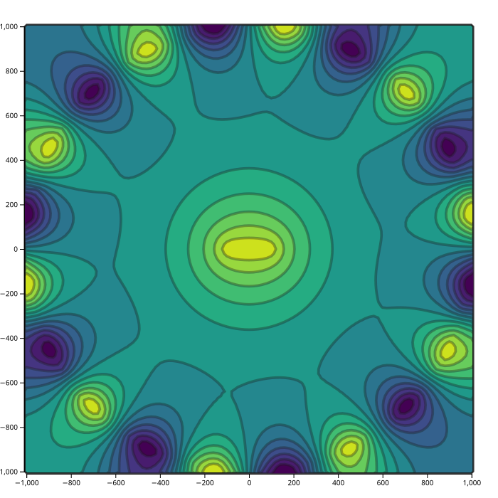

   Values run from -0.9 to 1.1, a wider range than the equality version: the
   bounds let the surface go past each ring by the distance between the sets.

Curves
~~~~~~

curve.py
^^^^^^^^

Four isolines used as data: three carry an exact value (10, 50 and 30), and the
fourth is added with a weight of 0.5. A curve is 2D, so the value comes from the
rule, not from the line, which separates it from a contour.

.. tabs::

   .. tab:: Python

      .. literalinclude:: ../../examples/python/curve.py
         :language: python

   .. tab:: Tcl

      .. literalinclude:: ../../examples/surfit/tests/curve.tcl
         :language: tcl-src

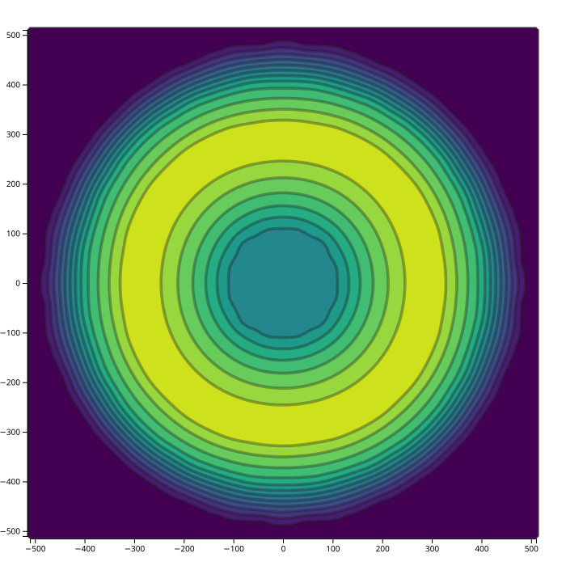

   Values run from 8.8 to 50. The surface reaches the highest curve and is
   pulled towards the weighted one without being forced onto it.

curve_ineq.py
^^^^^^^^^^^^^

The curve example with inequalities: the values along the same four isolines
become lower and upper bounds, so the result only has to respect their order.

.. tabs::

   .. tab:: Python

      .. literalinclude:: ../../examples/python/curve_ineq.py
         :language: python

   .. tab:: Tcl

      .. literalinclude:: ../../examples/surfit/tests/curve_ineq.tcl
         :language: tcl-src

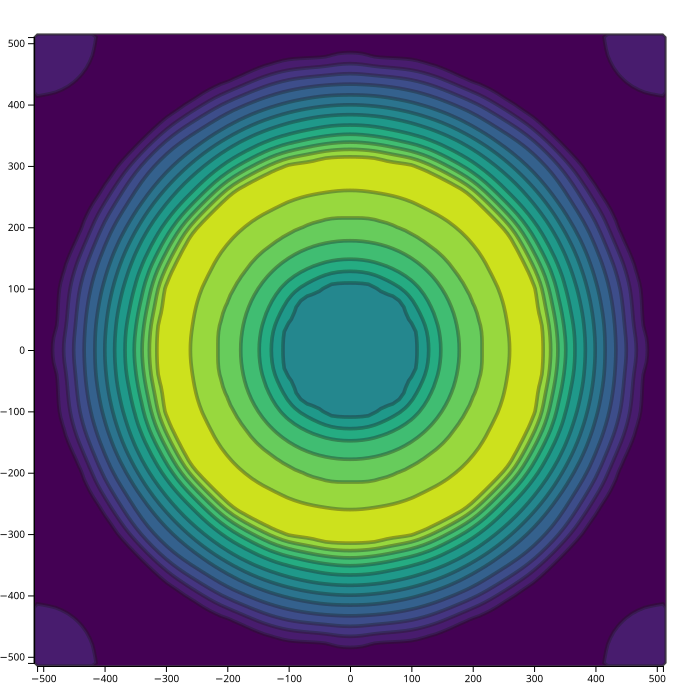

   Values run from 9.1 to 50.2, close to the equality version, but the surface is
   free to avoid the lines instead of passing through them.

curve_surf.py
^^^^^^^^^^^^^

Curves take their values from another surface: the result follows ``test_func``
along ``spiral`` and does so with a weight of 0.5 along ``spiral2``. The grid is
derived from the data, so it covers both spirals.

.. tabs::

   .. tab:: Python

      .. literalinclude:: ../../examples/python/curve_surf.py
         :language: python

   .. tab:: Tcl

      .. literalinclude:: ../../examples/surfit/tests/curve_surf.tcl
         :language: tcl-src

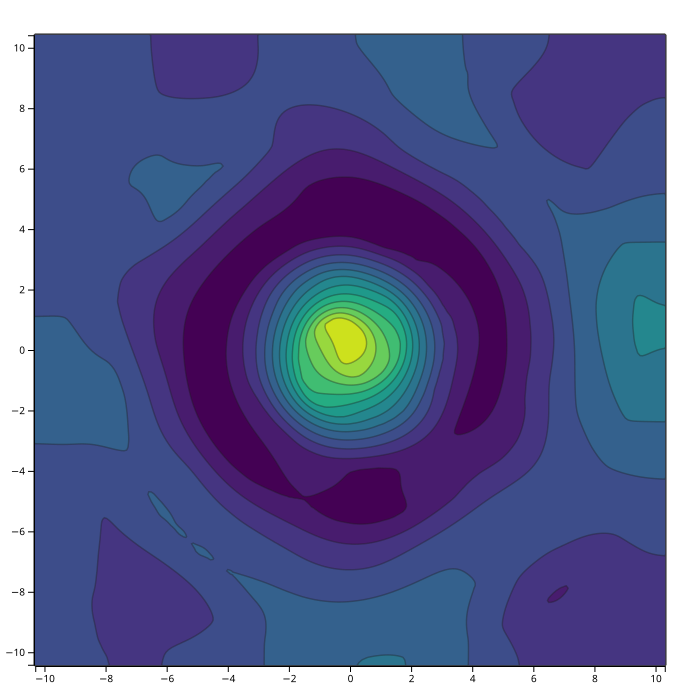

   Values run from -21.2 to 81.8. The spiral is the ridge where ``test_func`` is
   followed exactly.

curve_surf_ineq.py
^^^^^^^^^^^^^^^^^^

Inequalities with values taken from another surface: above ``test_func`` along
``spiral2`` and below it along ``spiral``. The two spirals interleave, so the
result is threaded between them.

.. tabs::

   .. tab:: Python

      .. literalinclude:: ../../examples/python/curve_surf_ineq.py
         :language: python

   .. tab:: Tcl

      .. literalinclude:: ../../examples/surfit/tests/curve_surf_ineq.tcl
         :language: tcl-src

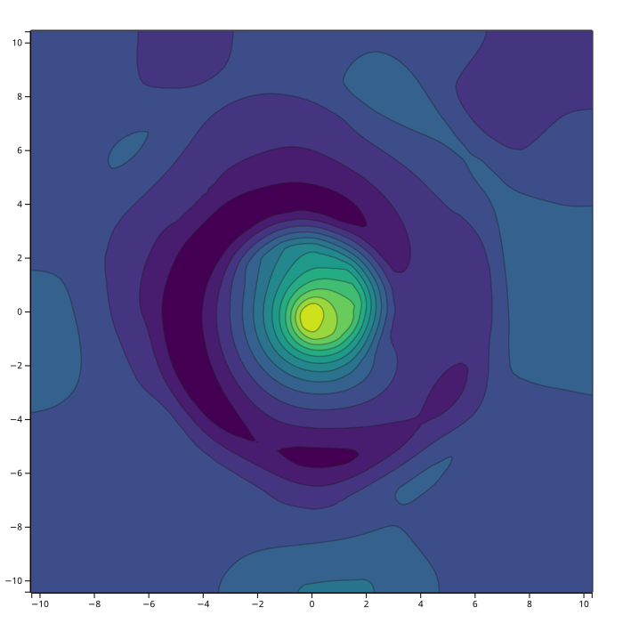

   Values run from -21.2 to 81.4. The surface passes between the spirals rather
   than on them.

Faults
~~~~~~

faults.py
^^^^^^^^^

Eleven points and four fault lines. The surface has to jump across each line
instead of smoothing over it.

.. tabs::

   .. tab:: Python

      .. literalinclude:: ../../examples/python/faults.py
         :language: python

   .. tab:: Tcl

      .. literalinclude:: ../../examples/surfit/tests/fault.tcl
         :language: tcl-src

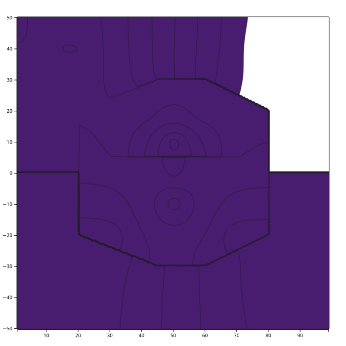

   The jumps are the abrupt colour changes along the polygon edges.

fault_aniso.py
^^^^^^^^^^^^^^

The faults example on a coarser grid, with anisotropy added to the completer:
inside each block the surface is smoothed along 45 degrees rather than uniformly
(the anisotropy angle is 45 degrees, its weight argument 2).

.. tabs::

   .. tab:: Python

      .. literalinclude:: ../../examples/python/fault_aniso.py
         :language: python

   .. tab:: Tcl

      .. literalinclude:: ../../examples/surfit/tests/fault_aniso.tcl
         :language: tcl-src

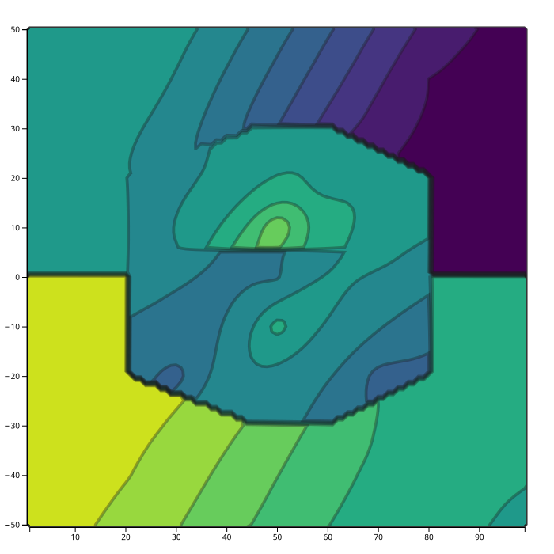

   Values run from -14.1 to 38.8. The jumps along the fault lines are still
   sharp, while the smoothing inside each block prefers one direction.

fault_approx.py
^^^^^^^^^^^^^^^

The faults example without the exact condition at the points: they are added
with a weight, so the surface may miss each measurement a little.

.. tabs::

   .. tab:: Python

      .. literalinclude:: ../../examples/python/fault_approx.py
         :language: python

   .. tab:: Tcl

      .. literalinclude:: ../../examples/surfit/tests/fault_approx.tcl
         :language: tcl-src

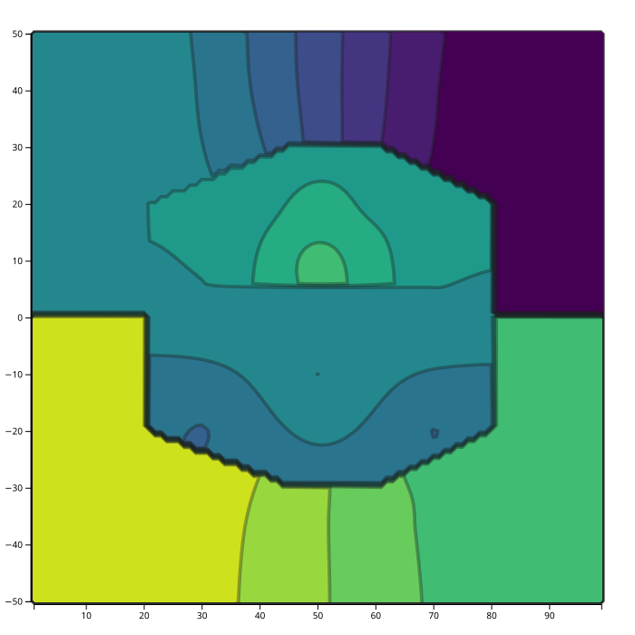

   Values run from -6.6 to 33.3. Compared with the exact version the surface is
   flatter, and the points no longer sit exactly on it.

Inequalities
~~~~~~~~~~~~

ineq.py
^^^^^^^

The simplest inequality example: seven points, a lower bound of 80, an upper
bound of 120, and a completer in between. The surface passes through the points
and stays inside the band everywhere.

.. tabs::

   .. tab:: Python

      .. literalinclude:: ../../examples/python/ineq.py
         :language: python

   .. tab:: Tcl

      .. literalinclude:: ../../examples/surfit/tests/ineq.tcl
         :language: tcl-src

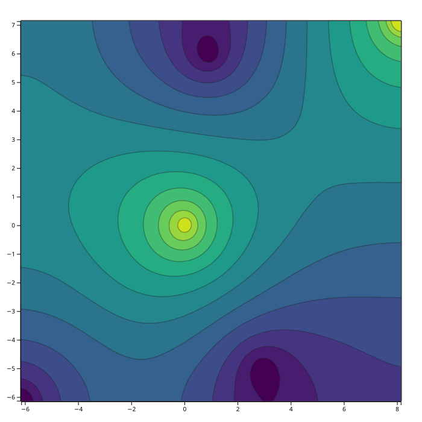

   Values run from 80 to 120: both bounds are reached but never exceeded.

points_ineq.py
^^^^^^^^^^^^^^

Two sets of measured points used as bounds: the surface has to stay above every
point of one set and below every point of the other.

.. tabs::

   .. tab:: Python

      .. literalinclude:: ../../examples/python/points_ineq.py
         :language: python

   .. tab:: Tcl

      .. literalinclude:: ../../examples/surfit/tests/points_ineq.tcl
         :language: tcl-src

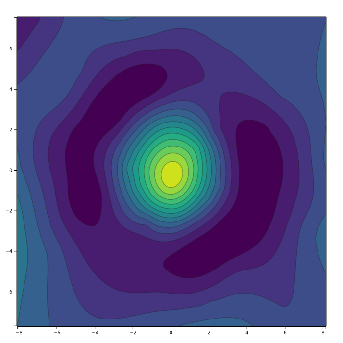

   Values run from -0.2 to 1. The two point sets bracket the surface, which stays
   between them without passing through either.

Masks
~~~~~

mask.py
^^^^^^^

A raster mask cuts a hole in the surface: where the mask is true the surface is
left undefined, everywhere else it follows ``test_func``.

.. tabs::

   .. tab:: Python

      .. literalinclude:: ../../examples/python/mask.py
         :language: python

   .. tab:: Tcl

      .. literalinclude:: ../../examples/surfit/tests/mask.tcl
         :language: tcl-src

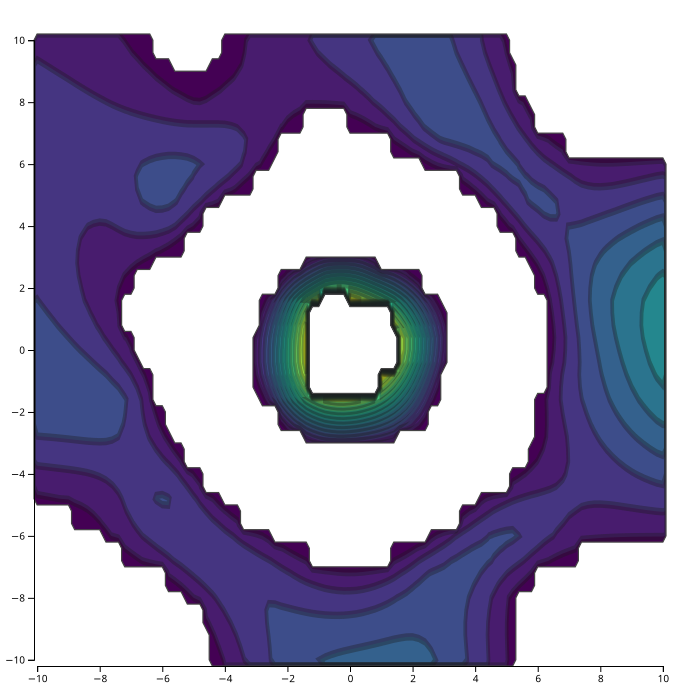

   Values run from -3.3 to 61.6 over 3031 of 5151 nodes: the missing nodes are
   the mask, not a failed solve.

mask_add.py
^^^^^^^^^^^

A value rule restricted to a mask: where the mask is true the surface is pulled
towards 3 with a weight of 0.2, and elsewhere it follows ``test_func`` as before.

.. tabs::

   .. tab:: Python

      .. literalinclude:: ../../examples/python/mask_add.py
         :language: python

   .. tab:: Tcl

      .. literalinclude:: ../../examples/surfit/tests/mask_add.tcl
         :language: tcl-src

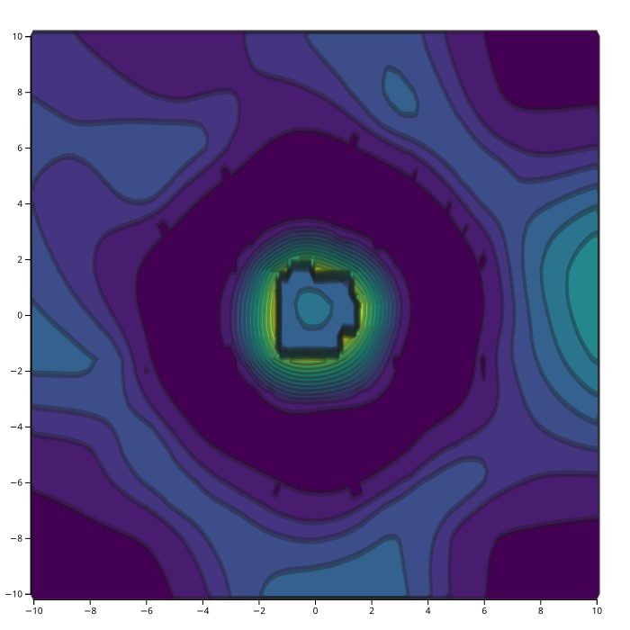

   Values run from -6.7 to 61.6. The weighted rule lowers the surface inside the
   mask without erasing the underlying shape.

mask_completer.py
^^^^^^^^^^^^^^^^^

The completer applied inside a mask only, with anisotropy: where the mask is true
the surface is smoothed along 30 degrees rather than uniformly (the anisotropy
angle is 30 degrees, its weight argument 2).

.. tabs::

   .. tab:: Python

      .. literalinclude:: ../../examples/python/mask_completer.py
         :language: python

   .. tab:: Tcl

      .. literalinclude:: ../../examples/surfit/tests/mask_completer.tcl
         :language: tcl-src

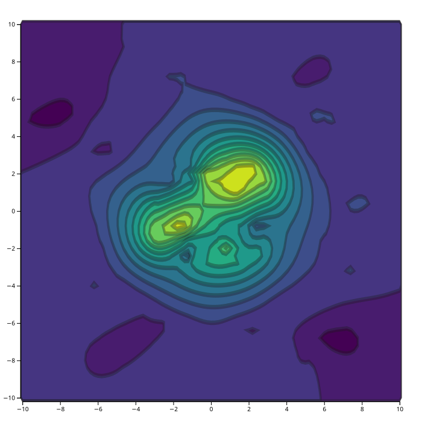

   Values run from 0 to 0.5. The points alone would give a noisy map; inside the
   mask the anisotropic completer smooths it out.

mask_ineq.py
^^^^^^^^^^^^

An inequality under a mask: where the mask is true the surface has to be at least
-10, and elsewhere it follows ``test_func``.

.. tabs::

   .. tab:: Python

      .. literalinclude:: ../../examples/python/mask_ineq.py
         :language: python

   .. tab:: Tcl

      .. literalinclude:: ../../examples/surfit/tests/mask_ineq.tcl
         :language: tcl-src

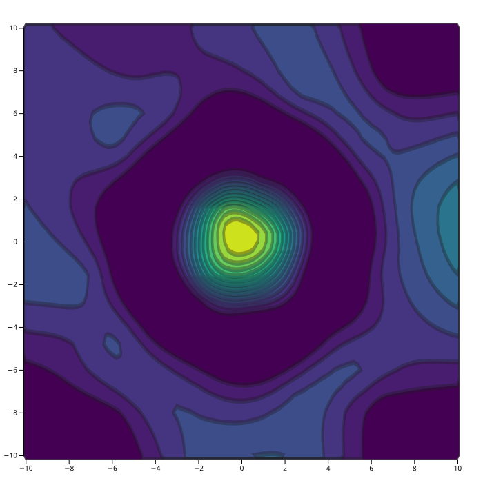

   Values run from -10.0 to 82.3. The floor is reached exactly inside the mask,
   while the rest of the map follows ``test_func``.

mask_mean.py
^^^^^^^^^^^^

An average under a mask: where the mask is true the surface averages -2, while
the points elsewhere are honoured exactly.

.. tabs::

   .. tab:: Python

      .. literalinclude:: ../../examples/python/mask_mean.py
         :language: python

   .. tab:: Tcl

      .. literalinclude:: ../../examples/surfit/tests/mask_mean.tcl
         :language: tcl-src

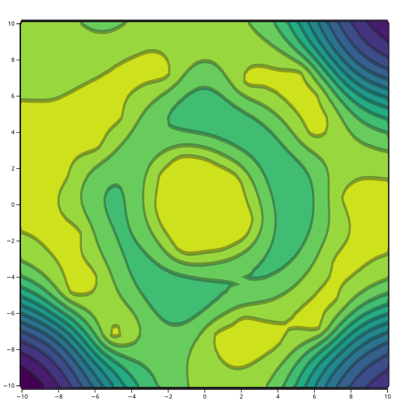

   Values run from -7.6 to 0.6. The points sit near zero, and the mask drags the
   average down to -2.

mask_surf.py
^^^^^^^^^^^^

A surface rule under a mask: where the mask is true the result equals
``test_func``, elsewhere the completer fills in.

.. tabs::

   .. tab:: Python

      .. literalinclude:: ../../examples/python/mask_surf.py
         :language: python

   .. tab:: Tcl

      .. literalinclude:: ../../examples/surfit/tests/mask_surf.tcl
         :language: tcl-src

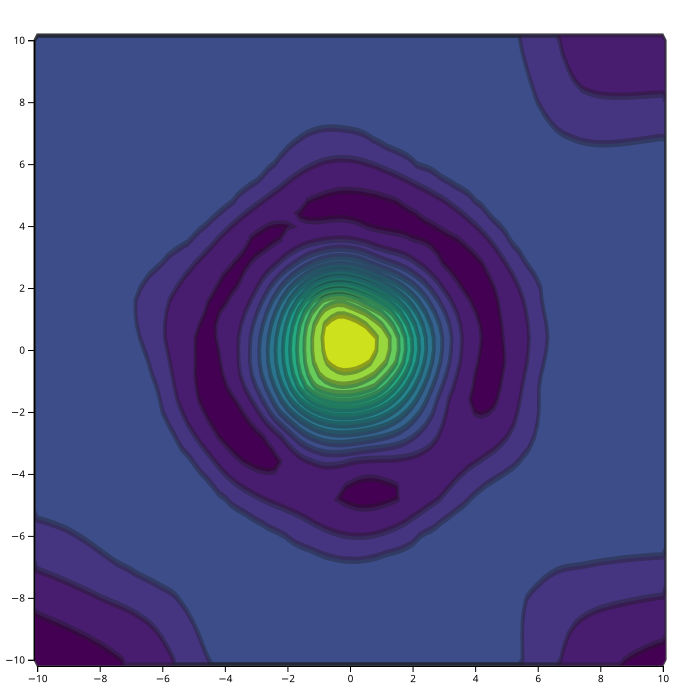

   Values run from -27.5 to 82.3. The mask keeps ``test_func``, and the completer
   extends it smoothly over the rest of the grid.

mask_surf_add.py
^^^^^^^^^^^^^^^^

A weighted surface rule under a mask: the completer comes first and ``test_func``
is added to it with a weight of 1 where the mask is true.

.. tabs::

   .. tab:: Python

      .. literalinclude:: ../../examples/python/mask_surf_add.py
         :language: python

   .. tab:: Tcl

      .. literalinclude:: ../../examples/surfit/tests/mask_surf_add.tcl
         :language: tcl-src

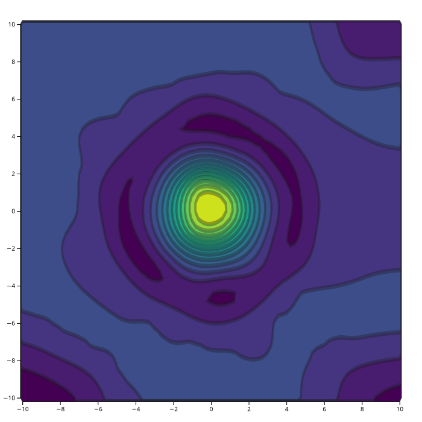

   Values run from -26.3 to 78.5, slightly less extreme than the exact rule,
   because the completer still has a say.

mask_surf_ineq.py
^^^^^^^^^^^^^^^^^

An inequality against a surface under a mask: where the mask is true the result
stays at or below ``test_func``, and the points pin it down elsewhere.

.. tabs::

   .. tab:: Python

      .. literalinclude:: ../../examples/python/mask_surf_ineq.py
         :language: python

   .. tab:: Tcl

      .. literalinclude:: ../../examples/surfit/tests/mask_surf_ineq.tcl
         :language: tcl-src

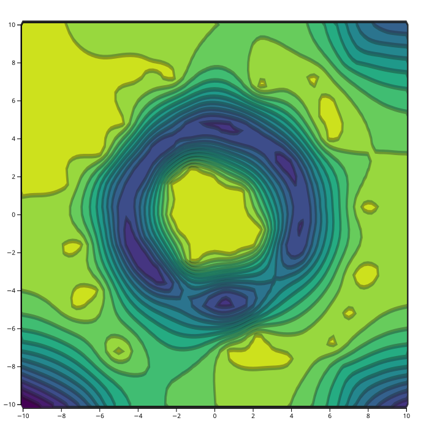

   Values run from -27.5 to 1.9. The masked region is capped by ``test_func``
   while the points hold the rest near zero.

mask_wmean.py
^^^^^^^^^^^^^

A weighted average under a mask: the surface averages 2 where ``mask_not`` is
true, weighted by ``test_func``, while the points are honoured exactly.

.. tabs::

   .. tab:: Python

      .. literalinclude:: ../../examples/python/mask_wmean.py
         :language: python

   .. tab:: Tcl

      .. literalinclude:: ../../examples/surfit/tests/mask_wmean.tcl
         :language: tcl-src

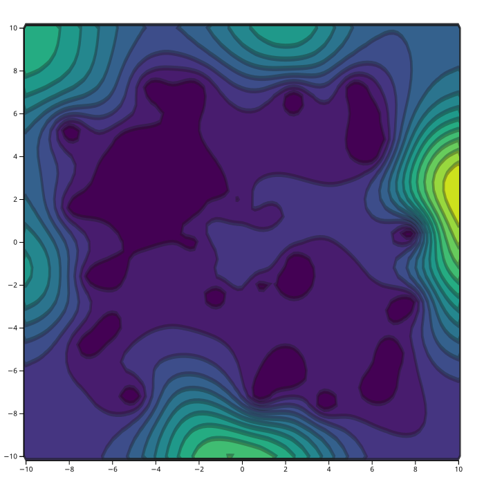

   Values run from 0 to 6.2. The weighted average lifts the near-zero points
   towards 2.

Averages
~~~~~~~~

mean.py
^^^^^^^

An average as a gridding condition: the surface passes through seven points and
its mean value over the whole map is 30.

.. tabs::

   .. tab:: Python

      .. literalinclude:: ../../examples/python/mean.py
         :language: python

   .. tab:: Tcl

      .. literalinclude:: ../../examples/surfit/tests/mean.tcl
         :language: tcl-src

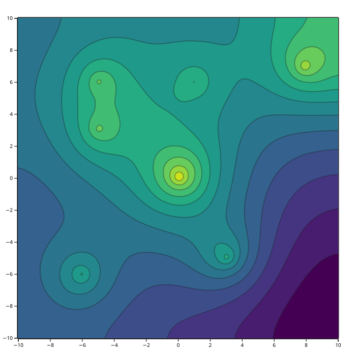

   Values run from -57.0 to 140. The wide range is what it takes to average 30
   while still passing through the points.

wmean.py
^^^^^^^^

A weighted average: the surface passes through seven points and its average is 30
with ``test_func`` as the weight, so the average is biased towards the places
where that surface is high.

.. tabs::

   .. tab:: Python

      .. literalinclude:: ../../examples/python/wmean.py
         :language: python

   .. tab:: Tcl

      .. literalinclude:: ../../examples/surfit/tests/wmean.tcl
         :language: tcl-src

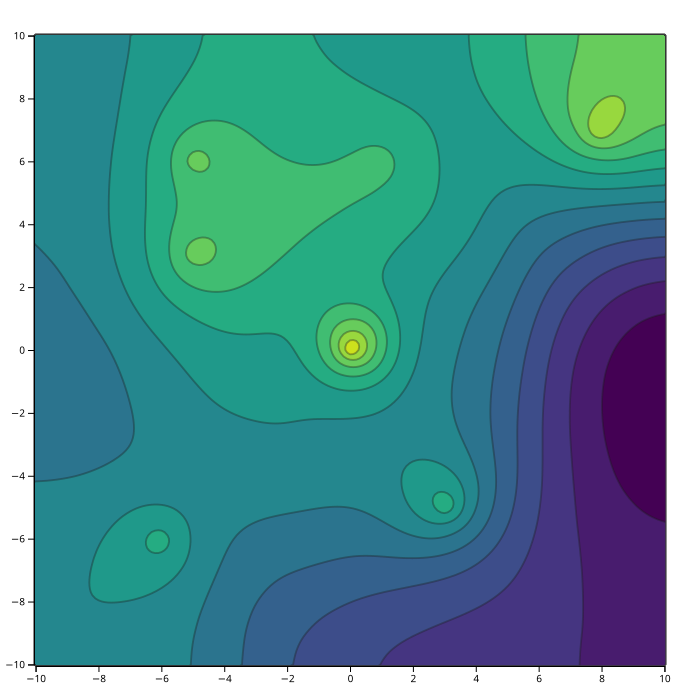

   Values run from -71.7 to 140. The weighted average reaches further down than
   the unweighted one, to compensate for the high values where the weight is
   large.

Surfaces
~~~~~~~~

surface.py
^^^^^^^^^^

A surface used as data: the result follows ``test_func`` in least squares and
tends to a plane where the surface gives no guidance.

.. tabs::

   .. tab:: Python

      .. literalinclude:: ../../examples/python/surface.py
         :language: python

   .. tab:: Tcl

      .. literalinclude:: ../../examples/surfit/tests/surface.tcl
         :language: tcl-src

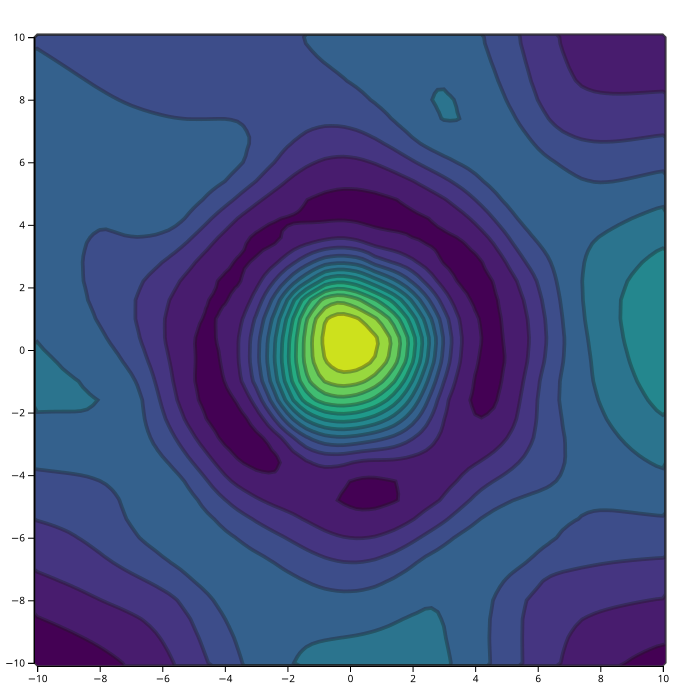

   The surface is smooth but not flat: the contour lines bunch up where
   ``test_func`` changes fastest, and the map runs from -27.5 to 82.3.

surface_add.py
^^^^^^^^^^^^^^

A surface added with a small weight: the completer alone would give a plane, and
``test_func`` bends it slightly towards its own shape.

.. tabs::

   .. tab:: Python

      .. literalinclude:: ../../examples/python/surface_add.py
         :language: python

   .. tab:: Tcl

      .. literalinclude:: ../../examples/surfit/tests/surface_add.tcl
         :language: tcl-src

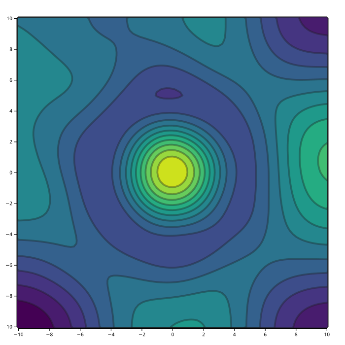

   Values run from -12.5 to 27.7, a much narrower range than ``test_func``
   itself: the weight of 0.01 keeps the result close to the plane.

surface_ineq.py
^^^^^^^^^^^^^^^

The surface example with an inequality: ``test_func`` shifted up by 80 is a lower
bound, so the result sits above that floor while seven points are honoured
exactly. A second copy shifted up by 90 is loaded by the script but no rule uses
it.

.. tabs::

   .. tab:: Python

      .. literalinclude:: ../../examples/python/surface_ineq.py
         :language: python

   .. tab:: Tcl

      .. literalinclude:: ../../examples/surfit/tests/surface_ineq.tcl
         :language: tcl-src

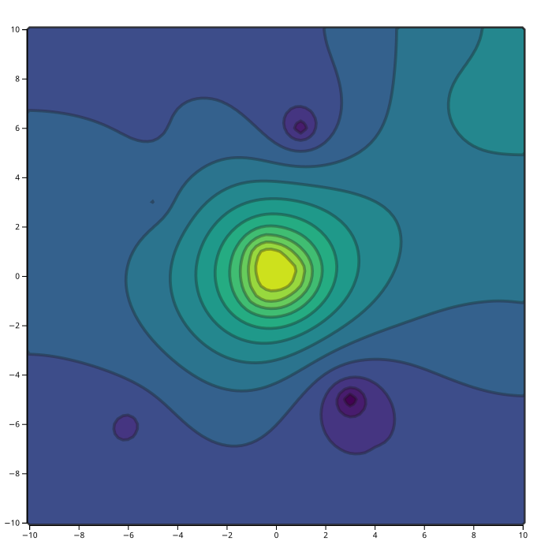

   Values run from 72.4 to 162.3. The floor is ``test_func`` plus 80, and the
   highest point of the result lies exactly on it.

Trends
~~~~~~

trend.py
^^^^^^^^

Faults under a regional trend: seven points and two fault lines, with the result
required to look like ``test_func`` at a large scale. The faults keep the trend
from being continuous across them.

.. tabs::

   .. tab:: Python

      .. literalinclude:: ../../examples/python/trend.py
         :language: python

   .. tab:: Tcl

      .. literalinclude:: ../../examples/surfit/tests/trend.tcl
         :language: tcl-src

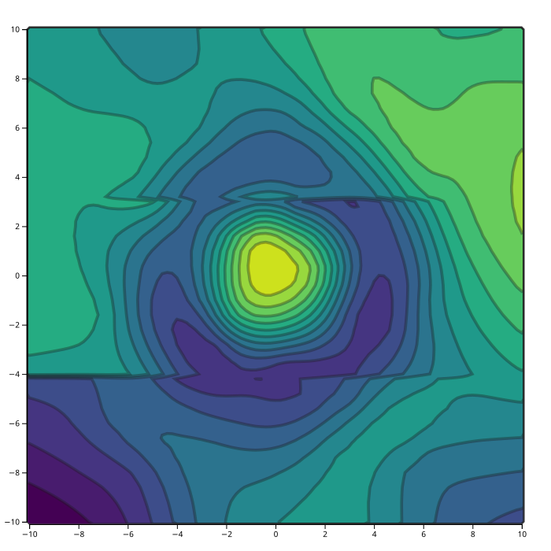

   Values run from 29.0 to 142.7. The trend dominates the shape, and the two
   fault lines show up as steps in it.

trend_from_numpy.py
^^^^^^^^^^^^^^^^^^^

A regional trend handed over as a numpy array, seven wells honoured exactly, and
the result read back into an array.

.. literalinclude:: ../../examples/python/trend_from_numpy.py
   :language: python

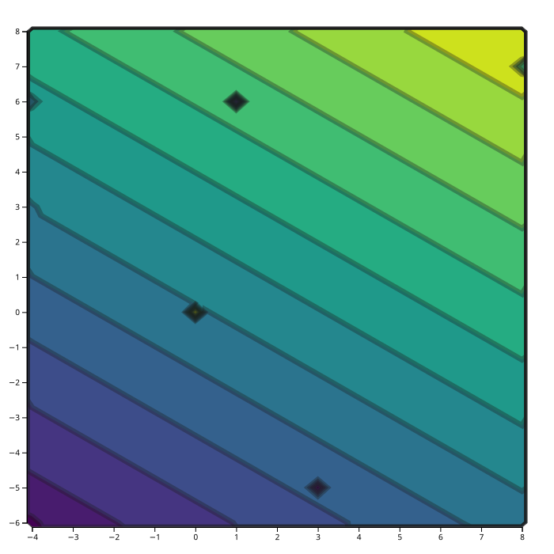

   The plane runs from 67 to 140. The small dark diamonds are the wells: their
   measurements sit off the plane, so each pulls the surface down locally rather
   than being smoothed away.

Other
~~~~~

progress.py
^^^^^^^^^^^

Reports the solver's progress while it runs; the Progress section above explains
the two styles. Its output is text, not a map:

.. code-block:: text

   -- cg (65536 cells)
      cg (65536 cells): iter 33, err 4.92211E-06

.. literalinclude:: ../../examples/python/progress.py
   :language: python

viewer.py
^^^^^^^^^

Writes the interactive HTML page. It is the same solve as ``area.py`` — only the
output differs — so the first map above is what it draws, with a pointer readout
and the undefined cells clipped out.

.. literalinclude:: ../../examples/python/viewer.py
   :language: python

API traps
~~~~~~~~~

Creating a :class:`Session` starts a new task on the calling thread. Data
loaded into that thread's module-level state before it is not part of the task::

    surfit.area_read("area6.txt", "area6")
    task = surfit.Session(...)      # area6 is no longer in memory
    task.area_leq(20, "area6")      # empty list: no area matches

Create the session first and load through it::

    task = surfit.Session(...)
    task.area_read("area6.txt", "area6")
    task.area_leq(20, "area6")      # [True], and the rule is applied

``names()`` lists **surfaces**, not areas. After loading areas it is therefore
still empty; inspect them with ``area_size()`` and ``area_getName("*")``.
Likewise, ``area_leq``/``area_geq`` return one flag per matched area and return
an empty list when the name does not match. They do not raise: check the return
value, or the rule silently does nothing.

Development notes on how the bindings are built and checked are in
:doc:`development`.
