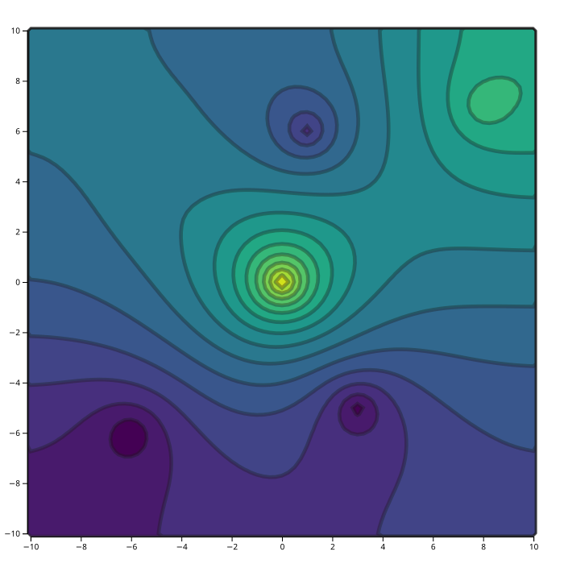

Первые шаги
===========

Эта страница собирает одну небольшую задачу с нуля: семь разрозненных точек,
явная сетка, два правила, решение и два способа сохранить результат. Пример —
``examples/python/first_steps.py``; его исходник есть на странице и запускается
как есть.

Исходное руководство начиналось с Tcl-оболочки и программы ``funner``. Теперь
не нужно ни то, ни другое: задача — это объект Python, а результат можно
записать страницей, которая открывается в браузере.

Нужны Python 3 с ``numpy`` и пакет ``surfit``; в :doc:`installation` описаны
колесо и сборка из исходников.

Как выглядит результат
----------------------

   Семь измерений учитываются точно. Карта идёт от 67 до 140 — это диапазон
   измерений; пространство между ними заполняет ``completer``.

Полный пример
-------------

.. literalinclude:: ../../examples/python/first_steps.py
   :language: python

Что делает каждый шаг
---------------------

Загрузить данные
~~~~~~~~~~~~~~~~

Измерения лежат в текстовом файле с колонками: x, y и значение, по точке на
строку. ``read_points`` (Tcl-команда ``pnts_read``) возвращает по флагу на
каждый найденный файл, поэтому ``assert all(...)`` ловит и неверный путь, и
шаблон, который ни с чем не совпал:

.. code-block:: python

   assert all(task.read_points("data/7points.txt", "wells"))

Если нужные колонки не первые три, их передают по имени; разделитель и число
строк заголовка — тоже аргументы:

.. code-block:: python

   task.read_points("model.txt", "wells", col1=4, col2=3, col3=5)

Остальные семейства читаются так же: ``read_curves``, ``read_contours``,
``read_areas``, ``surf_load`` и ``mask_load``.

Задать сетку
~~~~~~~~~~~~

``task.grid`` — явная сетка: начало и конец по x, шаг ячейки, затем те же три
числа для y:

.. code-block:: python

   task.grid(-10, 10, 0.25, -10, 10, 0.25)

Если границы должны следовать за данными, ``task.grid_auto()`` подгоняет сетку
под всё загруженное. Это и есть Tcl-команда ``grid``; метод ``grid`` — явный.

Добавить правила
~~~~~~~~~~~~~~~~

*Правило гриддинга* описывает, как использовать данные. ``points`` проводит
поверхность через измерения, ``completer`` сохраняет её гладкой там, где
измерений нет:

.. code-block:: python

   task.points("wells")
   task.completer()

Каждое правило возвращает по флагу на объект данных. Результат ``[False]``
означает, что шаблон имени ни с чем не совпал и правило **не добавлено** —
Tcl-фронтенд это молча игнорирует, поэтому на флаги стоит смотреть. У правил
есть вес (``_add``) и границы (``_leq``, ``_geq``); семейства перечислены в
:doc:`python`.

Решить
~~~~~~

.. code-block:: python

   task.solve()

Решатель проходит последовательность сеток; число итераций и невязка видны в
логе, а в :doc:`python` показано, как превратить их в индикатор прогресса.

Сохранить результат
~~~~~~~~~~~~~~~~~~~

Есть три уровня сохранения, и разница важна:

.. code-block:: python

   task.save("first_steps.dat")       # поверхность, surf_save
   task.file_save("task.dat")         # вся задача: данные, правила, поверхность
   task.surf_save_grd("map.grd")      # другой формат, из плагина

Для карты достаточно ``save``. ``file_save`` сохраняет задачу так, чтобы её
можно было загрузить и продолжить. Плагин форматов добавляет сохранялку для
каждого поддерживаемого формата; список — в :doc:`formats`.

Посмотреть результат
~~~~~~~~~~~~~~~~~~~~

``values()`` возвращает последнюю поверхность массивом ``(count_y, count_x)``
типа float64. Узлы вне данных содержат ``surfit.UNDEF_VALUE``, то есть
``FLT_MAX``; остальные выбирает ``defined_mask``:

.. code-block:: python

   grid = task.values()
   defined = surfit.defined_mask(grid)
   print(grid.shape, grid[defined].min(), grid[defined].max())

Пример заодно пишет HTML-страницу:

.. code-block:: python

   task.save_viewer("first_steps.html", title="first steps", levels=14)

Страница встраивает сетку и рисует заливку по изолиниям с подсказкой под
курсором; d3 загружается с CDN при открытии. Параметр ``d3_url`` указывает на
локальную копию там, где сети нет.

Другие виды данных
------------------

Те же четыре шага работают для любого семейства. Меняются только загрузчик и
правило:

.. list-table::
   :header-rows: 1
   :widths: 22 30 48

   * - Данные
     - Загрузка
     - Правило
   * - разрозненные точки
     - ``read_points``
     - ``points``, ``points_leq``, ``points_geq``
   * - кривые
     - ``read_curves``
     - ``curve``, ``curve_leq``, ``curve_geq``, ``fault``
   * - изолинии
     - ``read_contours``
     - ``contour``, ``contour_leq``, ``contour_geq``
   * - площади
     - ``read_areas``
     - ``area``, ``area_leq``, ``area_geq``, ``area_mean``
   * - поверхности
     - ``surf_load``
     - ``surface``, ``surface_leq``, ``surface_geq``, ``trend``
   * - маски
     - ``mask_load``
     - ``mask``, ``mask_leq``, ``mask_geq``

Правило применяется ко всем объектам, чьи имена совпали с шаблоном; по
умолчанию это ``"*"``, поэтому ``task.points()`` берёт все точки в памяти.
Примеры в ``examples/python/`` показывают каждое семейство по очереди вместе с
картой, которую оно даёт: :doc:`python`.

Куда дальше
-----------

* :doc:`python` — API, все семейства правил, numpy на входе и выходе, вьюер.
* :doc:`flows` — поля давления с ``freeflow``, правила и карты.
* :doc:`formats` — родной формат, BLN, шейпфайлы и остальные.
