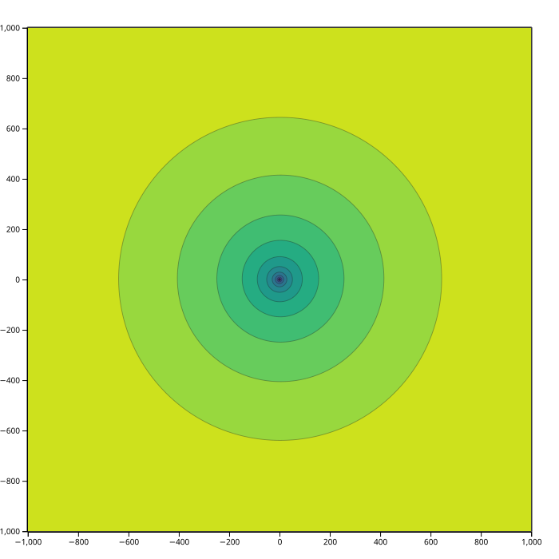
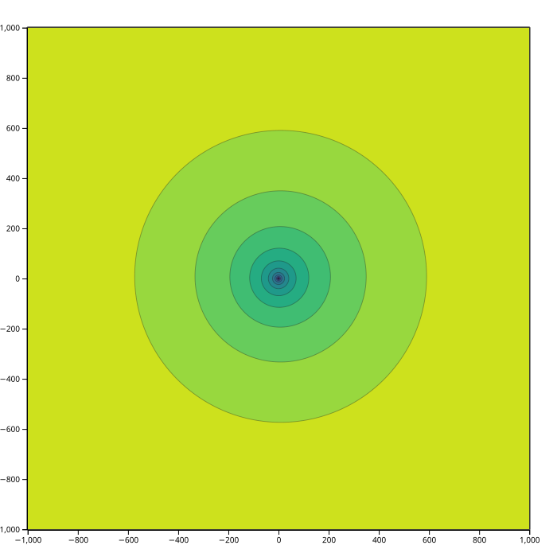
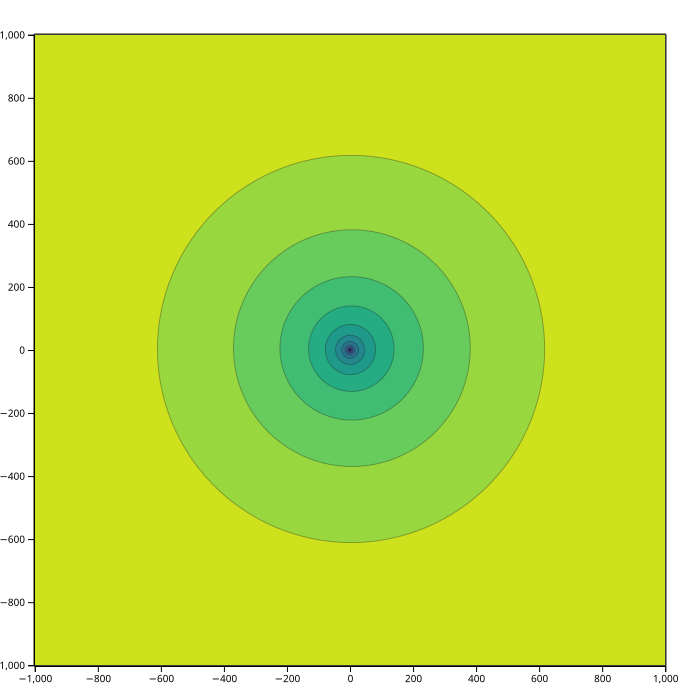
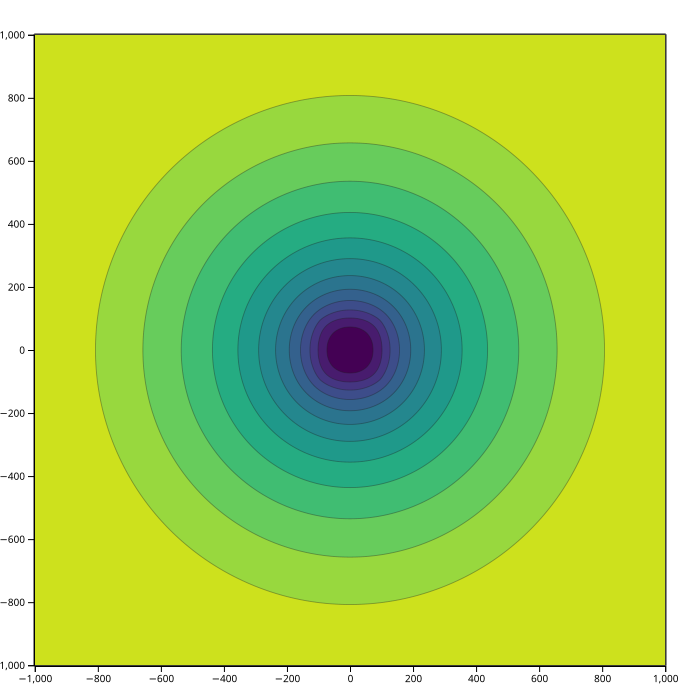
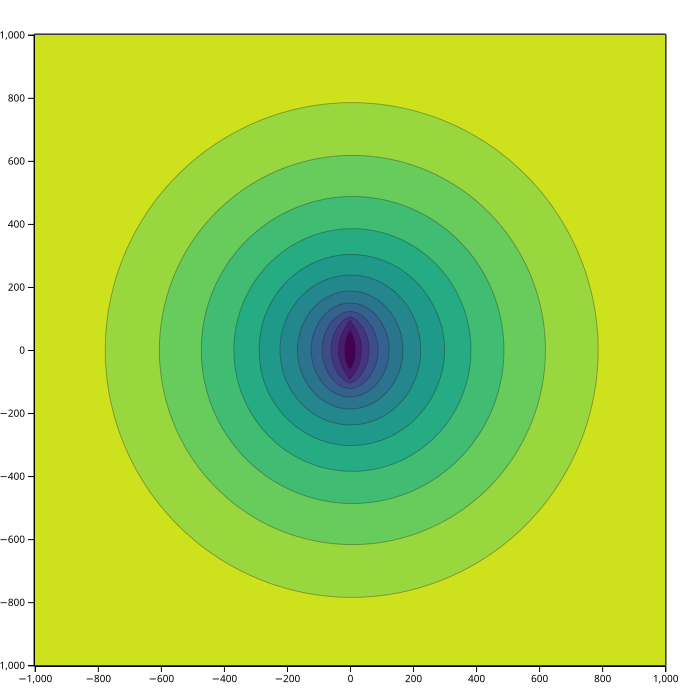
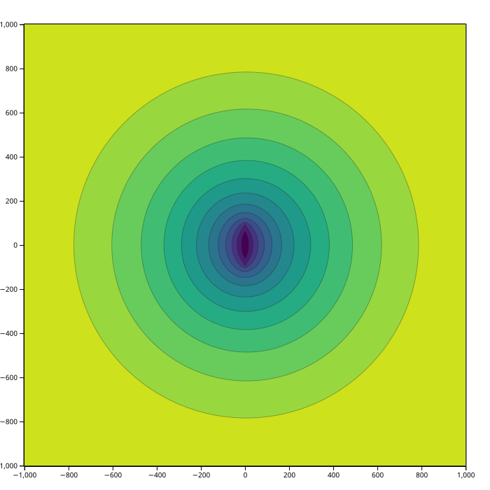
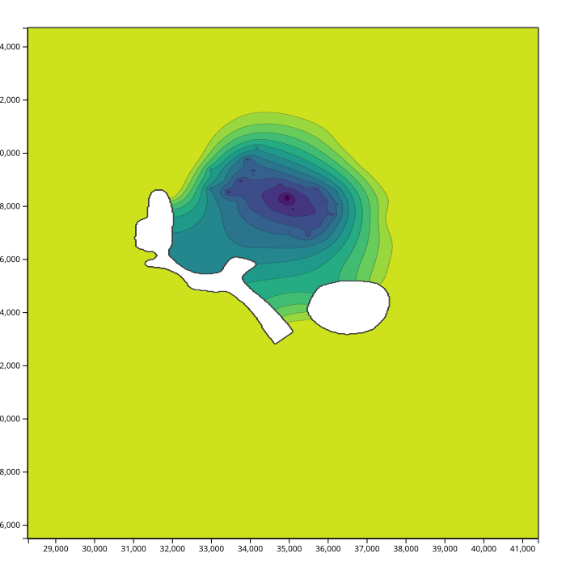

Потоки
======

``freeflow`` добавляет к движку правила для полей давления. Давления измеряются
в атмосферах или МПа, расходы — в м3/с; результат — поле давления, которое
проносит эти расходы через пласт. Модель собирают правила трёх видов:

* ``lcm_simple``, закон сохранения массы, задаёт физику каждой ячейки:
  проницаемость, вязкость и множитель.
* ``flow_points``, ``flow_curve``, ``flow_contour`` и ``flow_area`` привязывают
  измеренный расход к точке, линии, изолинии или полигону.
* ``fault`` помечает непроницаемую линию, а ``contour_add`` вносит измеренное
  давление вдоль изолинии.

Задача собирается как любая другая: загрузить данные, задать сетку, добавить
правило потока и обычные правила, затем ``solve()``. Новое здесь то, что данные
могут быть противоречивы — измеренные давление и расход в одной скважине редко
согласуются, — и веса решают, насколько доверять каждому. Краевая задача не
может принять оба; ради этого библиотека и существует.

Примеры — порты ``examples/freeflow/press1`` и ``press2``. Каждый пишет тот же
``.dat``, что и его Tcl-оригинал (``test_examples.py`` сверяет побайтово), а
карты ниже рисует ``make_images.py`` из самих примеров.

Поле с одной скважиной
----------------------

Все шесть примеров описывают одну карту: граничная кривая с давлением 250
атмосфер и одна скважина в центре. Различаются они тем, что известно о
скважине. Каждый печатает дебит через центральный квадрат 300 x 300 м; знак
следует принятому соглашению о расходах, поэтому сравнивайте модули.

press_points.py
~~~~~~~~~~~~~~~

База: давление в скважине 200 атмосфер, расход не задан, поэтому поле
интерполируется между двумя давлениями.

.. tabs::

   .. tab:: Python

      .. literalinclude:: ../../examples/python/press_points.py
         :language: python

   .. tab:: Tcl

      .. literalinclude:: ../../examples/freeflow/press1/points.tcl
         :language: tcl-src

   Значения идут от 200 до 250 атмосфер, дебит — 67.3 м3/сут.

flow_points.py
~~~~~~~~~~~~~~

Теперь скважина задана расходом: -0.00159 м3/с в центре. Давление в скважине
становится результатом закона сохранения массы, а не входным данным.

.. tabs::

   .. tab:: Python

      .. literalinclude:: ../../examples/python/flow_points.py
         :language: python

   .. tab:: Tcl

      .. literalinclude:: ../../examples/freeflow/press1/flow_points.tcl
         :language: tcl-src

   Скважина тянет поле вниз до 143.5 атмосфер, а дебит вырастает до
   138.1 м3/сут.

flow_points2.py
~~~~~~~~~~~~~~~

Известны и давление, и расход в скважине, и они противоречат друг другу.
``points_add`` сохраняет измерение 200 атм с весом, ``flow_points`` добавляет
расход, и решение оказывается компромиссом.

.. tabs::

   .. tab:: Python

      .. literalinclude:: ../../examples/python/flow_points2.py
         :language: python

   .. tab:: Tcl

      .. literalinclude:: ../../examples/freeflow/press1/flow_points2.tcl
         :language: tcl-src

   В скважине поле достигает 171.9 атмосфер, а дебит равен 103.2 м3/сут —
   между вариантами «только давление» и «только расход».

flow_area.py
~~~~~~~~~~~~

Тот же суммарный расход, распределённый по квадрату 200 x 200 м вместо точки.
Внутри квадрата давление почти постоянно.

.. tabs::

   .. tab:: Python

      .. literalinclude:: ../../examples/python/flow_area.py
         :language: python

   .. tab:: Tcl

      .. literalinclude:: ../../examples/freeflow/press1/flow_area.tcl
         :language: tcl-src

   Значения идут от 208.9 до 250 атмосфер, дебит — 141.4 м3/сут.

flow_curve.py
~~~~~~~~~~~~~

Тот же суммарный расход вдоль вертикальной линии через центр:

.. tabs::

   .. tab:: Python

      .. literalinclude:: ../../examples/python/flow_curve.py
         :language: python

   .. tab:: Tcl

      .. literalinclude:: ../../examples/freeflow/press1/flow_curve.tcl
         :language: tcl-src

   Значения идут от 202.2 до 250 атмосфер, дебит — 123.8 м3/сут.

flow_cntr.py
~~~~~~~~~~~~

Расход на единицу длины берётся из значения Z изолинии. Эта изолиния несёт
-7.95e-6 м3/с на метр, что на её 200 м даёт тот же суммарный расход, что и в
вариантах с точкой, площадью и кривой:

.. tabs::

   .. tab:: Python

      .. literalinclude:: ../../examples/python/flow_cntr.py
         :language: python

   .. tab:: Tcl

      .. literalinclude:: ../../examples/freeflow/press1/flow_cntr.tcl
         :language: tcl-src

   Значения идут от 202.0 до 250 атмосфер, дебит — 123.9 м3/сут.

Настоящее поле с трещиной
-------------------------

Примеры press2 используют поле 2001 года Аригольского месторождения:
измеренные давления и расходы, непроницаемые зоны, разлом и измеренную
изолинию давления. Два скрипта отличаются одним входом — направлением линии
трещины; этой парой исходное руководство выбирало направление.

Оба решают сетку 438 x 641 и оставляют определёнными 271736 узлов из 280758;
остальные лежат вне поля или за непроницаемыми зонами.

map_hor_frac.py
~~~~~~~~~~~~~~~

Трещина идёт горизонтально. Полный пример:

.. tabs::

   .. tab:: Python

      .. literalinclude:: ../../examples/python/map_hor_frac.py
         :language: python

   .. tab:: Tcl

      .. literalinclude:: ../../examples/freeflow/press2/map_hor_frac.tcl
         :language: tcl-src

   Значения идут от 11.2 до 21.4 МПа. Измеренная изолиния давления и
   непроницаемые зоны формируют поле вокруг трещины.

map_ver_frac.py
~~~~~~~~~~~~~~~

То же поле с вертикальной линией:

.. tabs::

   .. tab:: Python

      .. literalinclude:: ../../examples/python/map_ver_frac.py
         :language: python

   .. tab:: Tcl

      .. literalinclude:: ../../examples/freeflow/press2/map_ver_frac.tcl
         :language: tcl-src

   Значения идут от 10.7 до 21.4 МПа; изолинии давления наклонены в другую
   сторону, а неопределённая область та же.

Каждый пример печатает дебит через область, давление в точке (34967, 58314),
их невязки относительно измеренных -40.3844832 м3/сут и 12 МПа, а также
шероховатость ``surf_D1``. Печать этих чисел и есть сравнение: невязки дебита и
давления уравновешивают друг друга, а шероховатость показывает, какое поле
гладже.

И ``surf_debit``, и ``surf_debit_rect`` отвечают ``undef_value`` для точки или
прямоугольника вне сетки либо задевающего неопределённую ячейку. Прямоугольник
раньше отвечал ``FLT_MAX`` независимо от ``undef_value``; теперь он следует той
же настройке, что и точечный запрос.

Чтение данных
-------------

Измеренные файлы — текст с колонками, и примеры показывают аргументы колонок
в деле:

.. list-table::
   :header-rows: 1
   :widths: 32 24 44

   * - Файл
     - Читается как
     - Колонки и масштаб
   * - ``PZab_2001.txt``
     - точки, ``press2001``
     - дата, скважина, y, x, давление: ``col1=4 col2=3 col3=5``, затем
       ``*0.1013`` из атмосфер в МПа
   * - ``Q_2001.txt``
     - точки, ``debits2001``
     - те же колонки для y, x и расхода, затем ``*-1``, потому что расходы
       хранятся с обратным знаком
   * - ``VNK*.txt``, ``ZAM*.txt``
     - кривые и площади
     - сначала y, потом x: ``col1=2 col2=1``
   * - ``lines/P_2001_236_*.txt``
     - изолиния
     - измеренная изолиния давления, затем ``cntr_mult_real(0.1013)``
   * - ``lines/frac_236_*.txt``
     - кривая
     - линия трещины, к которой ``flow_curve`` применяет измеренный расход
