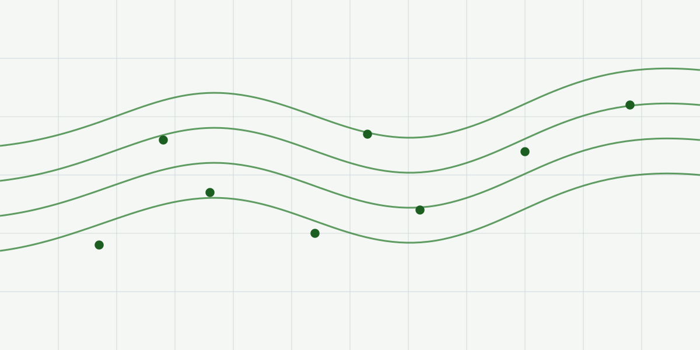
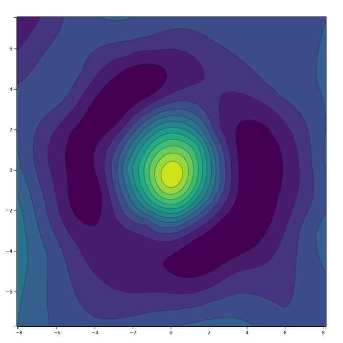
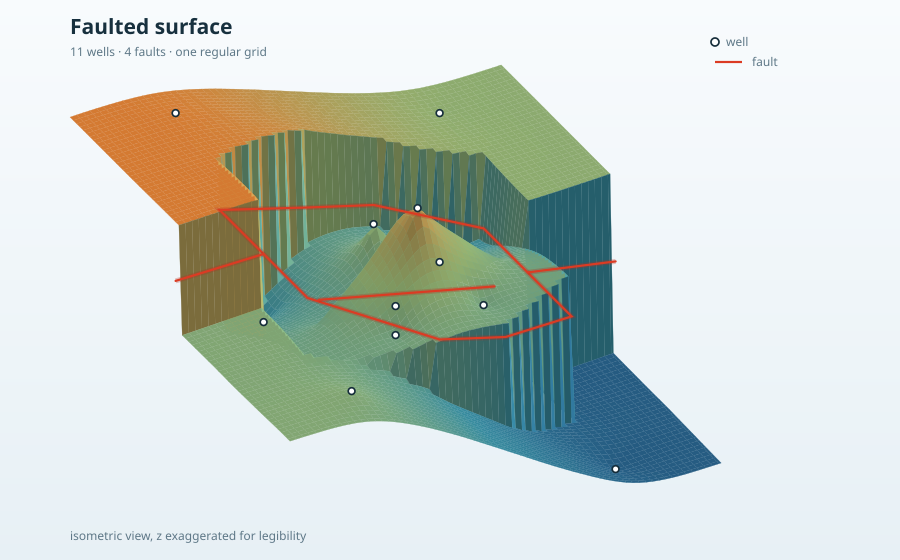

surfit
======

**surfit** вычисляет регулярную сетку по разнородным данным — точкам, кривым,
изолиниям, поверхностям и площадям — при условиях, которые называются
*правилами гриддинга*.

Именно правила делают программу больше, чем интерполятором. В одной задаче можно
одновременно потребовать, чтобы поверхность равнялась значению внутри полигона,
оставалась между двумя границами в другом месте, следовала тренду, учитывала
разломы, соответствовала гистограмме и оставалась гладкой между всем этим — у
каждого условия есть свой вес и приоритет.

Возможности
-----------

* Интерполяция и приближение рассеянных точек, 2D-кривых, 3D-изолиний,
  поверхностей и полигональных площадей.
* Разломы, тренд-поверхности, анизотропия, неравенства, средние и
  взвешенные средние, подгонка под гистограмму, маски.
* Быстрый многопоточный решатель с несколькими итерационными методами.
* Параллельные Python Session: состояние движка и установленная задача
  thread-local, поэтому независимые задачи могут решаться одновременно.
* Quality workflow: пространственная кросс-валидация, блочный bootstrap,
  вариограммы, поддержка узлов, измерение PSF, типизированная диагностика
  точек и provenance.
* Множество форматов: собственный файл surfit, сетки Surfer, GMT, Grass,
  ArcGIS, xyz, shapefile, BLN, JPEG и BMP.
* Python-пакет с numpy на входе и выходе. Исходный Tcl-фронтенд устарел
  и удаляется в 3.8.

---

Что может показать результат
-----------------------------

   Данные и границы: скважины привязаны, ограничения держатся.

   Разломы и скважины: поверхность прыгает через явные линии разломов.

С чего начать
-------------

Установка и одна законченная задача:

.. toctree::
   :maxdepth: 2

   installation
   first_steps

Руководства
-----------

Задачи и примеры:

.. toctree::
   :maxdepth: 2

   python
   terrain
   flows

Основы
------

Что означают термины и как устроен движок:

.. toctree::
   :maxdepth: 2

   basics
   how_it_works

Справочник
----------

Типы данных, команды, форматы файлов и устаревший фронтенд Tcl:

.. toctree::
   :maxdepth: 2

   data_types
   commands
   formats
   migration
   tcl

Дополнительно
-------------

Литература и заметки о разработке:

.. toctree::
   :maxdepth: 2

   references
   development

Лицензия
--------

surfit распространяется под GNU General Public License версии 2. Про вендоренную триангуляцию CDT (MPL-2.0)
написано в :doc:`development`.
