Python
======

Пакет Python управляет тем же движком, что и Tcl-фронтенд: одна ``Session``
на задачу, те же имена команд и массивы numpy на входе и выходе. Эта
страница — справочник по API; готовые задачи — в ``examples/python/`` и на
страницах :doc:`terrain` и :doc:`flows`.

.. code-block:: python

   import surfit

   task = surfit.Session(map_name="map_area", tol=5.01187e-06)

   for name in ("area1", "area2", "area3", "area4", "area5"):
       task.read_areas("data/%s.txt" % name, name)

   task.grid(-12, 12, 0.2, -12, 12, 0.2)

   task.area(10, "area1")             # равно 10 внутри area1
   task.area(30, "area3")
   task.area("undef", "area5")        # area5 остаётся неопределённой
   task.completer(1, 1.6)             # стремиться к константе или плоскости
   task.area_add(20, 0.07, "area2")   # приблизить, с весом
   task.area_add(40, 0.07, "area4")

   task.solve()
   task.save("area.dat")

   grid = task.values()               # numpy, (count_y, count_x), float64

Как устроен API
---------------

В задаче три фазы, и порядок обязателен:

#. **Загрузить данные.** ``read_areas``, ``read_points``, ``read_curves``,
   ``read_contours``, ``surf_load``, ``mask_load`` или массив через
   ``add_surface``.
#. **Задать сетку** через ``grid`` для явных границ или ``grid_auto``, чтобы
   подогнать её под загруженные данные (Tcl-команда ``grid``), и добавить
   правила.
#. **Решить** через ``solve``, затем прочитать или сохранить результат.

Типы данных, с которыми работает первая фаза, описаны в :doc:`data_types`;
метод, на котором стоит третья, — в :doc:`how_it_works`.

Каждая команда Tcl-фронтенда доступна и как метод сессии под тем же именем,
так что ``task.points("wells")`` означает то же, что ``points("wells")``.
Исключение одно — ``grid``: метод с таким именем строит явную сетку (Tcl-команда
``grid_get``), а Tcl-команде ``grid`` соответствует ``grid_auto``.

Термины
-------

**Пространственная кросс-валидация (CV).** Отложить точки по пространственному
правилу, построить модель без них и посчитать ошибку на отложенных точках.
Случайная CV оптимистична для кластеров; блочная CV — честный дефолт.

**Блочный bootstrap.** Пересемплировать целые пространственные блоки, а не
отдельные точки, чтобы сохранить зависимость соседей. Даёт разброс ансамбля,
а не posterior.

**Вариограмма.** Полудисперсия поля как функция расстояния. Range — где она
выходит на плато, sill — плато, nugget — скачок в нуле. В surfit это
диагностика и стартовые значения для анизотропии; это не kriging-solver.

**Поддержка (support).** Данные, которые держат узел: число точек, расстояние
до ближайшей и сумма весов. Слабая поддержка означает, что значение — в
основном интерполяция, каким бы маленьким ни был residual.

**PSF.** Ширина импульсного отклика: насколько одно наблюдение размазывается
по сетке. ``psf_report`` измеряет переданное поле; это не ковариационная
модель.

**Коллар.** Сетка больше интересующей области, которую решают и затем
обрезают, чтобы естественная граница была дальше от данных.

**Декластеризация.** Замена плотного блока точек одним представителем, чтобы
кластер не доминировал в фите. Исходные точки остаются для остатков.

**Provenance.** Версия движка/solver, хеши входов, CRS и единицы рядом с
результатом. Делает запуск проверяемым; CRS не валидирует.

Веса точек
----------

``read_points`` принимает необязательную последовательность ``weights`` — по
одному положительному числу на точку::

    task.read_points("wells.txt", "wells", weights=sigma_inv)

или, после чтения, ``task.pnts_set_weights("wells", sigma_inv)``. Точки,
попавшие в одну ячейку сетки, усредняются с этими весами, а не
арифметически; нулевой вес выбрасывает точку. Вектор неправильной длины
отвергается. Это расширение Python-стороны; у Tcl-ридера весов точек нет.
Веса — не карта статистических ошибок: solver по-прежнему возвращает одну
поверхность без ковариации.


Массивы и таблицы
-----------------

Данные не обязаны приходить через файл. Session может зарегистрировать массивы
напрямую::

    task.add_points(x, y, z, weights=sigma_inv, name="wells")
    task.add_curves(x, y, name="line")
    task.add_areas(x, y, name="zone")
    task.add_contours(x, y, z, name="iso")

Методы создают объекты движка напрямую из numpy-массивов; временный
columned-файл не участвует. Это короткий путь из pandas, Arrow или курсора БД,
и provenance остаётся у вызывающего кода. ``add_surface`` по-прежнему остаётся
массивным путём для растра/тренда.

Остатки и chi-square
--------------------

``task.residuals(x, y, z, weights=None, surface=None)`` сравнивает точки с
решением в ближайших узлах::

    stats = task.residuals(x, y, z, weights=sigma_inv)
    stats["rmse"], stats["bias"], stats["chi2"], stats["n"]

Возвращает ``n``, ``residuals``, ``rmse``, ``bias``, ``weighted_mse``, ``chi2``
и ``dof``. Точки вне сетки и на неопределённых узлах пропускаются; нулевые
веса тоже. ``chi2`` — сумма взвешенных квадратов остатков, поэтому для
обычного chi-square нужны веса, обратные дисперсии. Это диагностика, а не
карта ошибок: движок по-прежнему возвращает одну поверхность без ковариации.

``task.outliers(x, y, z, threshold=3.5)`` возвращает булеву маску для
остатков, удалённых от медианы больше чем на ``threshold`` MAD. Это
подсказка, а не robust loss: обнулите веса отмеченных точек и решите снова.


Робастное перевзвешивание
-------------------------

``surfit.diagnostics.robust_weights(residuals, loss="huber")`` возвращает
IRLS-веса остатков: Huber оставляет точку с уменьшенным весом, Tukey
обнуляет её за порогом. Движок по-прежнему решает least squares; пересоберите
задачу с новыми весами и решите ещё несколько раз::

    from surfit.diagnostics import robust_weights

    weights = base_weights
    for iteration in range(4):
        task = build_task(weights)       # ваш loader/rule setup
        task.solve()
        stats = task.residuals(x, y, z, weights=weights)
        weights[stats["used"]] = base_weights[stats["used"]] * \
            robust_weights(stats["residuals"], loss="huber")

Это робастный **workflow**, а не робастный solver: внутренняя задача движка
остаётся least squares.


Низкоуровневая ``surfit.diagnostics.point_residuals(values, extent, x, y, z)``
принимает массив и dict из ``surf_extent`` напрямую.


Пространственная кросс-валидация
--------------------------------

Случайная k-fold завышает точность на кластеризованных данных: соседние точки
протекают между обучением и проверкой. ``surfit.cross_validate`` делает схему
фолдов явной и считает ошибку только на отложенных точках::

    from surfit import cross_validate

    def build(train, train_weights):
        task = make_task(x[train], y[train], z[train], weights=train_weights)
        task.solve()
        return task

    result = cross_validate(
        build, x, y, z, folds=5, mode="block", block=2.0
    )
    result["rmse"], result["bias"], result["fold_details"]

Для сгруппированных данных (скважина, участок, кампания, прибор) используйте
``mode="group"`` и один group id на точку. ``folds=None`` означает
leave-one-group-out; группа не может попасть одновременно в train и validation::

    result = surfit.cross_validate(
        build, x, y, z, mode="group", groups=well_id)

``result["group_details"]`` содержит RMSE, bias, MAE и counts по каждой
группе. ``select_parameter`` принимает тот же аргумент ``groups``.

``mode="random"`` — дешёвая проверка; ``mode="block"`` отдаёт в фолд целые
прямоугольные блоки, ``mode="kfold"`` сохраняет порядок входа. Размер блока
лучше брать из range вариограммы, если она есть. Callback получает только
индексы обучения; проверочные точки в него не попадают. Результат — ошибка
точек при выбранной схеме, а не карта неопределённости. Callback может также
вернуть ``(values, extent)`` или массив при заданном ``extent=``.

Поддержка узлов и декластеризация
---------------------------------

``task.quality_attributes(x, y, weights=None)`` возвращает массивы на сетке:
``count`` (число точек в ячейке), ``sum_weights``, ``negative_weights``,
``min_distance`` и ``mean_distance`` до центра ячейки. В quality report также
появляются ``grid.covered``, ``grid.uncovered`` и
``grid.negative_weight_cells``. Это диагностика поддержки, а не карта ошибок.

Плотные линии и кластеры могут доминировать в глобальном фите.
``decluster_points`` сводит прямоугольные блоки к одной точке::

    from surfit import decluster_points

    reduced = decluster_points(
        x, y, z, weights=sigma_inv, method="mean", block=10.0
    )
    reduced["x"], reduced["y"], reduced["z"], reduced["weights"]

``method`` — ``mean``, ``nearest``, ``idw``, ``min`` или ``max``. Исходные
точки остаются для остатков; блоки с нулевым суммарным весом отбрасываются.

Типизированные диагностические точки
------------------------------------

``task.diagnostic_points(x, y, z, weights=None)`` возвращает запись на каждую
точку с кодом: 0 used, 1 outlier, 2 undefined cell, 3 outside grid,
4 zero weight. Также есть ``residual``, ``predicted``, ``scale`` (локальный
шаг сетки, делённый на число точек) и ``scaled_residual``::

    document = task.diagnostic_points(x, y, z, weights=sigma_inv)
    document["code_name"]
    task.save_diagnostics("qc.geojson", x, y, z)
    task.save_diagnostics("qc.csv", x, y, z)

GeoJSON и CSV — формат передачи в GIS или таблицу для проверки. Коды
подписей контуров и направления разломов здесь не выдумываются: слой
классифицирует только то, что реально видит по точкам.

Полигональная декластеризация
~~~~~~~~~~~~~~~~~~~~~~~~~~~~~

``surfit.voronoi_weights(x, y, bounds=None)`` возвращает веса со средним 1:
вес точки пропорционален обратной площади её ячейки Вороного, обрезанной по
``bounds``. ``bounds`` — mapping с ``min_x/max_x/min_y/max_y`` или
``(xmin, xmax, ymin, ymax)``; по умолчанию — bbox точек.
``backend="auto"`` использует SciPy, если он установлен, и откатывается на
чистое half-plane clipping; ``"clip"`` вообще не импортирует SciPy, а
``"scipy"`` требует его. Среднее весов — 1.

```python
weights = surfit.voronoi_weights(x, y, bounds=extent)
task.pnts_set_weights("wells", weights)
```

Используйте это для **2D-положений точек**; в поверхности surfit ``z`` — это
измеренное значение, а не пространственная координата. Дубликаты делят площадь
ячейки, краевые ячейки обрезаются, а не выбрасываются; на коллинеарных или
слишком редких точках helper поднимает ошибку. ``decluster_points`` — другая
операция: она сводит блоки к представителям.

Метаданные происхождения
------------------------

CRS, единицы и источник не помещаются в ``.dat`` или ``.grd``, поэтому
храните их в задаче и пишите JSON рядом::

    task = surfit.Session(
        map_name="result",
        metadata={"crs": "EPSG:32637", "x_units": "м", "y_units": "м"})

    task.set_metadata(z_units="м", source="кампания 2026")
    task.save("result.dat")
    task.save_metadata("result.meta.json")

``task.metadata`` возвращает копию; ``set_metadata`` добавляет поля; в sidecar
попадают они и ``map_name``. Это фиксация происхождения, а не перепроекция
сетки и не проверка CRS. В sidecar также есть ``provenance``: версии движка,
Python и NumPy, время создания UTC, платформа, CRS, единицы и необязательные
хеши входных файлов. ``report(..., sources=["wells.txt"])`` кладёт ту же карту
SHA-256 в quality report.


Диагностика вариограммы
-----------------------

``surfit.experimental_variogram(x, y, z, bins=20, direction=None)`` возвращает
центры лагов, полувариацию и число пар. ``direction`` выбирает пары в пределах
``tolerance`` градусов; ``estimator="robust"`` использует Cressie-Hawkins
вместо классического среднего. ``surfit.fit_variogram`` подгоняет
сферическую, экспоненциальную или гауссову модель и возвращает range, nugget
и partial sill::

    experimental = surfit.experimental_variogram(x, y, z, bins=16)
    fit = surfit.fit_variogram(
        experimental["lag"], experimental["gamma"], model="spherical"
    )
    fit["range"], fit["nugget"], fit["sill"]

``surfit.anisotropy`` подгоняет направленные вариограммы и возвращает грубый
угол и отношение длинного/короткого range для существующего правила::

    direction = surfit.anisotropy(x, y, z, angles=(0, 45, 90, 135))
    task.completer(1, 2, alpha=direction["angle"], w=direction["ratio"])

Это диагностика и стартовые значения, а не кригинг и не ковариационная
модель. Движок по-прежнему решает одну поверхность.

Неопределённость ансамблем
---------------------------

``surfit.diagnostics.ensemble(fields)`` возвращает среднее, стандартное
отклонение, 5/95-перцентили и число определённых полей в каждой ячейке.
``bootstrap_uncertainty(build, count, replicates=100, seed=0)`` выбирает
``count`` индексов точек с возвращением и вызывает ``build(sample)``;
callback должен вернуть решённую задачу или массив::

    from surfit.diagnostics import bootstrap_uncertainty

    def build(sample):
        task = make_task(x[sample], y[sample], z[sample])
        task.solve()
        return task

    stats = bootstrap_uncertainty(build, len(x), replicates=100, seed=7)
    stats["std"], stats["p05"], stats["p95"]

Это разброс ансамбля при пересемплировании, а не ковариационная матрица и не
posterior. Стоит один полный solve на реплику. Для кластеризованных данных
используйте блочное пересемплирование, сохраняющее целые пространственные
блоки::

    labels = surfit.block_labels(x, y, block=10.0)
    stats = bootstrap_uncertainty(
        build, len(x), replicates=100, seed=7, blocks=labels
    )

или передайте ``x=x, y=y, block_size=10.0`` — метки будут построены
автоматически.


Split-conformal калибровка
~~~~~~~~~~~~~~~~~~~~~~~~~~

``surfit.conformal_quantile(residuals, level=0.9)`` возвращает finite-sample
квантиль абсолютных остатков. ``surfit.calibrated_interval(center, residuals,
level=0.9)`` строит симметричный калиброванный интервал вокруг скаляра или
массива::

    interval = surfit.calibrated_interval(mean, held_out_residuals, 0.9)
    interval["lower"], interval["upper"], interval["quantile"]

Калибруйте на held-out остатках, не на train. Это калиброванный интервал
ансамбля, а не posterior и не kriging variance.

Coverage и группы
~~~~~~~~~~~~~~~~~

``surfit.interval_coverage(observed, lower, upper)`` возвращает ``n``,
``covered``, ``fraction``, ``mean_width`` и ``median_width``.
``surfit.coverage_by_group`` делает то же по группам.
``surfit.group_conformal_quantiles`` возвращает глобальный и групповые
квантили. ``symmetric=False`` даёт интервал по знаковым остаткам::

    coverage = surfit.interval_coverage(
        observed, interval["lower"], interval["upper"])
    by_group = surfit.coverage_by_group(
        observed, interval["lower"], interval["upper"], groups=site_id)
    group_q = surfit.group_conformal_quantiles(residuals, site_id, 0.9)

Калибруйте и считайте coverage на held-out остатках.

Внешний IRLS-драйвер
--------------------

``robust_solve(build, x, y, z, loss="huber", iterations=4)`` — тот же цикл в
виде функции: ``build(weights)`` должен вернуть решённую задачу, драйвер
обновляет веса и пересобирает задачу заданное число раз::

    from surfit.diagnostics import robust_solve

    result = robust_solve(build, x, y, z, loss="huber", iterations=4)
    result["task"].values()
    result["weights"]
    result["stats"]

Модель и правила фиксированы; меняются только веса точек. Это по-прежнему
внешний IRLS-цикл, а не встроенный robust solver.


Quality report и GeoTIFF
------------------------

``task.report(x, y, z, weights=None, sources=None)`` возвращает готовую к JSON
сводку: extent, число точек, остатки, флаги выбросов, метаданные и provenance.
``grid.crs``, ``grid.units`` и ``grid.nodata`` делают файл самодокументированным;
``provenance.sources`` пуст, если не передать ``sources``. Пишите её рядом с
картой::

    task.save_report("result.report.json", x, y, z, weights=sigma_inv,
                     sources=["wells.txt"])
    task.save_geotiff("result.tif")       # CRS из metadata
    task.save_geotiff("result.tif", crs="EPSG:32637")

``save_geotiff`` необязателен: GDAL импортируется лениво и даёт понятный
ImportError, если системных привязок нет. Растр north-up, узлы — центры
ячеек, undefined-узлы используют nodata surfit, CRS передаётся в
``osr.SpatialReference.SetFromUserInput``. Без ``crs`` берётся
``task.metadata["crs"]``; в dataset также пишется версия движка и поля
метаданных.

Помощники CRS
--------------

Перепроекция необязательна и использует ``pyproj``; сам движок остаётся
декартовым. ``to_crs`` преобразует точки, ``transform_extent`` сэмплирует
края и возвращает только новые границы — сетку нужно пересобрать в целевом
разрешении, а не считать, что аффинная сетка сохранилась::

    lon, lat = surfit.to_crs(x, y, "EPSG:4326", "EPSG:32637")
    bounds = surfit.transform_extent(extent, "EPSG:4326", "EPSG:32637")

``is_geographic_crs`` и ``require_projected`` ловят градусные единицы там,
где анизотропия или расстояния теряют смысл. Без pyproj помощники дают
понятный ImportError.

Коллар, разрешение и поиск параметра
------------------------------------

Коллар — это увеличенная сетка вокруг интересующей области, которую после
решения обрезают; она отодвигает естественную границу от данных. Помощники
сохраняют шаг сетки::

    padded = surfit.pad_extent(extent, margin=20.0)
    # решаем на padded, затем:
    values, extent = surfit.crop_surface(values, padded, original_extent)

``surfit.resolution_report(extent, x=x, y=y, values=values)`` показывает
предел Найквиста (``2 * step``), число точек на ячейку, покрытие и грубую
оценку шага данных. Он предупреждает, если сетка заметно мельче поддержки
данных; это диагностика поддержки, а не инверсия PSF.

``surfit.psf_report(values, extent, center=(x, y))`` измеряет уже полученный
импульсный отклик: возвращает ``half_width``, гауссову ``sigma`` и
``resolved_features = 2 * half_width``. ``surfit.estimate_psf(build, x0, y0,
extent)`` вызывает ``build(x0, y0)`` один раз и применяет то же измерение.
Callback строит импульс; это не ковариационная модель.

``surfit.select_parameter`` прогоняет spatial CV для каждого кандидата и
возвращает лучший. Callback получает кандидата, поэтому может пересобрать
веса точек, аргументы ``completer`` или tolerance::

    result = surfit.select_parameter(
        build, x, y, z,
        parameters=[0.5, 1.0, 2.0],
        folds=5, mode="block", block=10.0,
    )
    result["parameter"], result["scores"]

Quality workflow
----------------

Полный workflow — запускаемый пример. Он решает синтетическую задачу и печатает
остатки, spatial CV, подгонку вариограммы, подсказку анизотропии, поддержку,
декластеризацию, диагностику и provenance. Числа — это чек-лист, а не одна
«неопределённость».

.. literalinclude:: ../../examples/python/quality_workflow.py
   :language: python

Обмен растрами
----------------

``surfit.read_geotiff(path, band=1)`` читает north-up GeoTIFF и возвращает
``values``, ``extent``, ``crs`` и ``nodata``. Узлы — центры ячеек, row 0 —
``min_y``, а повёрнутые/west-up растры отвергаются, а не смещаются молча.

``surfit.save_geotiff_stack(directory, {name: array}, extent, crs=...)``
пишет по GeoTIFF на слой плюс ``manifest.json`` с именами, порядком, extent,
CRS и nodata. Это формат обмена, а не приватный контейнер.
``save_geotiff_bands(path, {name: array}, extent, ...)`` пишет один
multi-band GeoTIFF с описаниями band’ов. ``save_geotiff(..., cog=True)`` и
``save_geotiff_bands(..., cog=True)`` пишут Cloud Optimized GeoTIFF через
GDAL COG driver. Без GDAL используется ``tifffile`` для пикселей и
scale/tiepoint-тегов; запрос CRS или COG даёт явный ImportError, а не молча
теряет georeference.


Strict-режим
------------

По умолчанию пустое совпадение совместимо с Tcl: ``area_leq`` возвращает
``[]``, правило не добавляется. Если нужна ошибка, включите::

    task = surfit.Session(..., strict=True)
    task.area_geq(0, "missing")   # ValueError: area_geq matched no data


Out-of-core тайлы
-----------------

``surfit.tiled.solve_point_tiles`` решает задачу по точкам тайл за тайлом и
пишет мозаику в ``numpy.memmap``::

    from surfit.tiled import solve_point_tiles

    result = solve_point_tiles(
        x, y, z, (-10, 10, -10, 10), 0.5,
        inner=256, halo=32, memmap_path="map.f64",
        geotiff_path="map.tif", crs="EPSG:32637")

    result["values"]       # memmap, (count_y, count_x)
    result["tiles"]

Копируется только внутренняя часть перекрывающихся тайлов, поэтому швы видят
те же данные, что и середина. Для кривых, контуров и площадей используйте
общий ``solve_tiled``; callback получает тайл и может выбрать геометрию через
``select_geometries``::

    from surfit.tiled import select_geometries, solve_tiled

    def build(tile):
        task = surfit.Session(tol=1e-7)
        task.read_curves("iso.xy", "g")
        task.grid(*tile_grid_args)     # tile["extent"] и tile["step"]
        task.curve(5, "g")
        task.solve()
        return task

    result = solve_tiled(build, (-10, 10, -10, 10), 0.5,
                         inner=64, halo=16, memmap_path="map.f64")

Callback отвечает за выбор/обрезку данных; у тайла должно быть не меньше
восьми узлов на сторону, потому что первая фаза движка — 8x8.


Слоистые поверхности
--------------------

``SurfaceStack`` — упорядоченный набор независимых Session на одной сетке. Он
добавляет оркестрацию и отчёт, а не второй solver::

    stack = surfit.SurfaceStack("site")
    stack.add_layer("top", lambda: build_top())
    stack.add_layer("bottom", lambda: build_bottom())
    stack.solve()
    report = stack.report()
    report["crossings"]
    report["layers"][0]["thickness"]["pinchouts"]

Слои упорядочены; crossing — где верхний слой опускается ниже следующего,
pinch-out — неположительная толщина. Стек также отвергает слои с разными
extent/step. Используйте его, когда несколько поверхностей нужно решить и
проверить вместе; для одной поверхности остаётся обычный ``Session``.

Отношения — небольшой DAG, а не фиксированный список соседей::

    stack.add_relation("top", "bottom", min_thickness=1.0)
    stack.add_layer("lens", build_lens, above="bottom", below="top")

Стек топологически сортирует граф, отвергает циклы и передаёт все условия
слоя одним объектом ``SurfaceRelations``. ``above`` означает
``this >= target + min_thickness``; ``below`` —
``this <= target - min_thickness``.

Для отношения верхний builder получает ``SurfaceRelation`` и должен применить
его до следующего functional::

    def build_top(relation):
        task = surfit.Session(...)
        relation.apply(task)       # top >= lower + min_thickness
        task.points("wells")
        task.completer(1, 1.6)
        return task

    stack.add_layer("top", build_top, above="bottom", min_thickness=1.0)

Стек решает снизу вверх. Builder, не принимающий relation, даёт ошибку, а не
молча игнорирует условие.
Решённый стек можно сохранить без приватного бинарного формата::

    stack.save("stack_dir")
    loaded = surfit.SurfaceStack.load("stack_dir")

В каталоге лежат ``layers/*.npy`` и ``manifest.json`` с именами, порядком,
extent, timings и отчётом. Загрузка восстанавливает значения, толщину и отчёт;
исходные Session она не пересоздаёт.
Provenance
~~~~~~~~~~

Перед сохранением можно приложить аудируемые метаданные::

    stack.set_layer_provenance(
        "top",
        sources={"wells.csv": "sha256..."},
        params={"solver": "points"},
        metadata={"crs": "EPSG:32637", "units": "m"},
    )
    stack.provenance("top")

Manifest хранит запись, версию движка и per-layer
``sources``/``params``/``metadata``. Значения задаёт вызывающий код; стек не
хеширует файлы втихую.

Для больших стеков держите значения слоёв на диске::

    stack.solve(memmap=True, memmap_dir="stack_values")
    loaded = surfit.SurfaceStack.load("stack_dir", mmap=True)

``values()`` тогда возвращает массивы ``numpy.memmap``. Загруженный с
``mmap=True`` стек read-only: для ``apply_pinchout`` нужна записываемая копия.
Вызывайте ``close()``, чтобы сбросить и освободить отображения.


``solve(parallel=True)`` строит независимые слои в thread pool.
``thickness(name)`` возвращает массив до следующего слоя, а
``pinchout_mask(name)`` выбирает ячейки с нулевой или отрицательной толщиной.
``apply_pinchout(name, mode="merge")`` приравнивает верхний слой к нижнему;
``mode="undef"`` помечает верхние ячейки undefined. Это явные post-solve
проекции, а не скрытые ограничения solver’а. ``report()["seconds"]`` хранит
время решения стека.

Benchmark
---------

``surfit.benchmark_stack`` сравнивает direct in-memory цикл, последовательный
stack и параллельный stack на builder’ах вызывающего кода::

    result = surfit.benchmark_stack(
        {"top": build_top, "bottom": build_bottom},
        repeats=3, workers=4)
    result["sequential"]["median"], result["parallel"]["median"]
    result["speedup_parallel"]

Это только wall time; числа зависят от данных, ядер и опций сборки, поэтому
это не CI-критерий производительности. Builder должен создавать новую Session
на каждый вызов.

Validation gate
~~~~~~~~~~~~~~~~

``stack.validate`` превращает отчёт в policy-check::

    result = stack.validate(
        max_crossings=0, min_thickness=1.0, min_coverage=0.9)
    result["ok"], result["violations"]

    stack.validate(..., strict=True)   # raises StackValidationError

У каждого нарушения есть ``code`` (``crossings``, ``thickness``, ``coverage``),
слой, наблюдаемое значение и порог. Это проверка отчёта, а не автоматический
ремонт.

Serial-режим pool
-----------------

Worker pool принадлежит задаче, поэтому обычно он берёт размер от машины и
ни с кем не делится. ``Session(serial=True)`` принудительно ставит один worker
на этот solve и восстанавливает прежний размер — это удобно, чтобы снять
последовательный результат или не занимать остальные ядра::

    task = surfit.Session(map_name="serial", serial=True)
    task.solve()

То же для module-level кода::

    with surfit.serial_threads():
        surfit.surfit()

Другие Session — в этом потоке или в другом — сохраняют свои pool.


Правила
-------

Правило описывает требование к поверхности: где она проходит через данные, где
равна значению, где следует другой поверхности и насколько остаётся гладкой
между ними. :doc:`data_types` перечисляет семейства и их варианты;
:doc:`commands` — синтаксис и аргументы каждой команды.

Каждая команда возвращает по флагу на каждый совпавший объект. ``[False]``
означает, что шаблон имени ни с чем не совпал и правило **не добавлено** —
Tcl-фронтенд это молча игнорирует, поэтому при странном результате на флаги
стоит посмотреть.

Источники
---------

* points — `doi:10.1016/j.envsoft.2013.12.008 <https://doi.org/10.1016/j.envsoft.2013.12.008>`_
* curve, contour — `doi:10.1007/s00477-011-0482-8 <https://doi.org/10.1007/s00477-011-0482-8>`_
* surface, trend — `doi:10.1007/978-3-030-85040-1_461 <https://doi.org/10.1007/978-3-030-85040-1_461>`_
* fault — `doi:10.1190/int-2017-0171.1 <https://doi.org/10.1190/int-2017-0171.1>`_
* leq, geq — `doi:10.1029/2007WR006645 <https://doi.org/10.1029/2007WR006645>`_
* mean, wmean — `doi:10.1007/s11004-005-9022-8 <https://doi.org/10.1007/s11004-005-9022-8>`_
* hist — `doi:10.1002/joc.2168 <https://doi.org/10.1002/joc.2168>`_
* spatial CV, block bootstrap — `doi:10.1111/ecog.02881 <https://doi.org/10.1111/ecog.02881>`_
* вариограмма — `doi:10.1023/A:1021728614555 <https://doi.org/10.1023/A:1021728614555>`_
* поддержка, PSF — `doi:10.1002/2013JB010364 <https://doi.org/10.1002/2013JB010364>`_
* provenance — `CF Conventions 1.13 <https://cfconventions.org/Data/cf-conventions/cf-conventions-1.13/cf-conventions.html>`_

Массивы на входе и выходе
-------------------------

``values()`` возвращает последнюю созданную поверхность как массив
``(count_y, count_x)`` типа float64. Без шаблона это результат последнего
решения; иначе первой попалась бы, например, тренд-поверхность, добавленная по
пути. Явный шаблон имени выбирает нужную:

.. code-block:: python

   grid = task.values()               # результат
   trend = task.values("regional")    # именованная поверхность

Узлы вне данных неопределены и содержат ``surfit.UNDEF_VALUE``, то есть
``FLT_MAX``. Определённые выбирает ``surfit.defined_mask(grid)``:

.. code-block:: python

   defined = surfit.defined_mask(grid)
   print(grid[defined].min(), grid[defined].max())

В обратную сторону массив уходит через ``add_surface``. Он регистрируется как
именованная поверхность и дальше может использоваться как тренд или источник
неравенств:

.. code-block:: python

   import numpy as np

   trend = np.linspace(100.0, 120.0, 40 * 50).reshape(40, 50)
   task.add_surface(trend, start_x=0.0, step_x=25.0,
                    start_y=0.0, step_y=25.0, name="regional")
   task.surface("regional")

Число узлов берётся из формы массива: границы вычисляются по началу и шагу,
поэтому сетка совпадает точно.

Форматы файлов
--------------

Загрузчики и сохранялки плагина форматов доступны под своими именами из Tcl:

.. code-block:: python

   surfit.area_load_shp("zones.shp", "zones")
   surfit.cntr_load_shp("isolines.shp", "iso")
   surfit.surf_load_grd("surface.grd", "top")
   surfit.surf_save_grd("smoothed.grd", "top")

Полный список — в :doc:`formats`.

Цифровые модели рельефа и потоки
--------------------------------

Две библиотеки, которые Tcl-фронтенд загружает плагинами, ``globe`` (DEM) и
``freeflow`` (потоки), слинкованы с расширением, поэтому их команды доступны
сразу после ``import surfit`` и под теми же именами:

.. code-block:: python

   surfit.surf_to_dem("top")            # DEM из посчитанной поверхности
   surfit.dem_getCountX("top")
   surfit.dem_minz("top")
   surfit.dem_save_grd("top.grd", "top")

   surfit.dem_load_hgt("N00E006.hgt")   # DEM из тайла SRTM
   surfit.grid_get(6.4, 6.8, 0.0005, 0.0, 0.48, 0.0005)
   surfit.dem("N00E006.hgt")            # правило: следовать DEM
   surfit.completer()
   surfit.surfit()

   surfit.lcm_simple(1, 1, 1)           # правило: закон сохранения массы
   surfit.flow_points("wells")          # привязать данные потока к правилу
   surfit.surf_debit(0.0, 0.0, 1, 1, 1, "pressure")

Два замечания:

* ``dem_load_hgt_zip`` требует zlib. Сборка CMake включает его, если
  ``find_package(ZLIB)`` находит библиотеку; иначе команда сообщает
  «zlib not detected» и ничего не возвращает.
* DEM принадлежат задаче. У каждой сессии свой контейнер, поэтому две сессии
  могут загрузить разные растры под одним именем, а закрытие одной не трогает
  DEM другой. Модульные вызовы выше работают с контейнером самой библиотеки —
  там живёт DEM, загруженный вне сессии; новая сессия начинает без DEM. Правила,
  которые создают команды ``freeflow``, — обычные правила и принадлежат сессии.

Примеры потоков, с картами и объяснением каждого правила, — на странице
:doc:`flows`; примеры рельефа — на :doc:`terrain`.

Несколько задач
---------------

У каждой сессии своё состояние, поэтому две задачи могут жить в одном процессе
и не мешать друг другу:

.. code-block:: python

   first = surfit.Session("first")
   second = surfit.Session("second")

   first.read_areas("data/area1.txt", "area1")
   second.read_areas("data/area2.txt", "area1")

   first.solve()
   second.solve()

   first_grid = first.values()
   second_grid = second.values()

У каждой сессии своё состояние, поэтому несколько задач могут жить в одном
процессе. Вызовы можно чередовать в любом порядке; результат каждой задачи
совпадает с отдельным прогоном, и ``src/pysurfit/tests/test_sessions.py``
проверяет это побайтово.

Глобалы движка и установленная задача thread-local, поэтому каждый вызов
ставит задачу только в вызывающий поток. Две сессии из двух потоков работают
одновременно: оба solve считаются параллельно, и solve отпускает GIL. Вызовы
*одной* сессии сериализуются одним re-entrant замком на задачу, потому что её
состояние общее, пока поток с ним работает.

Сессию можно создать в одном потоке и использовать в другом: каждый вызов
копирует сохранённое состояние задачи в вызывающий поток и записывает его
обратно по возвращении. Функции уровня модуля вроде ``surfit.area(...)``
работают с библиотечным состоянием своего потока и не привязаны к Session,
поэтому для параллельной работы используйте Session, а не функции модуля.

Базы данных
-----------

``read_postgis`` читает точки через клиент ``psql``, поэтому драйвер Python и
дополнительные пакеты не нужны. Запрос должен возвращать x, y и z именно в
таком порядке; это может быть геометрия PostGIS или обычные колонки:

.. code-block:: python

   task.read_postgis(
       "service=surfit dbname=gis",
       """SELECT ST_X(geom), ST_Y(geom), COALESCE(ST_Z(geom), 0)
          FROM wells WHERE geom IS NOT NULL""",
       name="wells")

Вызов запускает ``psql --no-password`` в транзакции только для чтения и отдаёт
CSV тому же загрузчику, что и ``pnts_read``. Пароль берётся из ``.pgpass`` или
service-файла; не вписывайте его в строку подключения. Подключение уже должно
работать как ``psql -w``; если он просит пароль, сначала почините passfile или
service-запись. Результат, в котором не
ровно три числовые колонки, NULL-координата или пустой ответ — это ошибка, а не
пустая загрузка.

Весь результат забирается до того, как его увидит движок, поэтому очень
большую таблицу читайте порциями (``WHERE id BETWEEN ...``). ``psql`` должен
быть в ``PATH``; это зависимость клиента, а не Python. В движке нет CRS:
возвращайте координаты в единицах сетки или преобразуйте их в SQL через
``ST_Transform``. При вызове ``task.read_postgis(...)`` выборка идёт под замком
состояния сессии, поэтому другие сессии ждут завершения запроса.

Прогресс
--------

За решением можно наблюдать по ходу:

.. code-block:: python

   with surfit.progress():
       task.solve()

Движок сообщает о каждом решении и каждой итерации через своё логирование, а
контекстный менеджер превращает это в прогресс: фаза и размер сетки, номер
итерации и текущая ошибка шага (``max|alpha·p|``) — не невязка, как объясняет
:doc:`how_it_works`.

``style="bar"`` рисует полосу tqdm на месте и требует ``pip install
surfit[progress]``; ``style="lines"`` пишет по строке на событие не чаще чем раз
в ``every`` секунд; ``style=None`` выбирает полосу, если stderr — терминал, иначе
строки. Строки нужны там, где вывод захватывается: в логах CI и блокнотах.

В захваченном потоке возвраты каретки накладывают кадры друг на друга, поэтому
по умолчанию режим переключается на строки сам:

.. code-block:: text

   -- cg (65536 cells)
      cg (65536 cells): iter 33, err 4.92211E-06
   -- cg (231361 cells)
      cg (231361 cells): iter 17, err 4.63839E-06

Наблюдатель видит то, что пропускает текущий уровень логирования: молчащий лог
означает молчащий прогресс.

Тот же хук доступен напрямую, для собственного логирования:

.. code-block:: python

   surfit.set_log_handler(lambda level, message: print(level, message))
   task.solve()
   surfit.clear_log_handler()

Он вызывается, пока решение идёт с отпущенным GIL, поэтому может прийти из
другого потока; держите его коротким, он работает внутри решателя.

Просмотр результата
-------------------

Результат можно записать страницей, которая открывается в браузере:

.. code-block:: python

   task.save_viewer("map.html", title="area example", levels=14)

Страница рисует карту заливкой по изолиниям, с настоящими координатами на осях,
подсказкой с x, y и значением под курсором и вырезанной областью, где значения
не определены. Сетка встроена в страницу как float64, поэтому файл — точная
запись результата, и его можно передавать отдельно.

d3 загружается с CDN при открытии страницы. Это единственное, что странице нужно
извне; параметр ``d3_url`` указывает на локальную копию там, где сети нет.

.. code-block:: python

   task.save_viewer("map.html", d3_url="d3.v7.min.js")

Код изолиний лежит в ``surfit/viewer.js``, и это тот же код, который запускают
тесты, поэтому он проверяется без браузера: ``src/pysurfit/tests/test_viewer.py``
декодирует встроенную нагрузку обратно в исходную сетку, считает изолинии в
node и рисует в настоящий DOM через jsdom.

Готовые примеры
---------------

Все они лежат в ``examples/python/`` и запускаются как есть. Каждая карта — это
собственный вывод примера: ``docs/make_images.py`` импортирует пример и рисует
сетку, которую тот получает, поэтому иллюстрация не может разойтись с кодом.

Тридцать три — порты скриптов из ``examples/surfit/tests``; каждый пишет
``.dat``, побайтово совпадающий с тем, что пишет его Tcl-скрипт, а
``src/pysurfit/tests/test_examples.py`` запускает обе стороны и сравнивает их.
У ``aniso.tcl`` и ``area_hist.tcl`` порта нет; у ``trend_from_numpy``,
``progress`` и ``viewer`` нет Tcl-оригинала.

Площади
~~~~~~~

area.py
^^^^^^^

Пять полигонов: внутри ``area1`` поверхность равна 10, внутри ``area3`` — 30,
внутри ``area5`` остаётся неопределённой; ``area2`` и ``area4`` приближаются с
весом, а ``completer`` сглаживает пространство между ними.

.. tabs::

   .. tab:: Python

      .. literalinclude:: ../../examples/python/area.py
         :language: python

   .. tab:: Tcl

      .. literalinclude:: ../../examples/surfit/tests/area.tcl
         :language: tcl-src

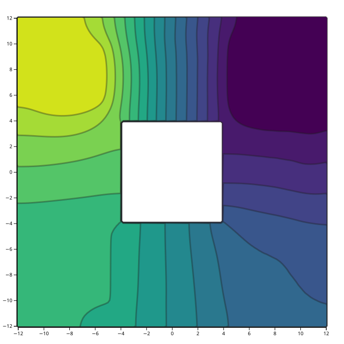

   Значения идут от 10 до 39.8. Белый квадрат в середине — это ``area5``,
   неопределённая намеренно; ячейки вне всех площадей тоже неопределены.

area_completer.py
^^^^^^^^^^^^^^^^^

То же сглаживание, но внутри одного полигона: ``area_completer`` ставит
completer с анизотропией (угол 30 градусов, ``w=2``) внутрь ``some_area``, а
обычный ``completer`` действует в остальной области. Одиннадцать точек
удерживают поверхность на данных.

.. tabs::

   .. tab:: Python

      .. literalinclude:: ../../examples/python/area_completer.py
         :language: python

   .. tab:: Tcl

      .. literalinclude:: ../../examples/surfit/tests/area_completer.tcl
         :language: tcl-src

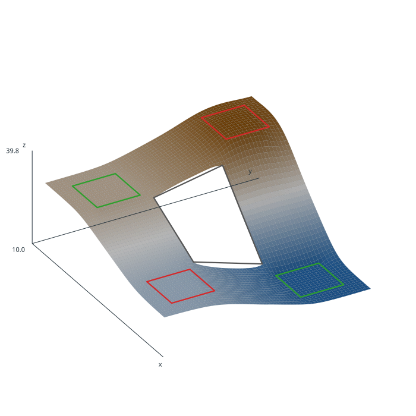

   Тот же пример с площадями в перспективе: затенённая поверхность и пять
   площадей. Дыра в середине — это ``area5``, неопределённая намеренно. Фигура
   строится из того же payload, что и карта выше, скриптом
   ``docs/surface3d.js``; d3 делает проекцию, затенение и порядок отрисовки.
   Контуры площадей плоские, на своих целевых значениях; горизонтальный
   прямоугольник в ортографической проекции выглядит параллелограммом.

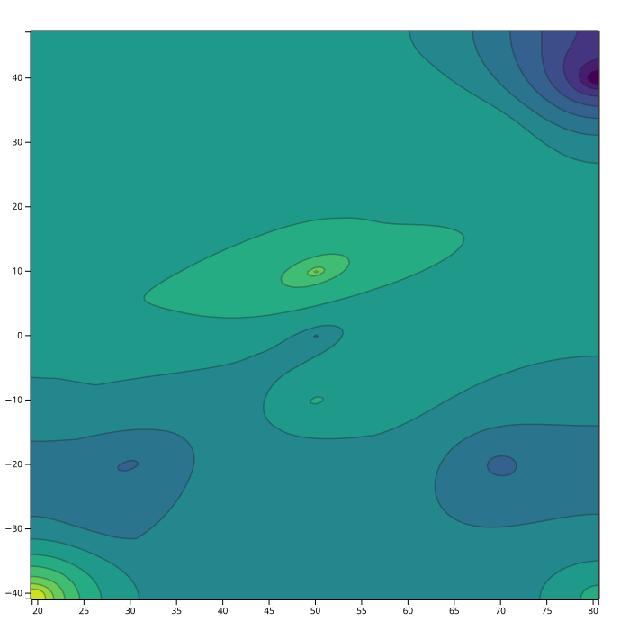

   Значения идут от -10 до 35.5. Внутри центральной площади изолинии вытянуты
   вдоль одного направления: сглаживание там предпочитает его.

area_ineq.py
^^^^^^^^^^^^

Пример с площадями и границами: ``area6`` просит значения от 15 до 20, но она
перекрывает ``area1`` и ``area3``, чьи точные значения (10 и 30) сильнее.
Неравенство изгибает остальную часть ``area6``, а сам скрипт сообщает, что
максимум внутри неё — 30.

.. tabs::

   .. tab:: Python

      .. literalinclude:: ../../examples/python/area_ineq.py
         :language: python

   .. tab:: Tcl

      .. literalinclude:: ../../examples/surfit/tests/area_ineq.tcl
         :language: tcl-src

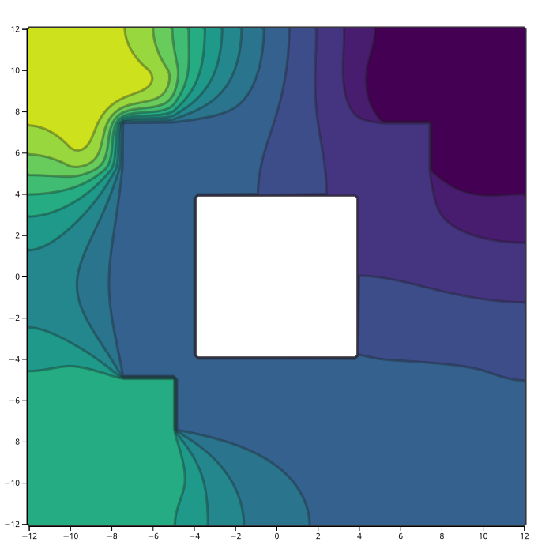

   Значения идут от 10 до 39.3. Полосы, которые добавляет неравенство, видны
   между точными площадями, а максимум внутри ``area6`` по-прежнему задаёт
   ``area3``.

area_mean.py
^^^^^^^^^^^^

Средние вместо точных значений: поверхность должна в среднем равняться 40
внутри ``area6`` и 30 по всей карте. Оба условия оставляют значение в каждом
отдельном узле свободным, поэтому карта глаже, чем вариант с точными значениями.

.. tabs::

   .. tab:: Python

      .. literalinclude:: ../../examples/python/area_mean.py
         :language: python

   .. tab:: Tcl

      .. literalinclude:: ../../examples/surfit/tests/area_mean.tcl
         :language: tcl-src

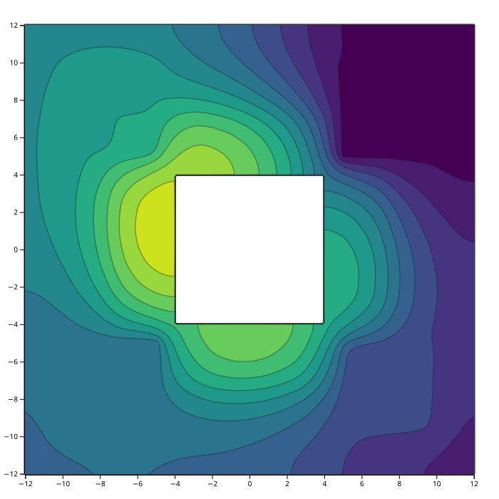

   Значения идут от 6.3 до 61.7. Оба средних выдержаны, а ``area6`` больше не
   привязана к одному числу.

area_wmean.py
^^^^^^^^^^^^^

То же среднее, но с поверхностью-весом: внутри ``area6`` поверхность в среднем
равна 30, а весом служит ``test_func``, поэтому среднее смещается туда, где эта
поверхность велика.

.. tabs::

   .. tab:: Python

      .. literalinclude:: ../../examples/python/area_wmean.py
         :language: python

   .. tab:: Tcl

      .. literalinclude:: ../../examples/surfit/tests/area_wmean.tcl
         :language: tcl-src

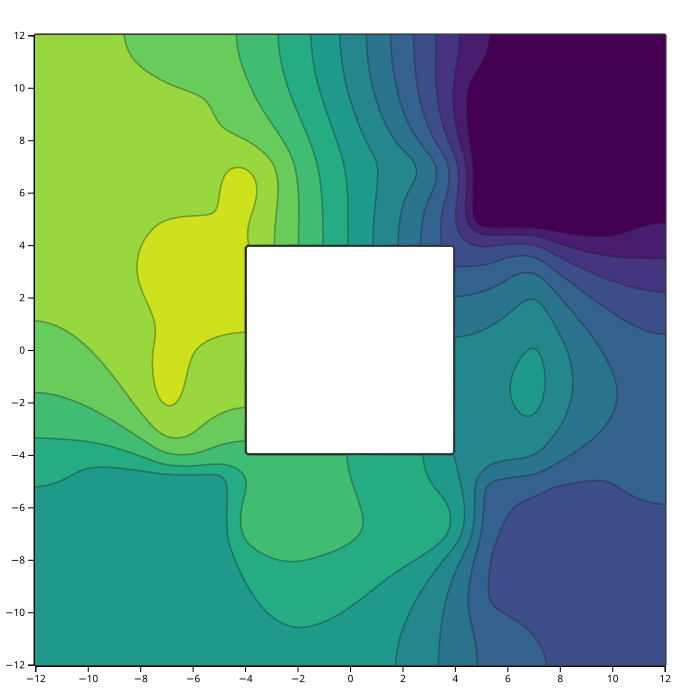

   Значения идут от 10 до 45.2: взвешенное среднее лежит ниже
   невзвешенного, потому что вес велик там, где ``test_func`` высок.

area_surf.py
^^^^^^^^^^^^

Поверхность как данные внутри площадей: результат точно следует ``test_func``
внутри ``area6`` и приближённо — внутри площадей 1–4, со своим весом для каждого
полигона.

.. tabs::

   .. tab:: Python

      .. literalinclude:: ../../examples/python/area_surf.py
         :language: python

   .. tab:: Tcl

      .. literalinclude:: ../../examples/surfit/tests/area_surf.tcl
         :language: tcl-src

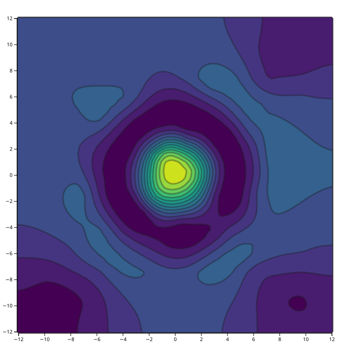

   Значения идут от -22.7 до 82.3 — это диапазон самого ``test_func``.

area_surf_ineq.py
^^^^^^^^^^^^^^^^^

Поверхность зажата между двумя копиями ``test_func``: выше неё в площадях 1, 3
и 5, ниже — в площадях 2, 4 и 6. Результат лежит внутри этого «бутерброда» и
гладок между площадями.

.. tabs::

   .. tab:: Python

      .. literalinclude:: ../../examples/python/area_surf_ineq.py
         :language: python

   .. tab:: Tcl

      .. literalinclude:: ../../examples/surfit/tests/area_surf_ineq.tcl
         :language: tcl-src

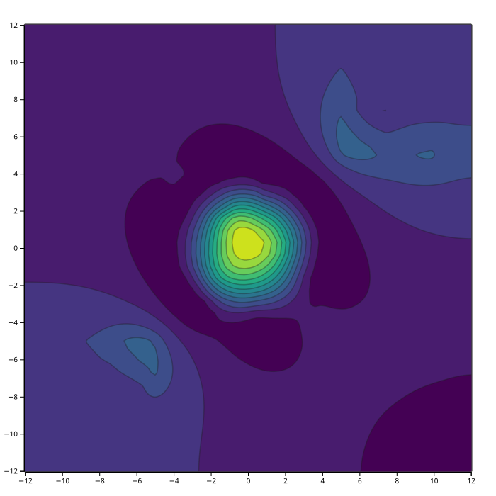

   Значения идут от -22.8 до 82.9. Две половины карты тянутся в разные стороны,
   а completer их сшивает.

Изолинии
~~~~~~~~

contour.py
^^^^^^^^^^

Три изолинии: малая и центральная учитываются точно, большая — с весом 0.5.
Изолиния несёт своё значение вдоль линии, и этим отличается от кривой.

.. tabs::

   .. tab:: Python

      .. literalinclude:: ../../examples/python/contour.py
         :language: python

   .. tab:: Tcl

      .. literalinclude:: ../../examples/surfit/tests/contour.tcl
         :language: tcl-src

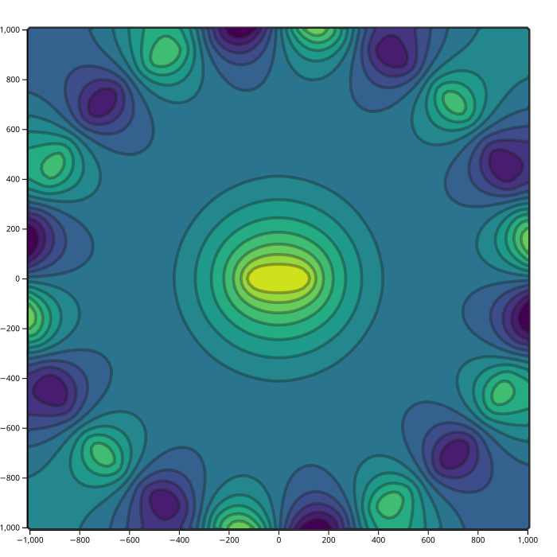

   Значения идут от -0.7 до 1. Три кольца — это сами изолинии; пространство
   между ними заполняет ``completer``.

contour_ineq.py
^^^^^^^^^^^^^^^

Два набора изолиний вместо одного: нижний набор задаёт нижнюю границу, а верхний,
сдвинутый на 0.2, — верхнюю, поэтому поверхности достаточно оставаться между
ними, а не касаться каждой.

.. tabs::

   .. tab:: Python

      .. literalinclude:: ../../examples/python/contour_ineq.py
         :language: python

   .. tab:: Tcl

      .. literalinclude:: ../../examples/surfit/tests/contour_ineq.tcl
         :language: tcl-src

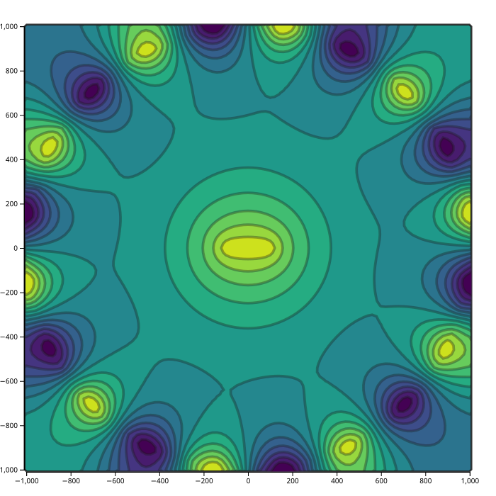

   Значения идут от -0.9 до 1.1 — шире, чем у варианта с равенствами: границы
   позволяют поверхности уйти за каждое кольцо на расстояние между наборами.

Кривые
~~~~~~

curve.py
^^^^^^^^

Четыре изолинии как данные: три несут точное значение (10, 50 и 30), четвёртая
добавлена с весом 0.5. Кривая двумерна, поэтому значение берётся из правила, а
не из линии, — этим она и отличается от изолинии.

.. tabs::

   .. tab:: Python

      .. literalinclude:: ../../examples/python/curve.py
         :language: python

   .. tab:: Tcl

      .. literalinclude:: ../../examples/surfit/tests/curve.tcl
         :language: tcl-src

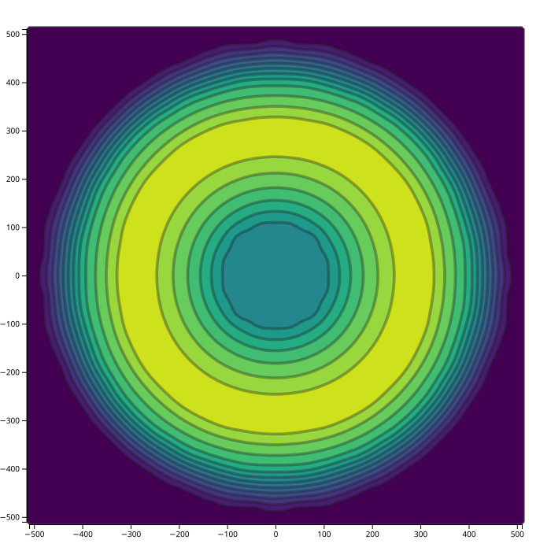

   Значения идут от 8.8 до 50. Поверхность доходит до самой высокой кривой и
   тянется к взвешенной, но не обязана на неё лечь.

curve_ineq.py
^^^^^^^^^^^^^

Пример с кривыми и неравенствами: значения вдоль тех же четырёх изолиний
становятся нижними и верхними границами, поэтому результат обязан соблюдать
только их порядок.

.. tabs::

   .. tab:: Python

      .. literalinclude:: ../../examples/python/curve_ineq.py
         :language: python

   .. tab:: Tcl

      .. literalinclude:: ../../examples/surfit/tests/curve_ineq.tcl
         :language: tcl-src

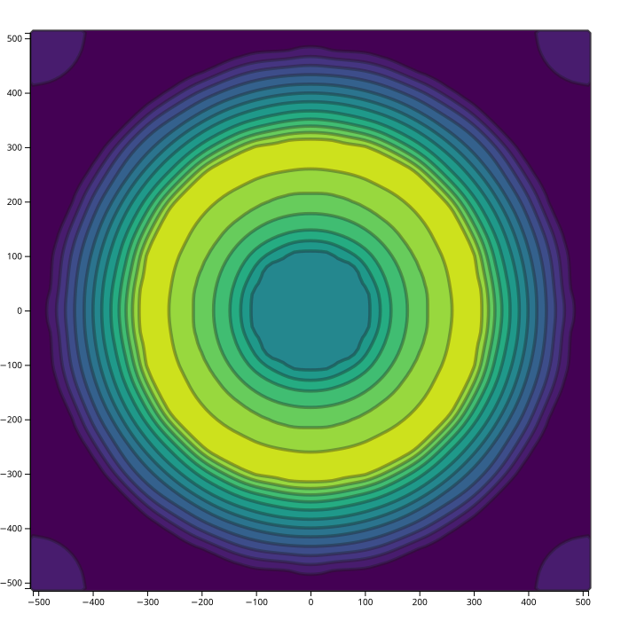

   Значения идут от 9.1 до 50.2 — близко к варианту с равенствами, но
   поверхность вольна обходить линии, а не проходить через них.

curve_surf.py
^^^^^^^^^^^^^

Кривые берут значения с другой поверхности: результат следует ``test_func``
вдоль ``spiral`` и делает это с весом 0.5 вдоль ``spiral2``. Сетка строится по
данным, поэтому покрывает обе спирали.

.. tabs::

   .. tab:: Python

      .. literalinclude:: ../../examples/python/curve_surf.py
         :language: python

   .. tab:: Tcl

      .. literalinclude:: ../../examples/surfit/tests/curve_surf.tcl
         :language: tcl-src

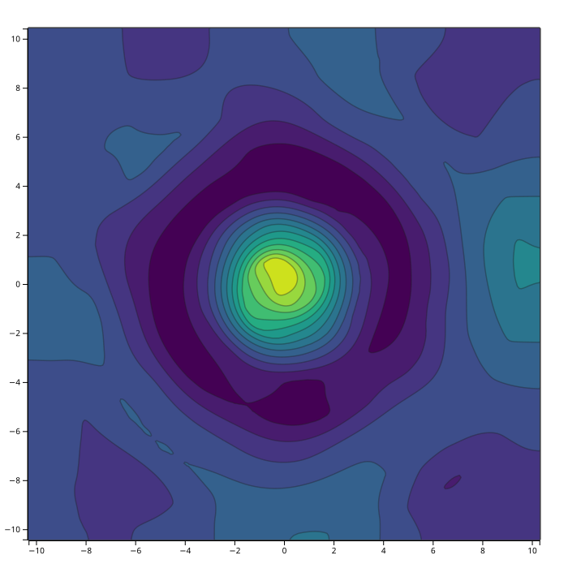

   Значения идут от -21.2 до 81.8. Спираль — это гребень, где ``test_func``
   соблюдается точно.

curve_surf_ineq.py
^^^^^^^^^^^^^^^^^^

Неравенства со значениями с другой поверхности: выше ``test_func`` вдоль
``spiral2`` и ниже неё вдоль ``spiral``. Две спирали чередуются, поэтому
результат продет между ними.

.. tabs::

   .. tab:: Python

      .. literalinclude:: ../../examples/python/curve_surf_ineq.py
         :language: python

   .. tab:: Tcl

      .. literalinclude:: ../../examples/surfit/tests/curve_surf_ineq.tcl
         :language: tcl-src

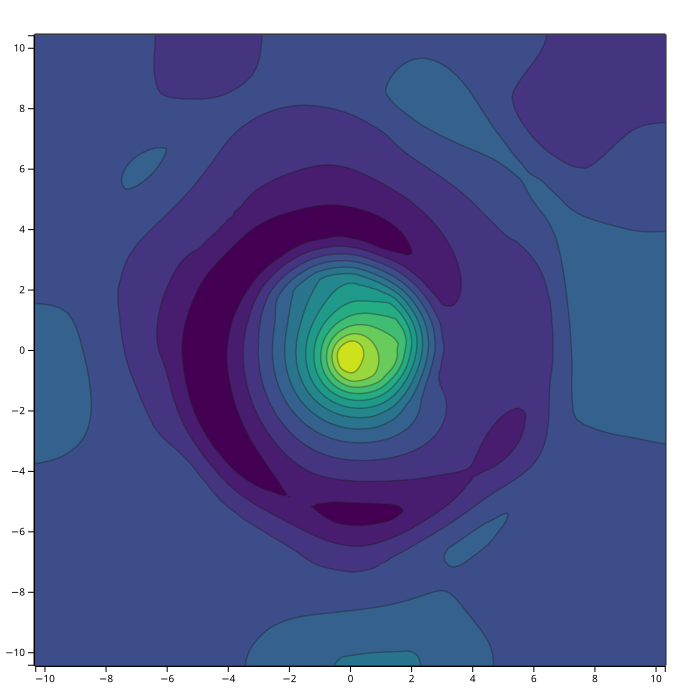

   Значения идут от -21.2 до 81.4. Поверхность проходит между спиралями, а не
   по ним.

Разрывы
~~~~~~~

faults.py
^^^^^^^^^

Одиннадцать точек и четыре линии разрывов. Поверхность обязана скачком
переходить через каждую линию, а не сглаживать её.

.. tabs::

   .. tab:: Python

      .. literalinclude:: ../../examples/python/faults.py
         :language: python

   .. tab:: Tcl

      .. literalinclude:: ../../examples/surfit/tests/fault.tcl
         :language: tcl-src

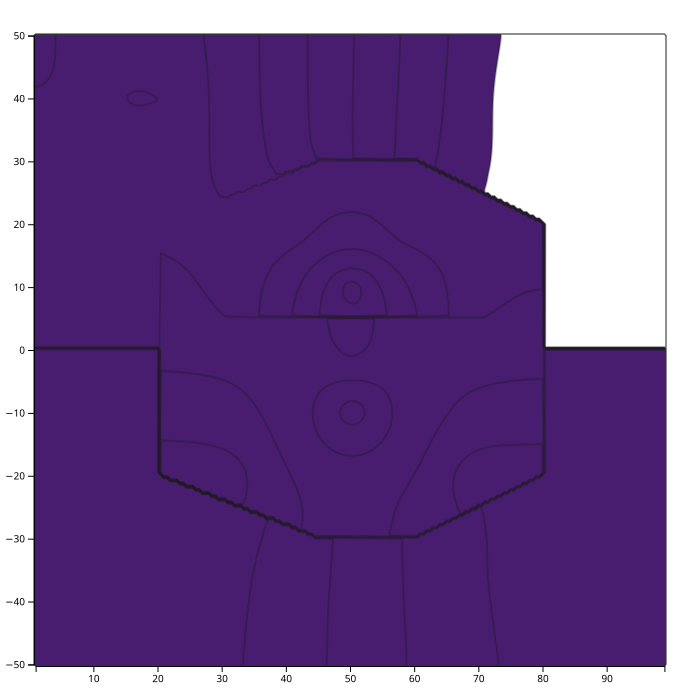

   Скачки — это резкие смены цвета вдоль границ многоугольников.

fault_aniso.py
^^^^^^^^^^^^^^

Пример с разрывами на более грубой сетке, с анизотропией в completer: внутри
каждого блока поверхность сглаживается вдоль 45 градусов, а не одинаково во всех
направлениях (угол анизотропии 45 градусов, аргумент веса 2).

.. tabs::

   .. tab:: Python

      .. literalinclude:: ../../examples/python/fault_aniso.py
         :language: python

   .. tab:: Tcl

      .. literalinclude:: ../../examples/surfit/tests/fault_aniso.tcl
         :language: tcl-src

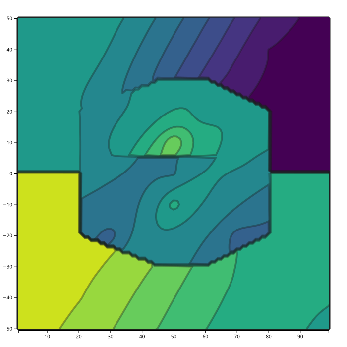

   Значения идут от -14.1 до 38.8. Скачки вдоль линий разрывов по-прежнему
   резкие, а сглаживание внутри блока предпочитает одно направление.

fault_approx.py
^^^^^^^^^^^^^^^

Пример с разрывами без точного условия в точках: они добавлены с весом, поэтому
поверхность может немного промахиваться мимо каждого замера.

.. tabs::

   .. tab:: Python

      .. literalinclude:: ../../examples/python/fault_approx.py
         :language: python

   .. tab:: Tcl

      .. literalinclude:: ../../examples/surfit/tests/fault_approx.tcl
         :language: tcl-src

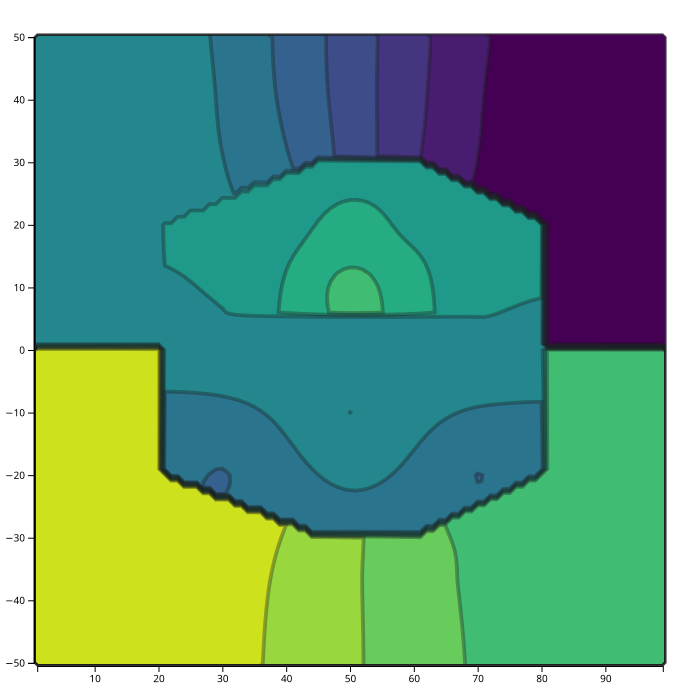

   Значения идут от -6.6 до 33.3. По сравнению с точным вариантом поверхность
   площе, и точки уже не лежат на ней.

Неравенства
~~~~~~~~~~~

ineq.py
^^^^^^^

Самый простой пример с неравенствами: семь точек, нижняя граница 80, верхняя
120 и completer между ними. Поверхность проходит через точки и всюду остаётся
внутри полосы.

.. tabs::

   .. tab:: Python

      .. literalinclude:: ../../examples/python/ineq.py
         :language: python

   .. tab:: Tcl

      .. literalinclude:: ../../examples/surfit/tests/ineq.tcl
         :language: tcl-src

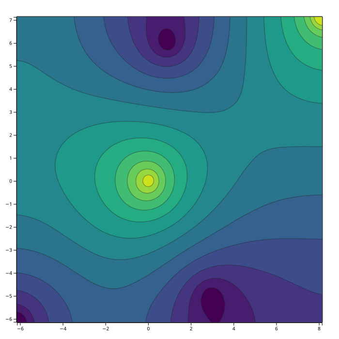

   Значения идут от 80 до 120: обе границы достигаются, но не нарушаются.

points_ineq.py
^^^^^^^^^^^^^^

Два набора измеренных точек как границы: поверхность должна оставаться выше
каждой точки одного набора и ниже каждой точки другого.

.. tabs::

   .. tab:: Python

      .. literalinclude:: ../../examples/python/points_ineq.py
         :language: python

   .. tab:: Tcl

      .. literalinclude:: ../../examples/surfit/tests/points_ineq.tcl
         :language: tcl-src

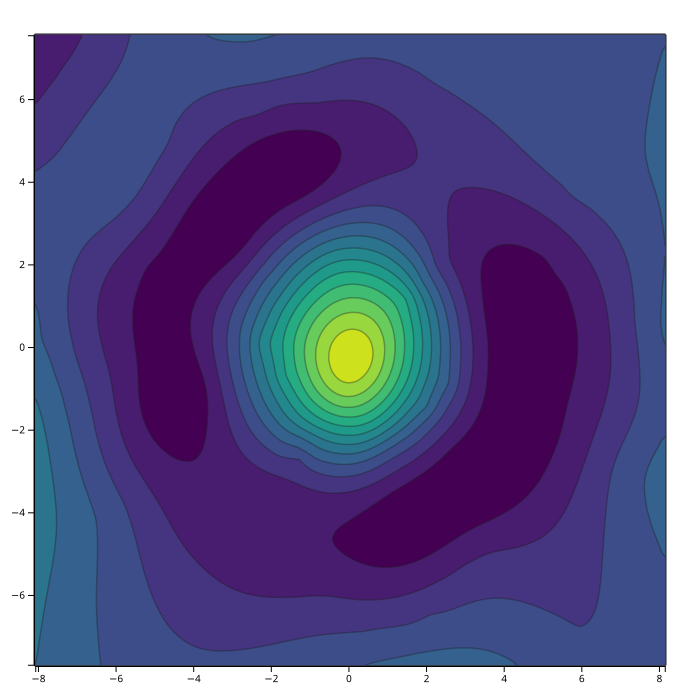

   Значения идут от -0.2 до 1. Два набора точек охватывают поверхность, и она
   остаётся между ними, не проходя ни через один.

Маски
~~~~~

mask.py
^^^^^^^

Растровая маска вырезает в поверхности дыру: там, где маска истинна, поверхность
остаётся неопределённой, а везде ещё следует ``test_func``.

.. tabs::

   .. tab:: Python

      .. literalinclude:: ../../examples/python/mask.py
         :language: python

   .. tab:: Tcl

      .. literalinclude:: ../../examples/surfit/tests/mask.tcl
         :language: tcl-src

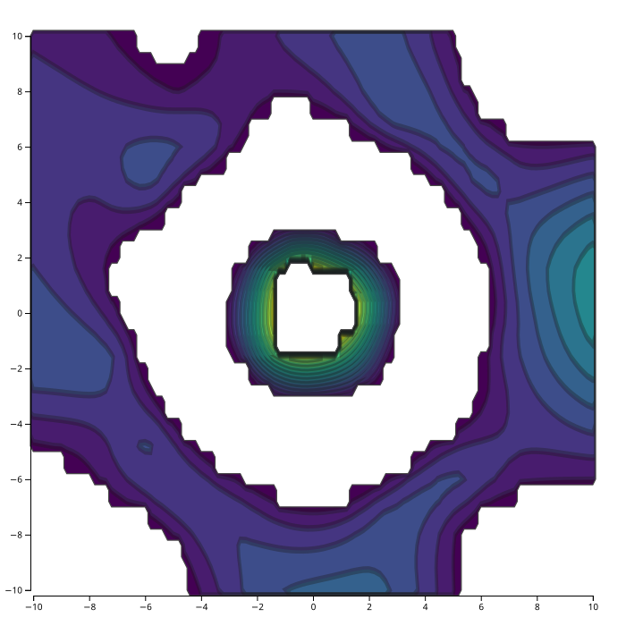

   Значения идут от -3.3 до 61.6 на 3031 узле из 5151: пропавшие узлы — это
   маска, а не сбой решения.

mask_add.py
^^^^^^^^^^^

Правило значения, ограниченное маской: там, где маска истинна, поверхность
тянется к 3 с весом 0.2, а в остальном, как и раньше, следует ``test_func``.

.. tabs::

   .. tab:: Python

      .. literalinclude:: ../../examples/python/mask_add.py
         :language: python

   .. tab:: Tcl

      .. literalinclude:: ../../examples/surfit/tests/mask_add.tcl
         :language: tcl-src

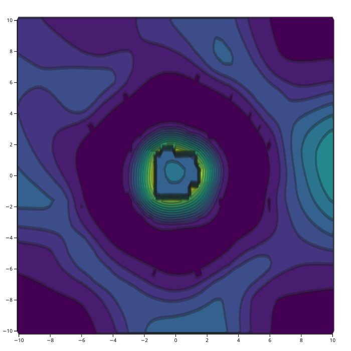

   Значения идут от -6.7 до 61.6. Взвешенное правило опускает поверхность
   внутри маски, не стирая её форму.

mask_completer.py
^^^^^^^^^^^^^^^^^

Completer, действующий только внутри маски, с анизотропией: там, где маска
истинна, поверхность сглаживается вдоль 30 градусов, а не одинаково во всех
направлениях (угол анизотропии 30 градусов, аргумент веса 2).

.. tabs::

   .. tab:: Python

      .. literalinclude:: ../../examples/python/mask_completer.py
         :language: python

   .. tab:: Tcl

      .. literalinclude:: ../../examples/surfit/tests/mask_completer.tcl
         :language: tcl-src

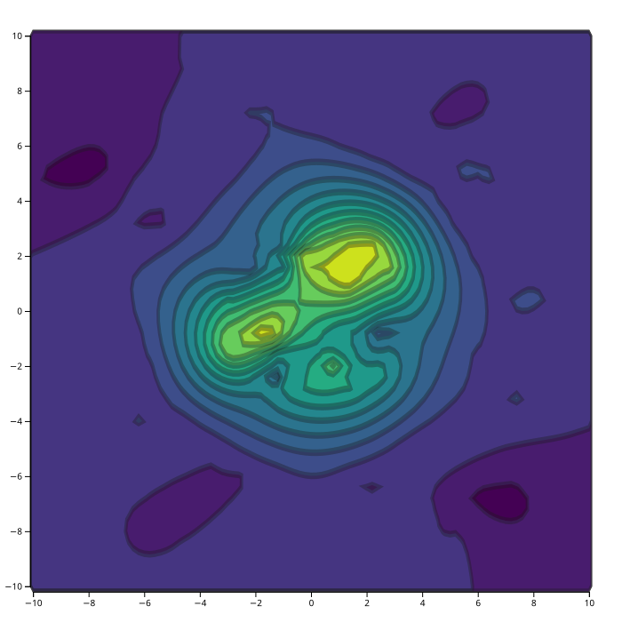

   Значения идут от 0 до 0.5. Одни точки дали бы шумную карту; внутри маски
   анизотропный completer её сглаживает.

mask_ineq.py
^^^^^^^^^^^^

Неравенство под маской: там, где маска истинна, поверхность должна быть не ниже
-10, а в остальном она следует ``test_func``.

.. tabs::

   .. tab:: Python

      .. literalinclude:: ../../examples/python/mask_ineq.py
         :language: python

   .. tab:: Tcl

      .. literalinclude:: ../../examples/surfit/tests/mask_ineq.tcl
         :language: tcl-src

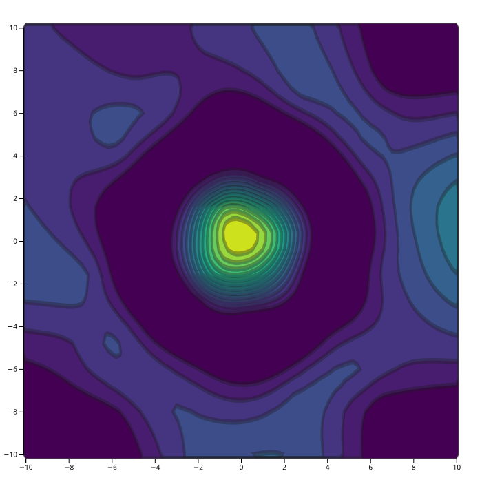

   Значения идут от -10.0 до 82.3. Внутри маски пол точно достигается, а
   остальная карта следует ``test_func``.

mask_mean.py
^^^^^^^^^^^^

Среднее под маской: там, где маска истинна, поверхность в среднем равна -2, а
точки в остальной области учитываются точно.

.. tabs::

   .. tab:: Python

      .. literalinclude:: ../../examples/python/mask_mean.py
         :language: python

   .. tab:: Tcl

      .. literalinclude:: ../../examples/surfit/tests/mask_mean.tcl
         :language: tcl-src

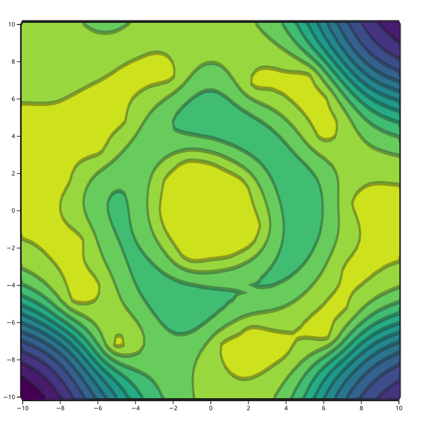

   Значения идут от -7.6 до 0.6. Точки лежат около нуля, а маска тянет среднее
   вниз до -2.

mask_surf.py
^^^^^^^^^^^^

Правило поверхности под маской: там, где маска истинна, результат равен
``test_func``, а в остальном работает completer.

.. tabs::

   .. tab:: Python

      .. literalinclude:: ../../examples/python/mask_surf.py
         :language: python

   .. tab:: Tcl

      .. literalinclude:: ../../examples/surfit/tests/mask_surf.tcl
         :language: tcl-src

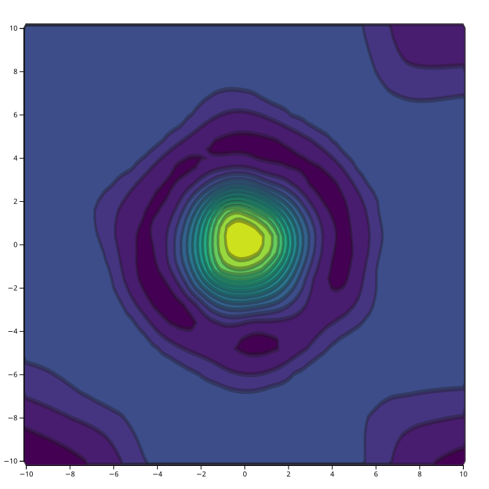

   Значения идут от -27.5 до 82.3. Маска сохраняет ``test_func``, а completer
   плавно продолжает её на остальную сетку.

mask_surf_add.py
^^^^^^^^^^^^^^^^

Взвешенное правило поверхности под маской: сначала идёт completer, а
``test_func`` добавляется к нему с весом 1 там, где маска истинна.

.. tabs::

   .. tab:: Python

      .. literalinclude:: ../../examples/python/mask_surf_add.py
         :language: python

   .. tab:: Tcl

      .. literalinclude:: ../../examples/surfit/tests/mask_surf_add.tcl
         :language: tcl-src

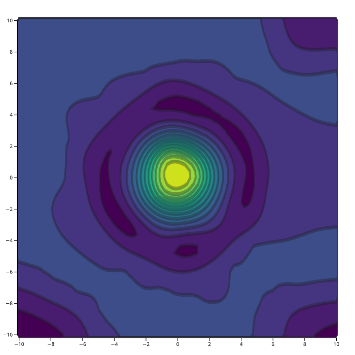

   Значения идут от -26.3 до 78.5 — чуть менее резкие, чем у точного правила,
   потому что completer тоже участвует.

mask_surf_ineq.py
^^^^^^^^^^^^^^^^^

Неравенство относительно поверхности под маской: там, где маска истинна,
результат остаётся не выше ``test_func``, а точки задают его в остальной области.

.. tabs::

   .. tab:: Python

      .. literalinclude:: ../../examples/python/mask_surf_ineq.py
         :language: python

   .. tab:: Tcl

      .. literalinclude:: ../../examples/surfit/tests/mask_surf_ineq.tcl
         :language: tcl-src

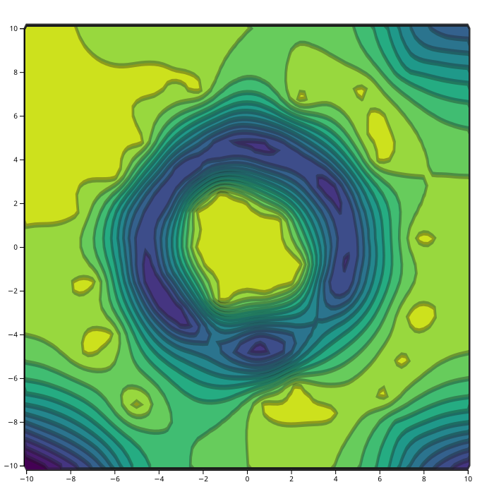

   Значения идут от -27.5 до 1.9. В области маски поверхность ограничена сверху
   ``test_func``, а точки держат остальное около нуля.

mask_wmean.py
^^^^^^^^^^^^^

Взвешенное среднее под маской: поверхность в среднем равна 2 там, где истинна
``mask_not``, с весом ``test_func``, а точки учитываются точно.

.. tabs::

   .. tab:: Python

      .. literalinclude:: ../../examples/python/mask_wmean.py
         :language: python

   .. tab:: Tcl

      .. literalinclude:: ../../examples/surfit/tests/mask_wmean.tcl
         :language: tcl-src

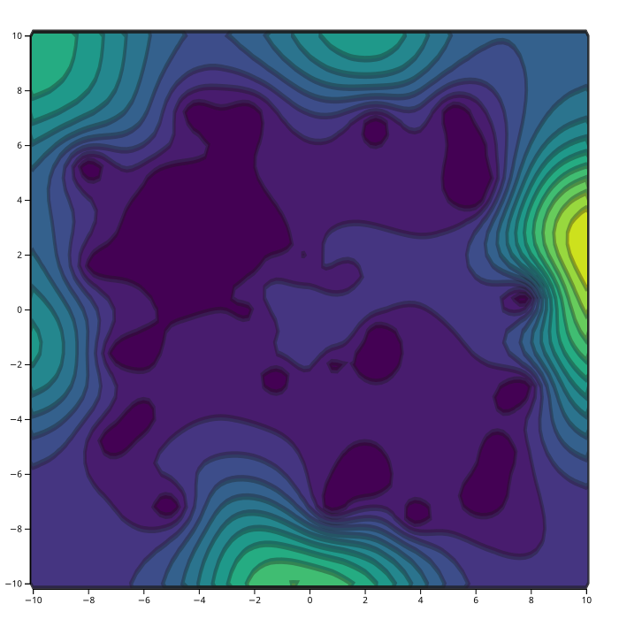

   Значения идут от 0 до 6.2. Взвешенное среднее поднимает околонулевые точки
   к 2.

Средние
~~~~~~~

mean.py
^^^^^^^

Среднее как условие гриддинга: поверхность проходит через семь точек, а её
среднее по всей карте равно 30.

.. tabs::

   .. tab:: Python

      .. literalinclude:: ../../examples/python/mean.py
         :language: python

   .. tab:: Tcl

      .. literalinclude:: ../../examples/surfit/tests/mean.tcl
         :language: tcl-src

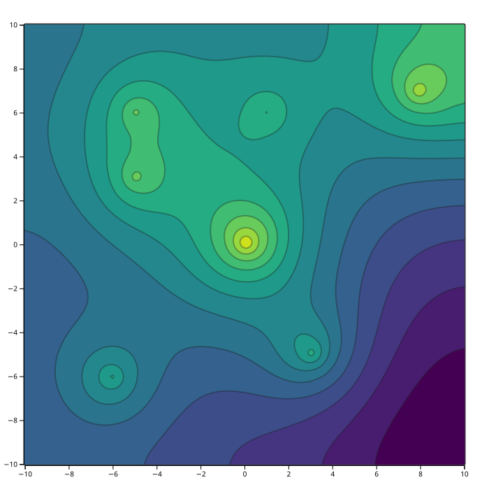

   Значения идут от -57.0 до 140. Такой широкий диапазон и нужен, чтобы среднее
   было 30, а поверхность при этом проходила через точки.

wmean.py
^^^^^^^^

Взвешенное среднее: поверхность проходит через семь точек, а её среднее равно
30 с весом ``test_func``, поэтому среднее смещается туда, где эта поверхность
велика.

.. tabs::

   .. tab:: Python

      .. literalinclude:: ../../examples/python/wmean.py
         :language: python

   .. tab:: Tcl

      .. literalinclude:: ../../examples/surfit/tests/wmean.tcl
         :language: tcl-src

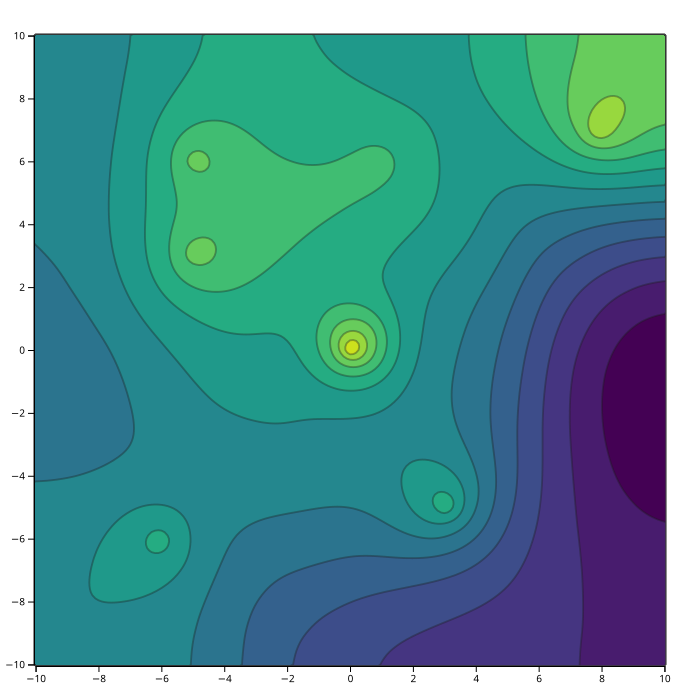

   Значения идут от -71.7 до 140. Взвешенное среднее уходит ниже невзвешенного,
   чтобы скомпенсировать большие значения там, где вес велик.

Поверхности
~~~~~~~~~~~

surface.py
^^^^^^^^^^

Поверхность как данные: результат следует за ``test_func`` в смысле наименьших
квадратов и стремится к плоскости там, где поверхность ничего не подсказывает.

.. tabs::

   .. tab:: Python

      .. literalinclude:: ../../examples/python/surface.py
         :language: python

   .. tab:: Tcl

      .. literalinclude:: ../../examples/surfit/tests/surface.tcl
         :language: tcl-src

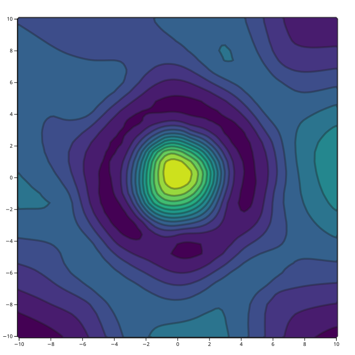

   Поверхность гладкая, но не плоская: изолинии сгущаются там, где ``test_func``
   меняется быстрее всего, а карта идёт от -27.5 до 82.3.

surface_add.py
^^^^^^^^^^^^^^

Поверхность, добавленная с малым весом: один completer дал бы плоскость, а
``test_func`` слегка изгибает её к своей форме.

.. tabs::

   .. tab:: Python

      .. literalinclude:: ../../examples/python/surface_add.py
         :language: python

   .. tab:: Tcl

      .. literalinclude:: ../../examples/surfit/tests/surface_add.tcl
         :language: tcl-src

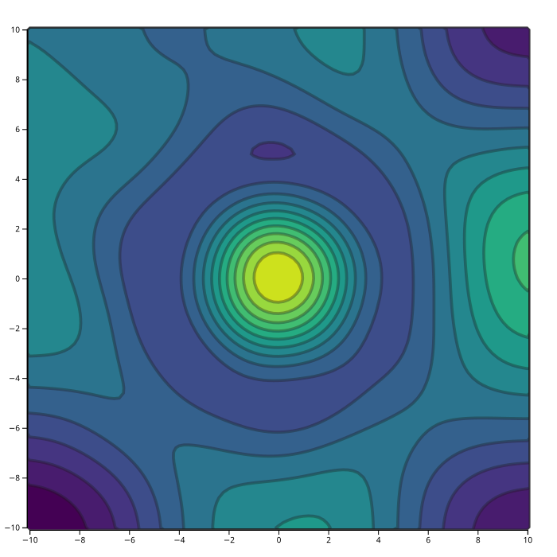

   Значения идут от -12.5 до 27.7 — диапазон много уже, чем у самого
   ``test_func``: вес 0.01 удерживает результат рядом с плоскостью.

surface_ineq.py
^^^^^^^^^^^^^^^

Пример с поверхностью и неравенством: ``test_func``, сдвинутая на 80, задаёт
нижнюю границу, поэтому результат лежит выше неё, а семь точек учитываются
точно. Вторая копия, сдвинутая на 90, загружается скриптом, но ни одно правило
её не использует.

.. tabs::

   .. tab:: Python

      .. literalinclude:: ../../examples/python/surface_ineq.py
         :language: python

   .. tab:: Tcl

      .. literalinclude:: ../../examples/surfit/tests/surface_ineq.tcl
         :language: tcl-src

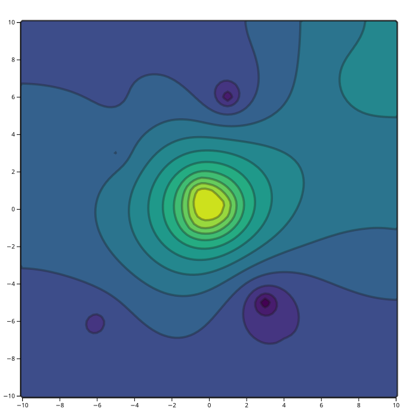

   Значения идут от 72.4 до 162.3. Граница — это ``test_func`` плюс 80, и самая
   высокая точка результата лежит ровно на ней.

Тренды
~~~~~~

trend.py
^^^^^^^^

Разрывы под региональным трендом: семь точек и две линии разрывов, а результат
обязан на крупном масштабе походить на ``test_func``. Разрывы не дают тренду
остаться непрерывным.

.. tabs::

   .. tab:: Python

      .. literalinclude:: ../../examples/python/trend.py
         :language: python

   .. tab:: Tcl

      .. literalinclude:: ../../examples/surfit/tests/trend.tcl
         :language: tcl-src

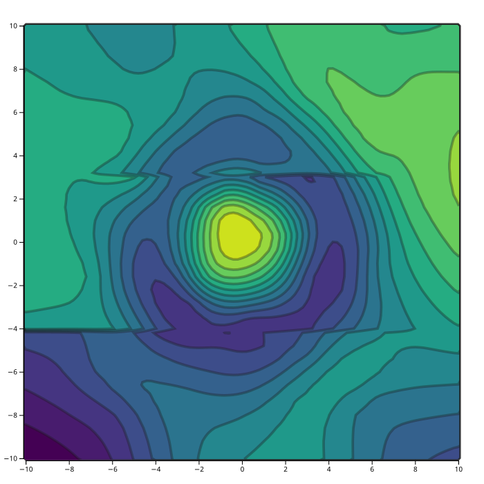

   Значения идут от 29.0 до 142.7. Форму задаёт тренд, а две линии разрывов
   видны как ступени в нём.

trend_from_numpy.py
^^^^^^^^^^^^^^^^^^^

Региональный тренд, переданный массивом numpy, семь скважин, учтённых точно, и
результат, прочитанный обратно в массив.

.. literalinclude:: ../../examples/python/trend_from_numpy.py
   :language: python

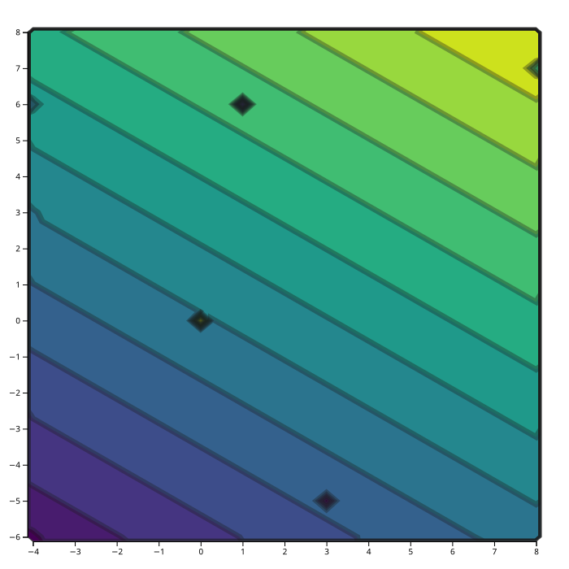

   Плоскость идёт от 67 до 140. Маленькие тёмные ромбы — это скважины: их
   замеры лежат вне плоскости, поэтому каждая локально тянет поверхность вниз,
   а не сглаживается.

Прочее
~~~~~~

progress.py
^^^^^^^^^^^

Показывает ход решения; раздел «Прогресс» выше объясняет два режима. Его вывод —
текст, а не карта:

.. code-block:: text

   -- cg (65536 cells)
      cg (65536 cells): iter 33, err 4.92211E-06

.. literalinclude:: ../../examples/python/progress.py
   :language: python

viewer.py
^^^^^^^^^

Пишет интерактивную HTML-страницу. Это тот же расчёт, что и в ``area.py``, —
отличается только вывод, — поэтому первая карта выше и есть то, что он рисует,
с подсказкой под курсором и вырезанными неопределёнными ячейками.

.. literalinclude:: ../../examples/python/viewer.py
   :language: python

Ловушки API
~~~~~~~~~~~

Создание :class:`Session` начинает новую задачу в вызывающем потоке. Данные,
загруженные в module-level состояние этого потока до неё, в задачу не входят::

    surfit.area_read("area6.txt", "area6")
    task = surfit.Session(...)      # area6 больше нет в памяти
    task.area_leq(20, "area6")      # пустой список: площадь не найдена

Сначала создайте сессию, потом загружайте данные через неё::

    task = surfit.Session(...)
    task.area_read("area6.txt", "area6")
    task.area_leq(20, "area6")      # [True], правило применяется

``names()`` возвращает имена **поверхностей**, а не площадей. Поэтому после
загрузки площадей он всё ещё пуст; смотрите ``area_size()`` и
``area_getName("*")``. ``area_leq``/``area_geq`` возвращают по флагу на каждую
найденную площадь, а при несовпадении имени — пустой список. Исключения они не
бросают: проверяйте возврат, иначе правило молча ничего не делает.

Замечания о том, как устроены привязки и как они проверяются, — в
:doc:`development`.
