Python
======

.. code-block:: python

   import surfit

   task = surfit.Session(map_name="map_area", tol=5.01187e-06)

   for name in ("area1", "area2", "area3", "area4", "area5"):
       task.read_areas("data/%s.txt" % name, name)

   task.grid(-12, 12, 0.2, -12, 12, 0.2)

   task.area(10, "area1")             # равно 10 внутри area1
   task.area(30, "area3")
   task.area("undef", "area5")        # area5 остаётся неопределённой
   task.completer(1, 1.6)             # стремиться к константе или плоскости
   task.area_add(20, 0.07, "area2")   # приблизить, с весом
   task.area_add(40, 0.07, "area4")

   task.solve()
   task.save("area.dat")

   grid = task.values()               # numpy, (count_y, count_x), float64

Как устроен API
---------------

В задаче три фазы, и порядок обязателен:

#. **Загрузить данные.** ``read_areas``, ``read_points``, ``read_curves``,
   ``read_contours``, ``surf_load``, ``mask_load`` или массив через
   ``add_surface``.
#. **Задать сетку** через ``grid`` для явных границ или ``grid_auto``, чтобы
   подогнать её под загруженные данные (Tcl-команда ``grid``), и добавить
   правила.
#. **Решить** через ``solve``, затем прочитать или сохранить результат.

Типы данных, с которыми работает первая фаза, описаны в :doc:`data_types`;
метод, на котором стоит третья, — в :doc:`how_it_works`.

Каждая команда Tcl-фронтенда доступна и как метод сессии под тем же именем,
так что ``task.points("wells")`` означает то же, что ``points("wells")``.
Исключение одно — ``grid``: метод с таким именем строит явную сетку (Tcl-команда
``grid_get``), а Tcl-команде ``grid`` соответствует ``grid_auto``.

Правила
-------

Правило описывает требование к результирующей поверхности. Семейства
различаются тем, где условие действует:

.. list-table::
   :header-rows: 1
   :widths: 22 78

   * - Семейство
     - Смысл
   * - ``points``
     - поверхность проходит через измеренные точки или рядом с ними
   * - ``curve``, ``contour``
     - поверхность равна значению вдоль кривой или изолинии
   * - ``area``
     - поверхность равна значению внутри полигона
   * - ``surface``, ``trend``
     - поверхность следует другой поверхности или подобранному тренду
   * - ``mask``
     - правило действует только там, где указывает растровая маска
   * - ``fault``
     - вдоль линии поверхность может иметь разрыв
   * - ``completer``
     - поверхность остаётся гладкой между остальными условиями
   * - ``leq``, ``geq``, ``mean``, ``wmean``, ``hist``
     - глобальные границы, средние и подгонка под гистограмму

У большинства семейств есть варианты: обычная команда добавляет правило,
``_add`` добавляет его с весом и объединяет с предыдущим, а ``_leq`` / ``_geq``
превращают условие в неравенство.

Каждая команда возвращает список флагов по объектам. Результат ``[False]``
означает, что шаблон имени ни с чем не совпал и правило **не добавлено** —
исходный Tcl-фронтенд это молча игнорирует, поэтому при странном результате
на флаги стоит посмотреть.

Массивы на входе и выходе
-------------------------

``values()`` возвращает последнюю созданную поверхность как массив
``(count_y, count_x)`` типа float64. Без шаблона это результат последнего
решения; иначе первой попалась бы, например, тренд-поверхность, добавленная по
пути. Явный шаблон имени выбирает нужную:

.. code-block:: python

   grid = task.values()               # результат
   trend = task.values("regional")    # именованная поверхность

Узлы вне данных неопределены и содержат ``surfit.UNDEF_VALUE``, то есть
``FLT_MAX``. Определённые выбирает ``surfit.defined_mask(grid)``:

.. code-block:: python

   defined = surfit.defined_mask(grid)
   print(grid[defined].min(), grid[defined].max())

В обратную сторону массив уходит через ``add_surface``. Он регистрируется как
именованная поверхность и дальше может использоваться как тренд или источник
неравенств:

.. code-block:: python

   import numpy as np

   trend = np.linspace(100.0, 120.0, 40 * 50).reshape(40, 50)
   task.add_surface(trend, start_x=0.0, step_x=25.0,
                    start_y=0.0, step_y=25.0, name="regional")
   task.surface("regional")

Число узлов берётся из формы массива: границы вычисляются по началу и шагу,
поэтому сетка совпадает точно.

Форматы файлов
--------------

Загрузчики и сохранялки плагина форматов доступны под своими именами из Tcl:

.. code-block:: python

   surfit.area_load_shp("zones.shp", "zones")
   surfit.cntr_load_shp("isolines.shp", "iso")
   surfit.surf_load_grd("surface.grd", "top")
   surfit.surf_save_grd("smoothed.grd", "top")

Полный список — в :doc:`formats`.

Цифровые модели рельефа и потоки
--------------------------------

Две библиотеки, которые Tcl-фронтенд загружает плагинами, ``globe`` (DEM) и
``freeflow`` (потоки), слинкованы с расширением, поэтому их команды доступны
сразу после ``import surfit`` и под теми же именами:

.. code-block:: python

   surfit.surf_to_dem("top")            # DEM из посчитанной поверхности
   surfit.dem_getCountX("top")
   surfit.dem_minz("top")
   surfit.dem_save_grd("top.grd", "top")

   surfit.dem_load_hgt("N00E006.hgt")   # DEM из тайла SRTM
   surfit.grid_get(6.4, 6.8, 0.0005, 0.0, 0.48, 0.0005)
   surfit.dem("N00E006.hgt")            # правило: следовать DEM
   surfit.completer()
   surfit.surfit()

   surfit.lcm_simple(1, 1, 1)           # правило: закон сохранения массы
   surfit.flow_points("wells")          # привязать данные потока к правилу
   surfit.surf_debit(0.0, 0.0, 1, 1, 1, "pressure")

Два замечания:

* ``dem_load_hgt_zip`` требует zlib. Сборка CMake включает его, если
  ``find_package(ZLIB)`` находит библиотеку; иначе команда сообщает
  «zlib not detected» и ничего не возвращает.
* DEM принадлежат задаче. У каждой сессии свой контейнер, поэтому две сессии
  могут загрузить разные растры под одним именем, а закрытие одной не трогает
  DEM другой. Модульные вызовы выше работают с контейнером самой библиотеки —
  там живёт DEM, загруженный вне сессии; новая сессия начинает без DEM. Правила,
  которые создают команды ``freeflow``, — обычные правила и принадлежат сессии.

Примеры потоков, с картами и объяснением каждого правила, — на странице
:doc:`flows`; примеры рельефа — на :doc:`terrain`.

Несколько задач
---------------

У каждой сессии своё состояние, поэтому две задачи могут жить в одном процессе
и не мешать друг другу:

.. code-block:: python

   first = surfit.Session("first")
   second = surfit.Session("second")

   first.read_areas("data/area1.txt", "area1")
   second.read_areas("data/area2.txt", "area1")

   first.solve()
   second.solve()

   first_grid = first.values()
   second_grid = second.values()

Каждый вызов через сессию сначала подставляет состояние этой задачи, поэтому
вызовы можно чередовать в любом порядке; результат совпадает с тем, что дал бы
каждый расчёт по отдельности. Именно это и проверяет
``src/pysurfit/tests/test_sessions.py``, сравнивая чередующиеся сетки побайтово
с одиночными прогонами в отдельных процессах.

Активно состояние только одно за раз — на этом и держится дешёвое
переключение. Каждый вызов сессии держит общий на процесс замок вокруг
переключения и самой команды, поэтому две сессии можно вести из двух потоков:
вызовы сериализуются, а решение блокирует вызовы второй сессии до своего
завершения. GIL при этом отпускается, так что потоки Python, не трогающие
surfit, продолжают работать.

Замок относится к вызовам сессии. Функция уровня модуля вроде
``surfit.area(...)`` по-прежнему работает с активным состоянием и не защищена;
если движок делят несколько потоков, используйте сессию.

Базы данных
-----------

``read_postgis`` читает точки через клиент ``psql``, поэтому драйвер Python и
дополнительные пакеты не нужны. Запрос должен возвращать x, y и z именно в
таком порядке; это может быть геометрия PostGIS или обычные колонки:

.. code-block:: python

   task.read_postgis(
       "service=surfit dbname=gis",
       """SELECT ST_X(geom), ST_Y(geom), COALESCE(ST_Z(geom), 0)
          FROM wells WHERE geom IS NOT NULL""",
       name="wells")

Вызов запускает ``psql --no-password`` в транзакции только для чтения и отдаёт
CSV тому же загрузчику, что и ``pnts_read``. Пароль берётся из ``.pgpass`` или
service-файла; не вписывайте его в строку подключения. Подключение уже должно
работать как ``psql -w``; если он просит пароль, сначала почините passfile или
service-запись. Результат, в котором не
ровно три числовые колонки, NULL-координата или пустой ответ — это ошибка, а не
пустая загрузка.

Весь результат забирается до того, как его увидит движок, поэтому очень
большую таблицу читайте порциями (``WHERE id BETWEEN ...``). ``psql`` должен
быть в ``PATH``; это зависимость клиента, а не Python. В движке нет CRS:
возвращайте координаты в единицах сетки или преобразуйте их в SQL через
``ST_Transform``. При вызове ``task.read_postgis(...)`` выборка идёт под замком
состояния сессии, поэтому другие сессии ждут завершения запроса.

Прогресс
--------

За решением можно наблюдать по ходу:

.. code-block:: python

   with surfit.progress():
       task.solve()

Движок сообщает о каждом решении и каждой итерации через своё логирование, а
контекстный менеджер превращает это в прогресс: фаза и размер сетки, номер
итерации и текущая невязка.

Где этот прогресс виден, зависит от того, куда идёт вывод, — и это стоит знать,
потому что случаи действительно разные:

``style="bar"``
    полоса tqdm, перерисовываемая на месте через возврат каретки. То, что нужно
    на терминале; требует tqdm (``pip install surfit[progress]``).
``style="lines"``
    по строке на событие, не чаще чем раз в ``every`` секунд. Для логов CI,
    блокнотов и вообще всюду, где вывод **захватывается**, а не показывается.
``style=None`` (по умолчанию)
    полоса, если stderr — терминал, иначе строки.

При ``style="bar"`` на терминале прогон заканчивается строкой вроде этой:

.. code-block:: text

   cg (14641 cells): 113iter [00:00, 347iter/s, err 4.99215E-06]

Решатель не знает заранее, сколько будет итераций, поэтому полоса считает
итерации, а невязку показывает в postfix, вместо того чтобы заполняться до
процентов.

Перерисовываемая полоса выживает только на терминале. В захваченном потоке
возвраты каретки накладывают кадры друг на друга, и остаётся лишь последний,
поэтому по умолчанию режим переключается на строки сам:

.. code-block:: text

   -- cg (65536 cells)
      cg (65536 cells): iter 33, err 4.92211E-06
   -- cg (231361 cells)
      cg (231361 cells): iter 17, err 4.63839E-06

Наблюдатель видит то, что пропускает текущий уровень логирования: молчащий лог
означает молчащий прогресс.

Тот же хук доступен напрямую, для собственного логирования:

.. code-block:: python

   surfit.set_log_handler(lambda level, message: print(level, message))
   task.solve()
   surfit.clear_log_handler()

Он вызывается, пока решение идёт с отпущенным GIL, поэтому может прийти из
другого потока; держите его коротким, он работает внутри решателя.

Просмотр результата
-------------------

Результат можно записать страницей, которая открывается в браузере:

.. code-block:: python

   task.save_viewer("map.html", title="area example", levels=14)

Страница рисует карту заливкой по изолиниям, с настоящими координатами на осях,
подсказкой с x, y и значением под курсором и вырезанной областью, где значения
не определены. Сетка встроена в страницу как float64, поэтому файл — точная
запись результата, и его можно передавать отдельно.

d3 загружается с CDN при открытии страницы. Это единственное, что странице нужно
извне; параметр ``d3_url`` указывает на локальную копию там, где сети нет.

.. code-block:: python

   task.save_viewer("map.html", d3_url="d3.v7.min.js")

Код изолиний лежит в ``surfit/viewer.js``, и это тот же код, который запускают
тесты, поэтому он проверяется без браузера: ``src/pysurfit/tests/test_viewer.py``
декодирует встроенную нагрузку обратно в исходную сетку, считает изолинии в
node и рисует в настоящий DOM через jsdom.

Готовые примеры
---------------

Все они лежат в ``examples/python/`` и запускаются как есть. Каждая карта — это
собственный вывод примера: ``docs/make_images.py`` импортирует пример и рисует
сетку, которую тот получает, поэтому иллюстрация не может разойтись с кодом.

Тридцать три из них — порты скриптов из ``examples/surfit/tests``, и каждый
пишет ``.dat``, побайтово совпадающий с тем, что пишет его Tcl-скрипт:
``src/pysurfit/tests/test_examples.py`` запускает обе стороны и сравнивает их.
Два скрипта, которых не было в исходном руководстве, ``aniso.tcl`` и
``area_hist.tcl``, — единственные без порта. У ``trend_from_numpy``,
``progress`` и ``viewer`` Tcl-оригинала нет.

Заголовки повторяют группировку исходного руководства.

Площади
~~~~~~~

area.py
^^^^^^^

Пять полигонов: внутри ``area1`` поверхность равна 10, внутри ``area3`` — 30,
внутри ``area5`` остаётся неопределённой; ``area2`` и ``area4`` приближаются с
весом, а ``completer`` сглаживает пространство между ними.

.. tabs::

   .. tab:: Python

      .. literalinclude:: ../../examples/python/area.py
         :language: python

   .. tab:: Tcl

      .. literalinclude:: ../../examples/surfit/tests/area.tcl
         :language: tcl-src

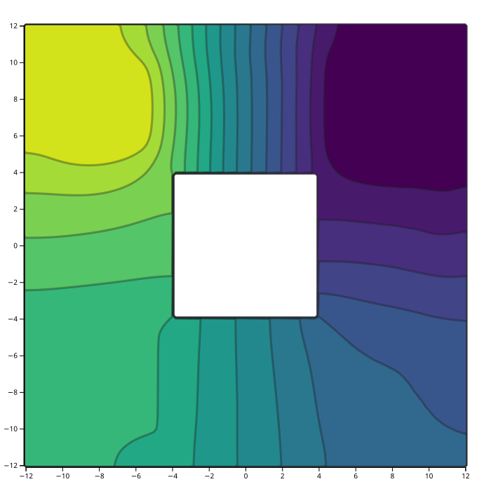

   Значения идут от 10 до 39.8. Белый квадрат в середине — это ``area5``,
   неопределённая намеренно; ячейки вне всех площадей тоже неопределены.

area_completer.py
^^^^^^^^^^^^^^^^^

То же сглаживание, но внутри одного полигона: ``area_completer`` ставит
completer с анизотропией (угол 30 градусов, ``w=2``) внутрь ``some_area``, а
обычный ``completer`` действует в остальной области. Одиннадцать точек
удерживают поверхность на данных.

.. tabs::

   .. tab:: Python

      .. literalinclude:: ../../examples/python/area_completer.py
         :language: python

   .. tab:: Tcl

      .. literalinclude:: ../../examples/surfit/tests/area_completer.tcl
         :language: tcl-src

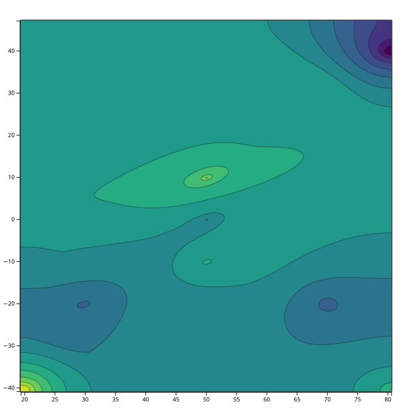

   Значения идут от -10 до 35.5. Внутри центральной площади изолинии вытянуты
   вдоль одного направления: сглаживание там предпочитает его.

area_ineq.py
^^^^^^^^^^^^

Пример с площадями и границами: ``area6`` просит значения от 15 до 20, но она
перекрывает ``area1`` и ``area3``, чьи точные значения (10 и 30) сильнее.
Неравенство изгибает остальную часть ``area6``, а сам скрипт сообщает, что
максимум внутри неё — 30.

.. tabs::

   .. tab:: Python

      .. literalinclude:: ../../examples/python/area_ineq.py
         :language: python

   .. tab:: Tcl

      .. literalinclude:: ../../examples/surfit/tests/area_ineq.tcl
         :language: tcl-src

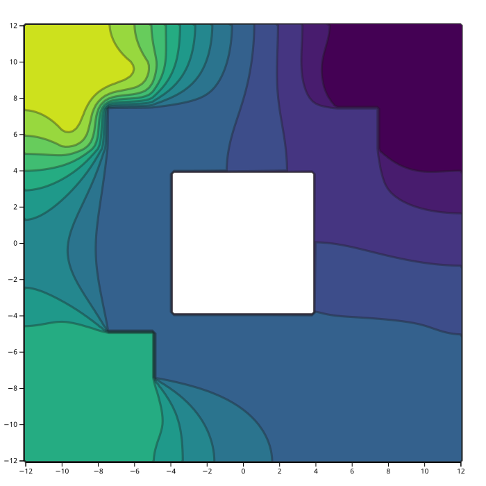

   Значения идут от 10 до 39.3. Полосы, которые добавляет неравенство, видны
   между точными площадями, а максимум внутри ``area6`` по-прежнему задаёт
   ``area3``.

area_mean.py
^^^^^^^^^^^^

Средние вместо точных значений: поверхность должна в среднем равняться 40
внутри ``area6`` и 30 по всей карте. Оба условия оставляют значение в каждом
отдельном узле свободным, поэтому карта глаже, чем вариант с точными значениями.

.. tabs::

   .. tab:: Python

      .. literalinclude:: ../../examples/python/area_mean.py
         :language: python

   .. tab:: Tcl

      .. literalinclude:: ../../examples/surfit/tests/area_mean.tcl
         :language: tcl-src

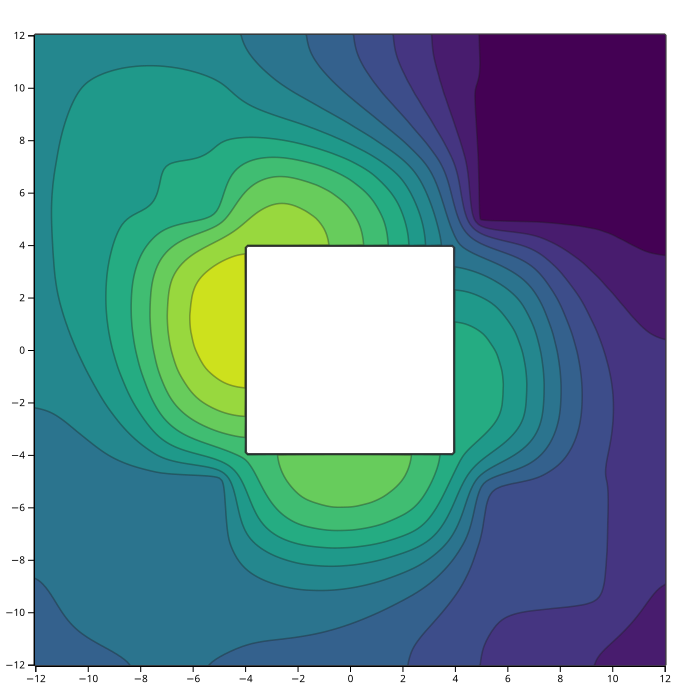

   Значения идут от 6.3 до 61.7. Оба средних выдержаны, а ``area6`` больше не
   привязана к одному числу.

area_wmean.py
^^^^^^^^^^^^^

То же среднее, но с поверхностью-весом: внутри ``area6`` поверхность в среднем
равна 30, а весом служит ``test_func``, поэтому среднее смещается туда, где эта
поверхность велика.

.. tabs::

   .. tab:: Python

      .. literalinclude:: ../../examples/python/area_wmean.py
         :language: python

   .. tab:: Tcl

      .. literalinclude:: ../../examples/surfit/tests/area_wmean.tcl
         :language: tcl-src

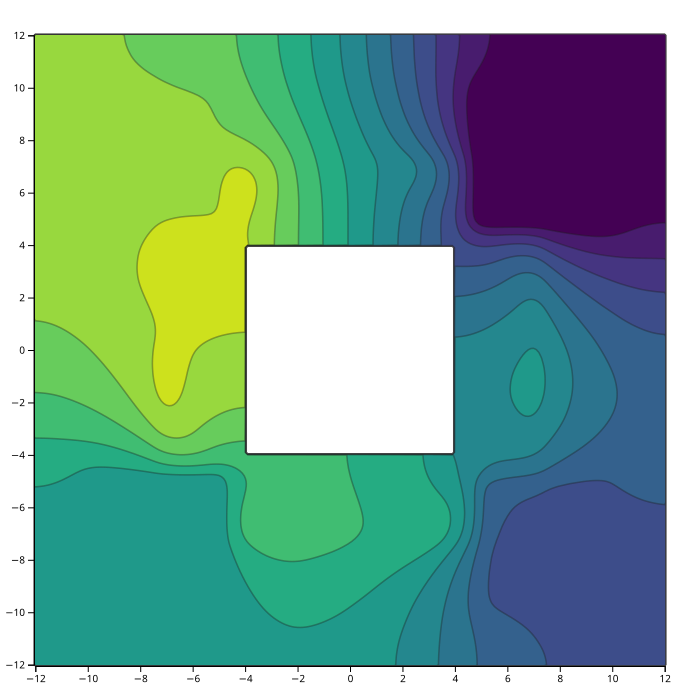

   Значения идут от 10 до 45.2: взвешенное среднее лежит ниже
   невзвешенного, потому что вес велик там, где ``test_func`` высок.

area_surf.py
^^^^^^^^^^^^

Поверхность как данные внутри площадей: результат точно следует ``test_func``
внутри ``area6`` и приближённо — внутри площадей 1–4, со своим весом для каждого
полигона.

.. tabs::

   .. tab:: Python

      .. literalinclude:: ../../examples/python/area_surf.py
         :language: python

   .. tab:: Tcl

      .. literalinclude:: ../../examples/surfit/tests/area_surf.tcl
         :language: tcl-src

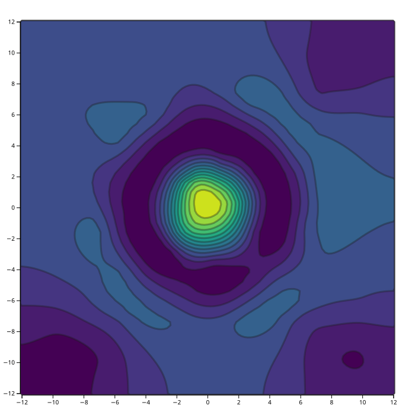

   Значения идут от -22.7 до 82.3 — это диапазон самого ``test_func``.

area_surf_ineq.py
^^^^^^^^^^^^^^^^^

Поверхность зажата между двумя копиями ``test_func``: выше неё в площадях 1, 3
и 5, ниже — в площадях 2, 4 и 6. Результат лежит внутри этого «бутерброда» и
гладок между площадями.

.. tabs::

   .. tab:: Python

      .. literalinclude:: ../../examples/python/area_surf_ineq.py
         :language: python

   .. tab:: Tcl

      .. literalinclude:: ../../examples/surfit/tests/area_surf_ineq.tcl
         :language: tcl-src

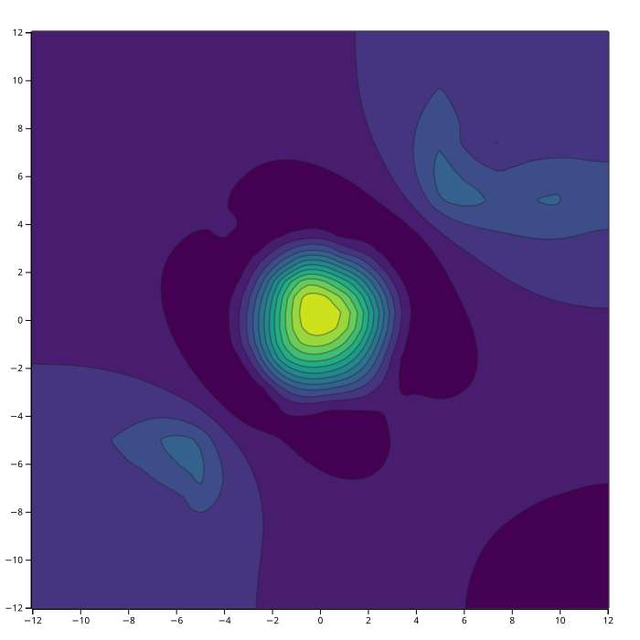

   Значения идут от -22.8 до 82.9. Две половины карты тянутся в разные стороны,
   а completer их сшивает.

Изолинии
~~~~~~~~

contour.py
^^^^^^^^^^

Три изолинии: малая и центральная учитываются точно, большая — с весом 0.5.
Изолиния несёт своё значение вдоль линии, и этим отличается от кривой.

.. tabs::

   .. tab:: Python

      .. literalinclude:: ../../examples/python/contour.py
         :language: python

   .. tab:: Tcl

      .. literalinclude:: ../../examples/surfit/tests/contour.tcl
         :language: tcl-src

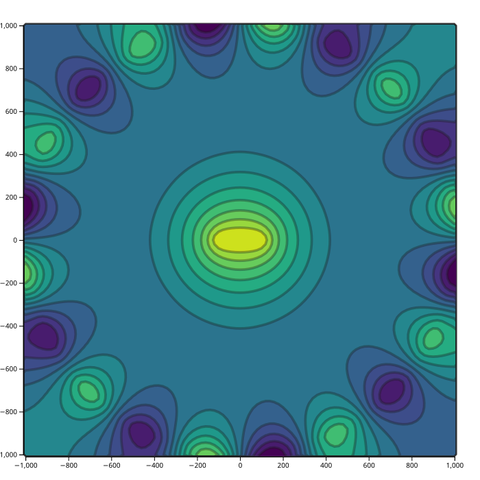

   Значения идут от -0.7 до 1. Три кольца — это сами изолинии; пространство
   между ними заполняет ``completer``.

contour_ineq.py
^^^^^^^^^^^^^^^

Два набора изолиний вместо одного: нижний набор задаёт нижнюю границу, а верхний,
сдвинутый на 0.2, — верхнюю, поэтому поверхности достаточно оставаться между
ними, а не касаться каждой.

.. tabs::

   .. tab:: Python

      .. literalinclude:: ../../examples/python/contour_ineq.py
         :language: python

   .. tab:: Tcl

      .. literalinclude:: ../../examples/surfit/tests/contour_ineq.tcl
         :language: tcl-src

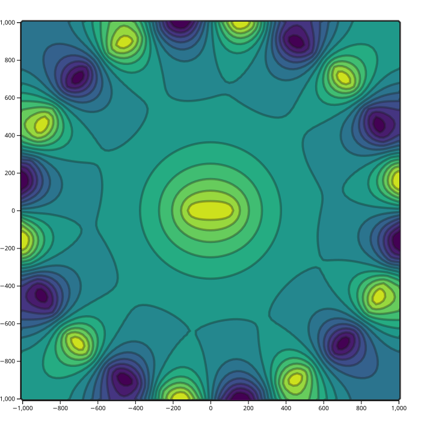

   Значения идут от -0.9 до 1.1 — шире, чем у варианта с равенствами: границы
   позволяют поверхности уйти за каждое кольцо на расстояние между наборами.

Кривые
~~~~~~

curve.py
^^^^^^^^

Четыре изолинии как данные: три несут точное значение (10, 50 и 30), четвёртая
добавлена с весом 0.5. Кривая двумерна, поэтому значение берётся из правила, а
не из линии, — этим она и отличается от изолинии.

.. tabs::

   .. tab:: Python

      .. literalinclude:: ../../examples/python/curve.py
         :language: python

   .. tab:: Tcl

      .. literalinclude:: ../../examples/surfit/tests/curve.tcl
         :language: tcl-src

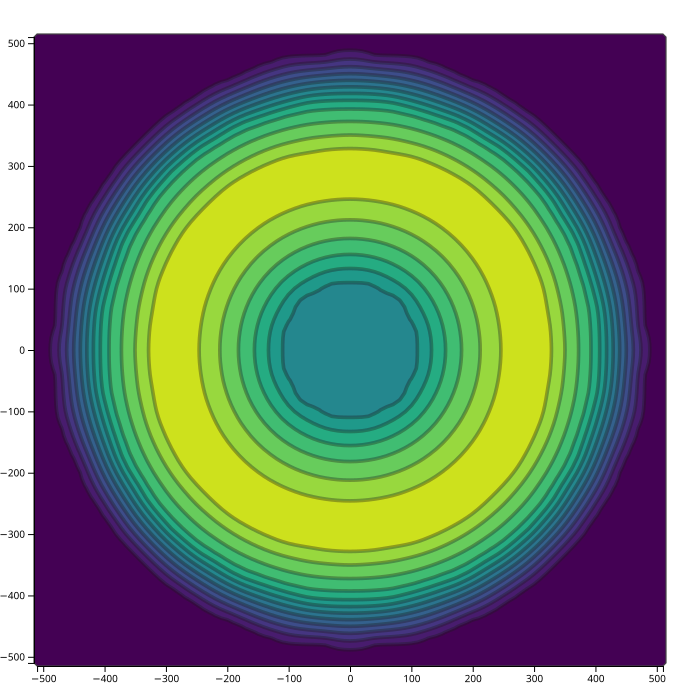

   Значения идут от 8.8 до 50. Поверхность доходит до самой высокой кривой и
   тянется к взвешенной, но не обязана на неё лечь.

curve_ineq.py
^^^^^^^^^^^^^

Пример с кривыми и неравенствами: значения вдоль тех же четырёх изолиний
становятся нижними и верхними границами, поэтому результат обязан соблюдать
только их порядок.

.. tabs::

   .. tab:: Python

      .. literalinclude:: ../../examples/python/curve_ineq.py
         :language: python

   .. tab:: Tcl

      .. literalinclude:: ../../examples/surfit/tests/curve_ineq.tcl
         :language: tcl-src

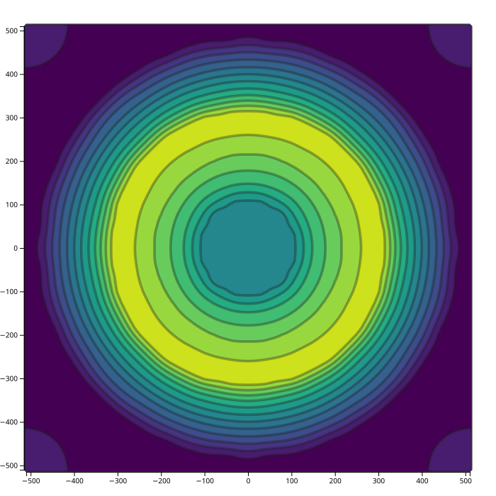

   Значения идут от 9.1 до 50.2 — близко к варианту с равенствами, но
   поверхность вольна обходить линии, а не проходить через них.

curve_surf.py
^^^^^^^^^^^^^

Кривые берут значения с другой поверхности: результат следует ``test_func``
вдоль ``spiral`` и делает это с весом 0.5 вдоль ``spiral2``. Сетка строится по
данным, поэтому покрывает обе спирали.

.. tabs::

   .. tab:: Python

      .. literalinclude:: ../../examples/python/curve_surf.py
         :language: python

   .. tab:: Tcl

      .. literalinclude:: ../../examples/surfit/tests/curve_surf.tcl
         :language: tcl-src

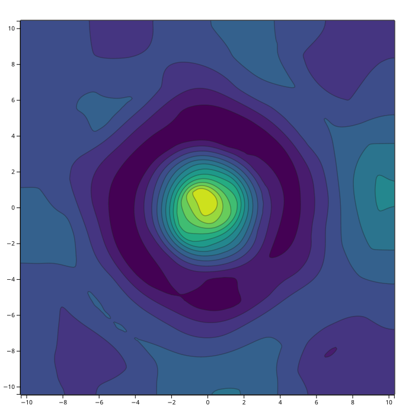

   Значения идут от -21.2 до 81.8. Спираль — это гребень, где ``test_func``
   соблюдается точно.

curve_surf_ineq.py
^^^^^^^^^^^^^^^^^^

Неравенства со значениями с другой поверхности: выше ``test_func`` вдоль
``spiral2`` и ниже неё вдоль ``spiral``. Две спирали чередуются, поэтому
результат продет между ними.

.. tabs::

   .. tab:: Python

      .. literalinclude:: ../../examples/python/curve_surf_ineq.py
         :language: python

   .. tab:: Tcl

      .. literalinclude:: ../../examples/surfit/tests/curve_surf_ineq.tcl
         :language: tcl-src

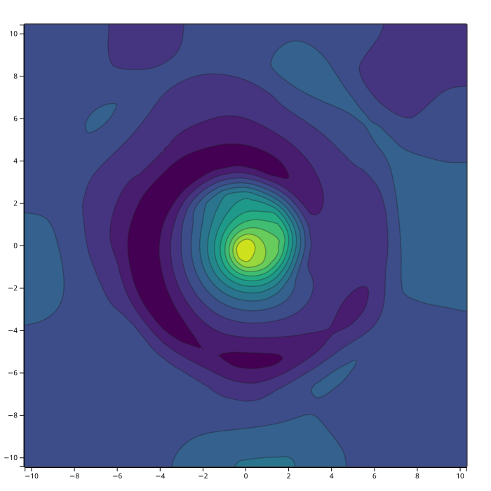

   Значения идут от -21.2 до 81.4. Поверхность проходит между спиралями, а не
   по ним.

Разрывы
~~~~~~~

faults.py
^^^^^^^^^

Одиннадцать точек и четыре линии разрывов. Поверхность обязана скачком
переходить через каждую линию, а не сглаживать её.

.. tabs::

   .. tab:: Python

      .. literalinclude:: ../../examples/python/faults.py
         :language: python

   .. tab:: Tcl

      .. literalinclude:: ../../examples/surfit/tests/fault.tcl
         :language: tcl-src

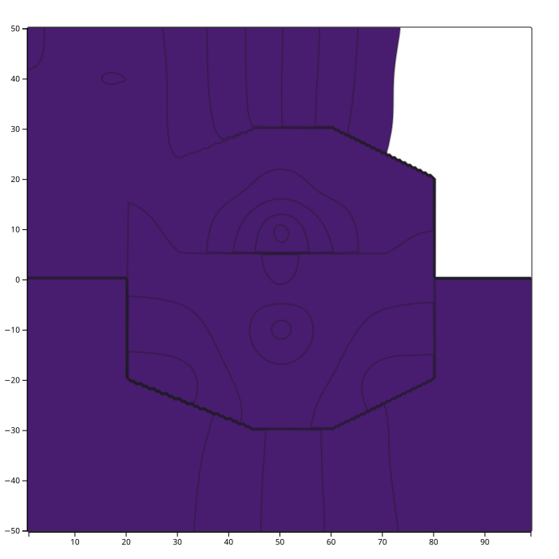

   Скачки — это резкие смены цвета вдоль границ многоугольников.

fault_aniso.py
^^^^^^^^^^^^^^

Пример с разрывами на более грубой сетке, с анизотропией в completer: внутри
каждого блока поверхность сглаживается вдоль 45 градусов, а не одинаково во всех
направлениях (угол анизотропии 45 градусов, аргумент веса 2).

.. tabs::

   .. tab:: Python

      .. literalinclude:: ../../examples/python/fault_aniso.py
         :language: python

   .. tab:: Tcl

      .. literalinclude:: ../../examples/surfit/tests/fault_aniso.tcl
         :language: tcl-src

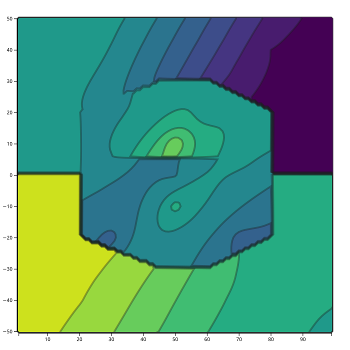

   Значения идут от -14.1 до 38.8. Скачки вдоль линий разрывов по-прежнему
   резкие, а сглаживание внутри блока предпочитает одно направление.

fault_approx.py
^^^^^^^^^^^^^^^

Пример с разрывами без точного условия в точках: они добавлены с весом, поэтому
поверхность может немного промахиваться мимо каждого замера.

.. tabs::

   .. tab:: Python

      .. literalinclude:: ../../examples/python/fault_approx.py
         :language: python

   .. tab:: Tcl

      .. literalinclude:: ../../examples/surfit/tests/fault_approx.tcl
         :language: tcl-src

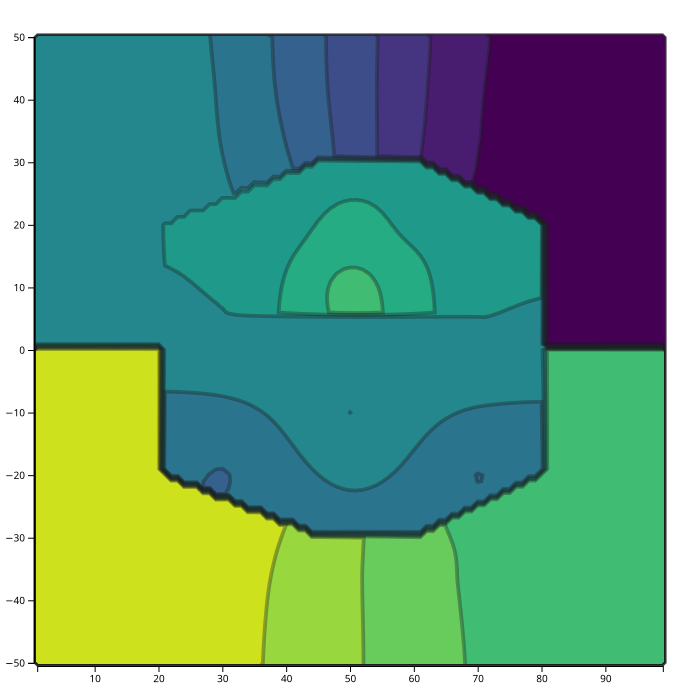

   Значения идут от -6.6 до 33.3. По сравнению с точным вариантом поверхность
   площе, и точки уже не лежат на ней.

Неравенства
~~~~~~~~~~~

ineq.py
^^^^^^^

Самый простой пример с неравенствами: семь точек, нижняя граница 80, верхняя
120 и completer между ними. Поверхность проходит через точки и всюду остаётся
внутри полосы.

.. tabs::

   .. tab:: Python

      .. literalinclude:: ../../examples/python/ineq.py
         :language: python

   .. tab:: Tcl

      .. literalinclude:: ../../examples/surfit/tests/ineq.tcl
         :language: tcl-src

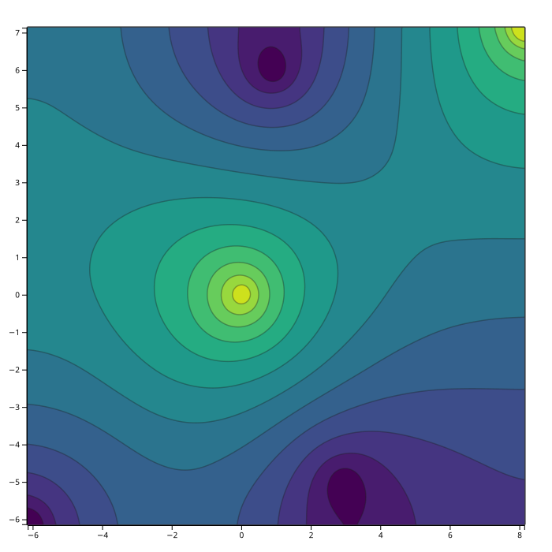

   Значения идут от 80 до 120: обе границы достигаются, но не нарушаются.

points_ineq.py
^^^^^^^^^^^^^^

Два набора измеренных точек как границы: поверхность должна оставаться выше
каждой точки одного набора и ниже каждой точки другого.

.. tabs::

   .. tab:: Python

      .. literalinclude:: ../../examples/python/points_ineq.py
         :language: python

   .. tab:: Tcl

      .. literalinclude:: ../../examples/surfit/tests/points_ineq.tcl
         :language: tcl-src

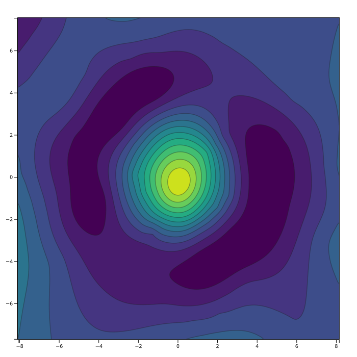

   Значения идут от -0.2 до 1. Два набора точек охватывают поверхность, и она
   остаётся между ними, не проходя ни через один.

Маски
~~~~~

mask.py
^^^^^^^

Растровая маска вырезает в поверхности дыру: там, где маска истинна, поверхность
остаётся неопределённой, а везде ещё следует ``test_func``.

.. tabs::

   .. tab:: Python

      .. literalinclude:: ../../examples/python/mask.py
         :language: python

   .. tab:: Tcl

      .. literalinclude:: ../../examples/surfit/tests/mask.tcl
         :language: tcl-src

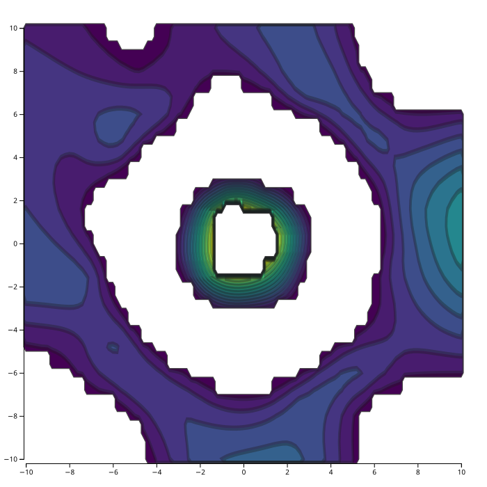

   Значения идут от -3.3 до 61.6 на 3031 узле из 5151: пропавшие узлы — это
   маска, а не сбой решения.

mask_add.py
^^^^^^^^^^^

Правило значения, ограниченное маской: там, где маска истинна, поверхность
тянется к 3 с весом 0.2, а в остальном, как и раньше, следует ``test_func``.

.. tabs::

   .. tab:: Python

      .. literalinclude:: ../../examples/python/mask_add.py
         :language: python

   .. tab:: Tcl

      .. literalinclude:: ../../examples/surfit/tests/mask_add.tcl
         :language: tcl-src

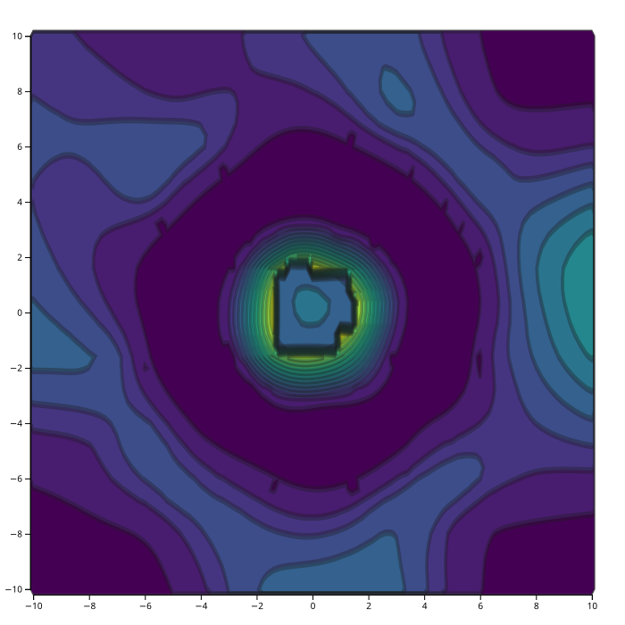

   Значения идут от -6.7 до 61.6. Взвешенное правило опускает поверхность
   внутри маски, не стирая её форму.

mask_completer.py
^^^^^^^^^^^^^^^^^

Completer, действующий только внутри маски, с анизотропией: там, где маска
истинна, поверхность сглаживается вдоль 30 градусов, а не одинаково во всех
направлениях (угол анизотропии 30 градусов, аргумент веса 2).

.. tabs::

   .. tab:: Python

      .. literalinclude:: ../../examples/python/mask_completer.py
         :language: python

   .. tab:: Tcl

      .. literalinclude:: ../../examples/surfit/tests/mask_completer.tcl
         :language: tcl-src

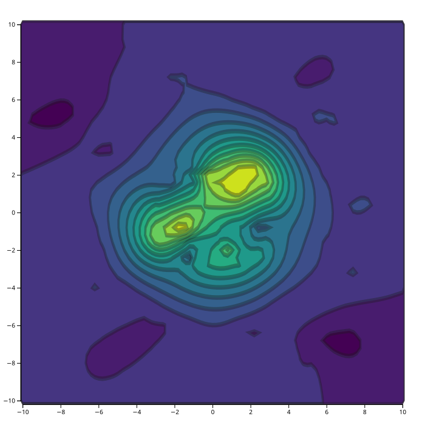

   Значения идут от 0 до 0.5. Одни точки дали бы шумную карту; внутри маски
   анизотропный completer её сглаживает.

mask_ineq.py
^^^^^^^^^^^^

Неравенство под маской: там, где маска истинна, поверхность должна быть не ниже
-10, а в остальном она следует ``test_func``.

.. tabs::

   .. tab:: Python

      .. literalinclude:: ../../examples/python/mask_ineq.py
         :language: python

   .. tab:: Tcl

      .. literalinclude:: ../../examples/surfit/tests/mask_ineq.tcl
         :language: tcl-src

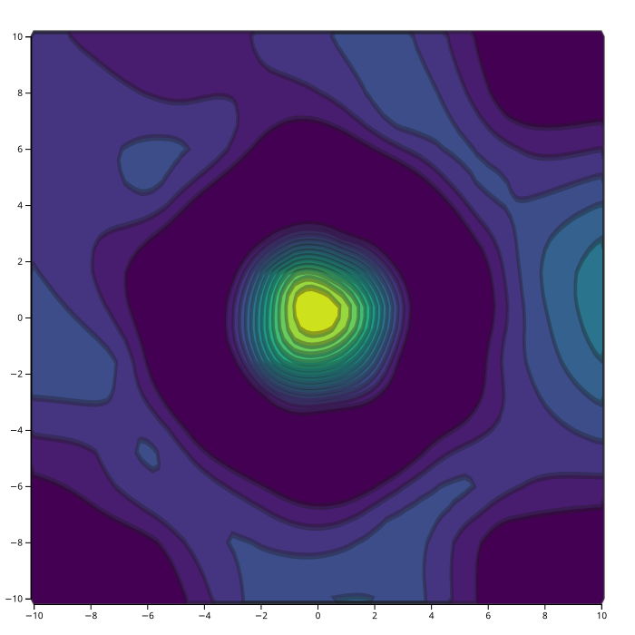

   Значения идут от -10.0 до 82.3. Внутри маски пол точно достигается, а
   остальная карта следует ``test_func``.

mask_mean.py
^^^^^^^^^^^^

Среднее под маской: там, где маска истинна, поверхность в среднем равна -2, а
точки в остальной области учитываются точно.

.. tabs::

   .. tab:: Python

      .. literalinclude:: ../../examples/python/mask_mean.py
         :language: python

   .. tab:: Tcl

      .. literalinclude:: ../../examples/surfit/tests/mask_mean.tcl
         :language: tcl-src

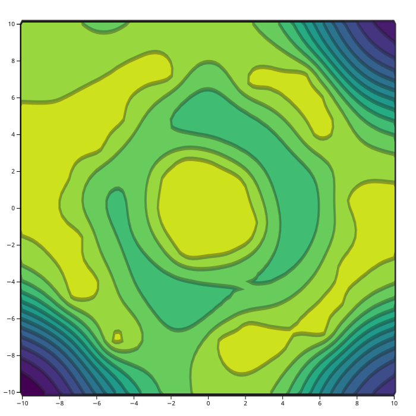

   Значения идут от -7.6 до 0.6. Точки лежат около нуля, а маска тянет среднее
   вниз до -2.

mask_surf.py
^^^^^^^^^^^^

Правило поверхности под маской: там, где маска истинна, результат равен
``test_func``, а в остальном работает completer.

.. tabs::

   .. tab:: Python

      .. literalinclude:: ../../examples/python/mask_surf.py
         :language: python

   .. tab:: Tcl

      .. literalinclude:: ../../examples/surfit/tests/mask_surf.tcl
         :language: tcl-src

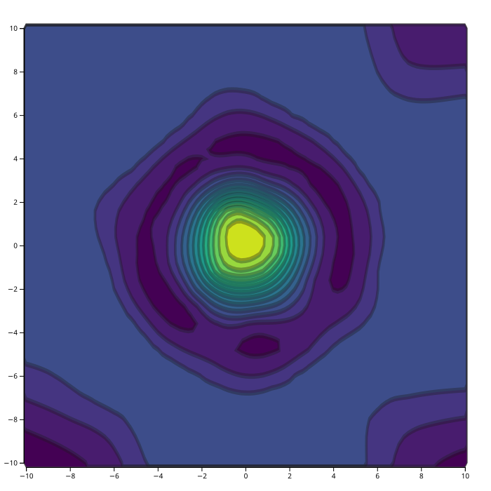

   Значения идут от -27.5 до 82.3. Маска сохраняет ``test_func``, а completer
   плавно продолжает её на остальную сетку.

mask_surf_add.py
^^^^^^^^^^^^^^^^

Взвешенное правило поверхности под маской: сначала идёт completer, а
``test_func`` добавляется к нему с весом 1 там, где маска истинна.

.. tabs::

   .. tab:: Python

      .. literalinclude:: ../../examples/python/mask_surf_add.py
         :language: python

   .. tab:: Tcl

      .. literalinclude:: ../../examples/surfit/tests/mask_surf_add.tcl
         :language: tcl-src

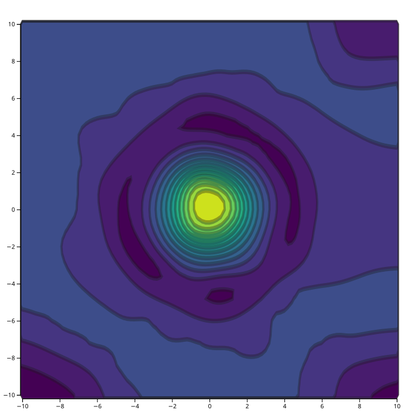

   Значения идут от -26.3 до 78.5 — чуть менее резкие, чем у точного правила,
   потому что completer тоже участвует.

mask_surf_ineq.py
^^^^^^^^^^^^^^^^^

Неравенство относительно поверхности под маской: там, где маска истинна,
результат остаётся не выше ``test_func``, а точки задают его в остальной области.

.. tabs::

   .. tab:: Python

      .. literalinclude:: ../../examples/python/mask_surf_ineq.py
         :language: python

   .. tab:: Tcl

      .. literalinclude:: ../../examples/surfit/tests/mask_surf_ineq.tcl
         :language: tcl-src

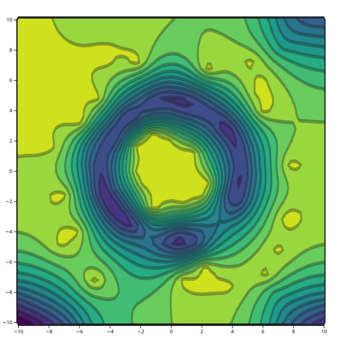

   Значения идут от -27.5 до 1.9. В области маски поверхность ограничена сверху
   ``test_func``, а точки держат остальное около нуля.

mask_wmean.py
^^^^^^^^^^^^^

Взвешенное среднее под маской: поверхность в среднем равна 2 там, где истинна
``mask_not``, с весом ``test_func``, а точки учитываются точно.

.. tabs::

   .. tab:: Python

      .. literalinclude:: ../../examples/python/mask_wmean.py
         :language: python

   .. tab:: Tcl

      .. literalinclude:: ../../examples/surfit/tests/mask_wmean.tcl
         :language: tcl-src

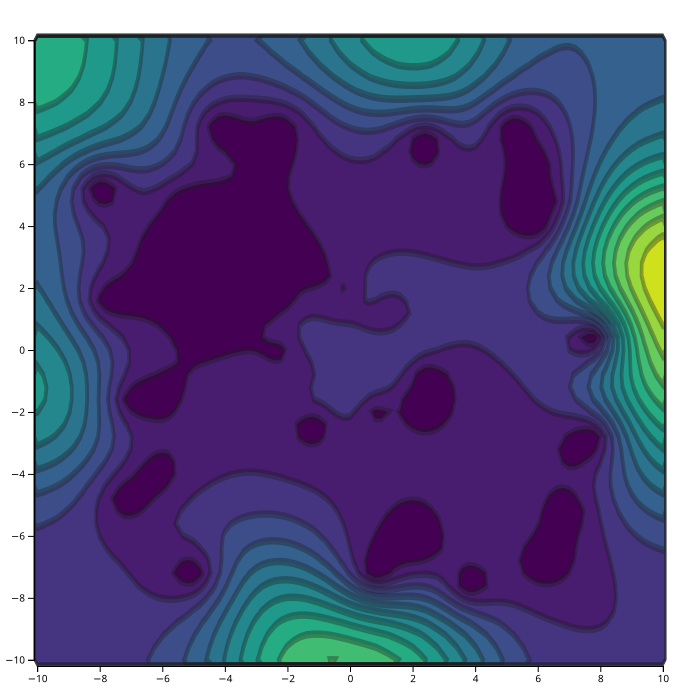

   Значения идут от 0 до 6.2. Взвешенное среднее поднимает околонулевые точки
   к 2.

Средние
~~~~~~~

mean.py
^^^^^^^

Среднее как условие гриддинга: поверхность проходит через семь точек, а её
среднее по всей карте равно 30.

.. tabs::

   .. tab:: Python

      .. literalinclude:: ../../examples/python/mean.py
         :language: python

   .. tab:: Tcl

      .. literalinclude:: ../../examples/surfit/tests/mean.tcl
         :language: tcl-src

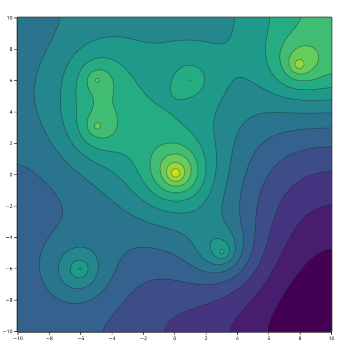

   Значения идут от -57.0 до 140. Такой широкий диапазон и нужен, чтобы среднее
   было 30, а поверхность при этом проходила через точки.

wmean.py
^^^^^^^^

Взвешенное среднее: поверхность проходит через семь точек, а её среднее равно
30 с весом ``test_func``, поэтому среднее смещается туда, где эта поверхность
велика.

.. tabs::

   .. tab:: Python

      .. literalinclude:: ../../examples/python/wmean.py
         :language: python

   .. tab:: Tcl

      .. literalinclude:: ../../examples/surfit/tests/wmean.tcl
         :language: tcl-src

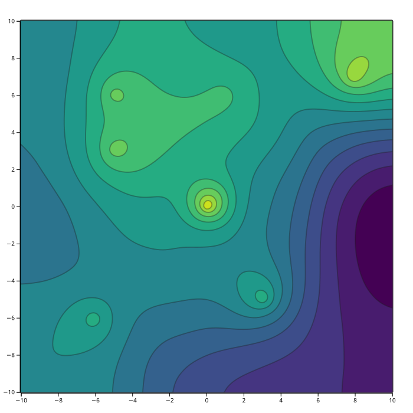

   Значения идут от -71.7 до 140. Взвешенное среднее уходит ниже невзвешенного,
   чтобы скомпенсировать большие значения там, где вес велик.

Поверхности
~~~~~~~~~~~

surface.py
^^^^^^^^^^

Поверхность как данные: результат следует за ``test_func`` в смысле наименьших
квадратов и стремится к плоскости там, где поверхность ничего не подсказывает.

.. tabs::

   .. tab:: Python

      .. literalinclude:: ../../examples/python/surface.py
         :language: python

   .. tab:: Tcl

      .. literalinclude:: ../../examples/surfit/tests/surface.tcl
         :language: tcl-src

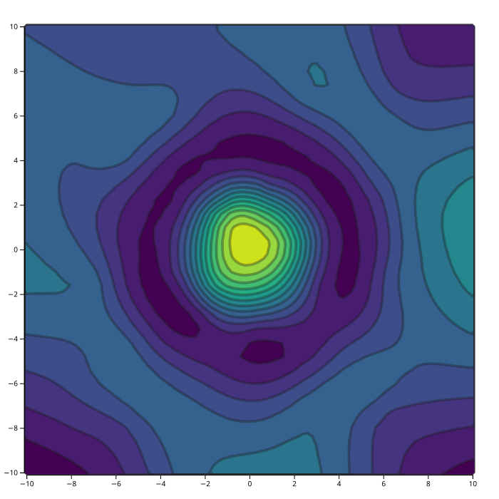

   Поверхность гладкая, но не плоская: изолинии сгущаются там, где ``test_func``
   меняется быстрее всего, а карта идёт от -27.5 до 82.3.

surface_add.py
^^^^^^^^^^^^^^

Поверхность, добавленная с малым весом: один completer дал бы плоскость, а
``test_func`` слегка изгибает её к своей форме.

.. tabs::

   .. tab:: Python

      .. literalinclude:: ../../examples/python/surface_add.py
         :language: python

   .. tab:: Tcl

      .. literalinclude:: ../../examples/surfit/tests/surface_add.tcl
         :language: tcl-src

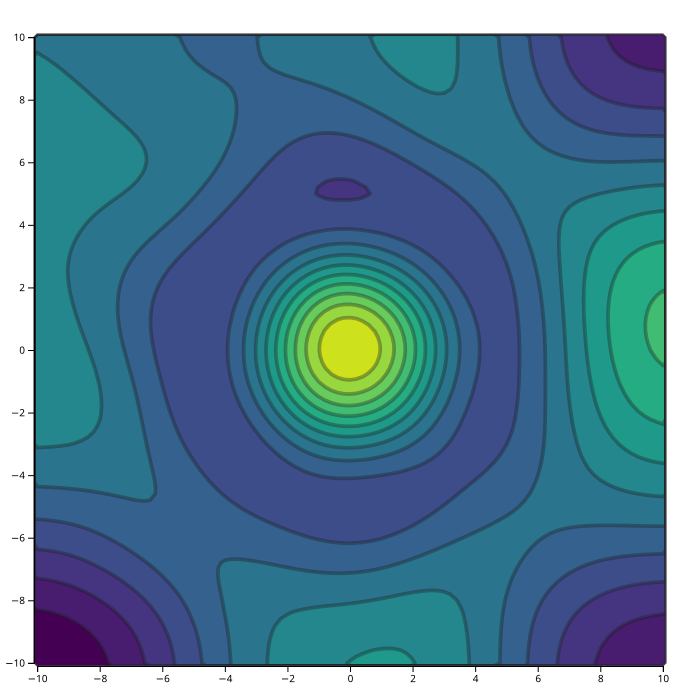

   Значения идут от -12.5 до 27.7 — диапазон много уже, чем у самого
   ``test_func``: вес 0.01 удерживает результат рядом с плоскостью.

surface_ineq.py
^^^^^^^^^^^^^^^

Пример с поверхностью и неравенством: ``test_func``, сдвинутая на 80, задаёт
нижнюю границу, поэтому результат лежит выше неё, а семь точек учитываются
точно. Вторая копия, сдвинутая на 90, загружается скриптом, но ни одно правило
её не использует.

.. tabs::

   .. tab:: Python

      .. literalinclude:: ../../examples/python/surface_ineq.py
         :language: python

   .. tab:: Tcl

      .. literalinclude:: ../../examples/surfit/tests/surface_ineq.tcl
         :language: tcl-src

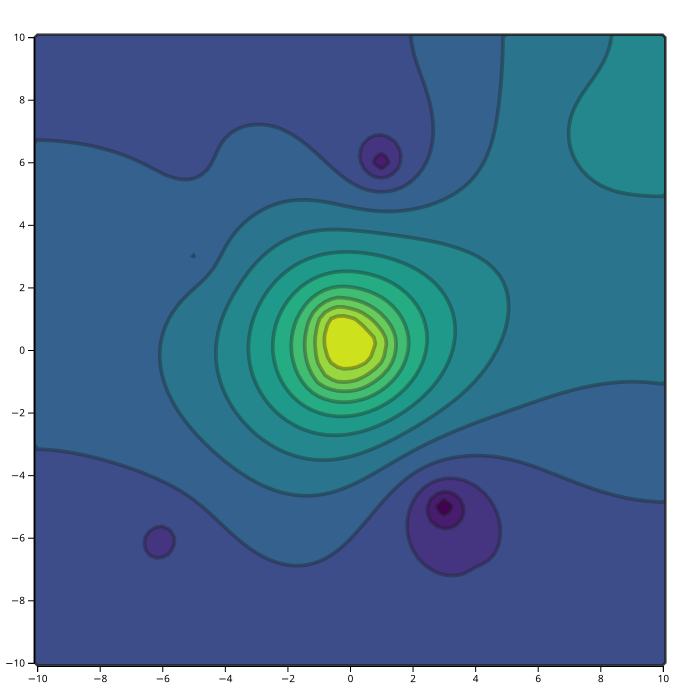

   Значения идут от 72.4 до 162.3. Граница — это ``test_func`` плюс 80, и самая
   высокая точка результата лежит ровно на ней.

Тренды
~~~~~~

trend.py
^^^^^^^^

Разрывы под региональным трендом: семь точек и две линии разрывов, а результат
обязан на крупном масштабе походить на ``test_func``. Разрывы не дают тренду
остаться непрерывным.

.. tabs::

   .. tab:: Python

      .. literalinclude:: ../../examples/python/trend.py
         :language: python

   .. tab:: Tcl

      .. literalinclude:: ../../examples/surfit/tests/trend.tcl
         :language: tcl-src

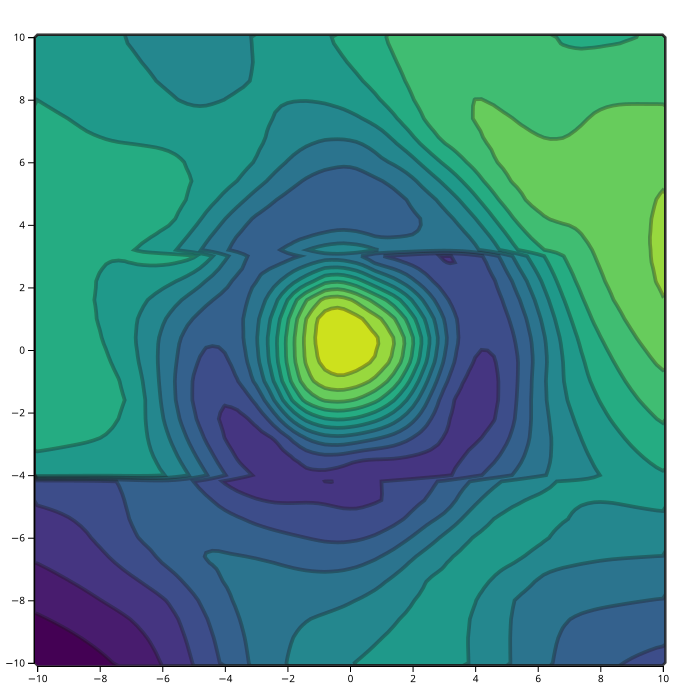

   Значения идут от 29.0 до 142.7. Форму задаёт тренд, а две линии разрывов
   видны как ступени в нём.

trend_from_numpy.py
^^^^^^^^^^^^^^^^^^^

Региональный тренд, переданный массивом numpy, семь скважин, учтённых точно, и
результат, прочитанный обратно в массив.

.. literalinclude:: ../../examples/python/trend_from_numpy.py
   :language: python

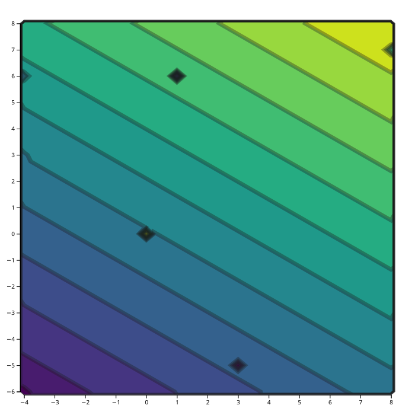

   Плоскость идёт от 67 до 140. Маленькие тёмные ромбы — это скважины: их
   замеры лежат вне плоскости, поэтому каждая локально тянет поверхность вниз,
   а не сглаживается.

Прочее
~~~~~~

progress.py
^^^^^^^^^^^

Показывает ход решения; раздел «Прогресс» выше объясняет два режима. Его вывод —
текст, а не карта:

.. code-block:: text

   -- cg (65536 cells)
      cg (65536 cells): iter 33, err 4.92211E-06

.. literalinclude:: ../../examples/python/progress.py
   :language: python

viewer.py
^^^^^^^^^

Пишет интерактивную HTML-страницу. Это тот же расчёт, что и в ``area.py``, —
отличается только вывод, — поэтому первая карта выше и есть то, что он рисует,
с подсказкой под курсором и вырезанными неопределёнными ячейками.

.. literalinclude:: ../../examples/python/viewer.py
   :language: python

Замечания о том, как устроены привязки и как они проверяются, — в
:doc:`development`.
