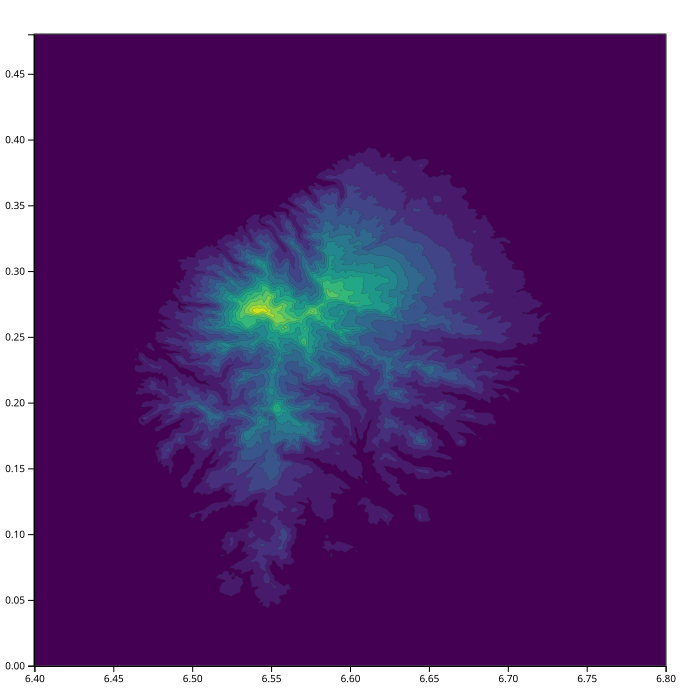

Рельеф
======

``globe`` добавляет в движок цифровые модели рельефа. DEM — это растр с
привязкой к координатам: он знает координаты угла и шаг, поэтому его можно
опросить в любой точке и спроецировать на сетку задачи. Используют его два
правила:

* ``dem`` заставляет поверхность следовать за DEM — жёсткое условие, как
  ``area`` со значением в каждом узле;
* ``dem_add`` добавляет DEM с весом поверх предыдущих правил, поэтому результат —
  компромисс между трендом и измеренным рельефом.

Примеры — порты ``examples/globe/dem.tcl`` и ``dem_add.tcl``. Каждый пишет тот
же ``.dat``, что и его Tcl-оригинал (``test_examples.py`` сверяет побайтово), а
карты ниже рисует ``make_images.py`` из самих примеров.

Тайл
----

Оба примера читают ``N00E006.hgt.zip`` — тайл SRTM на один градус с шагом
3 угловые секунды, 1201 x 1201 ячеек, внутри zip. У формата HGT вообще нет
заголовка:

* имя несёт привязку: ``N00E006`` — это тайл, юго-западный угол которого
  0 с. ш., 6 в. д.; он покрывает градус на север и на восток;
* длина файла несёт разрешение: 1201 x 1201 отсчётов — это SRTM-3 (3 угловые
  секунды), 3601 x 3601 — SRTM-1 (1 угловая секунда);
* отсчёты — знаковые 16-битные метры в big-endian, строка за строкой от северной
  кромки; ``-32768`` — пустое значение, 0 — море.

Поэтому загрузчики принимают *шаблон* файла, и поэтому обрезанный тайл прочитать
нельзя: ``_dem_load_hgt`` выводит охват из имени, а число отсчётов проверяет по
длине файла. Вариант с zip требует zlib; CMake включает его, если находит
библиотеку. Несжатый ``.hgt`` читает ``dem_load_hgt``, zip — ``dem_load_hgt_zip``.

Тайл, который лежит рядом с примерами, — это весь квадрат N00E006, усреднённый
из открытых данных рельефа с шагом 1 угловая секунда на AWS
(``elevation-tiles-prod/skadi``) до разрешения SRTM-3, с уровнем моря, равным 0.
Читается он как обычный тайл SRTM: Сан-Томе поднимается из плоского моря, а пик в
точке 0.27 с. ш. — это Пику-де-Сан-Томе. Он занимает 164 КБ, поэтому репозиторий
может его нести; полный тайл с шагом 1 угловая секунда — это 25 МБ, и такие
файлы не коммитятся и не скачиваются проверками.

Примеры
-------

Оба примера строят одну и ту же сетку — от 6.4 в. д. до 6.8 в. д. и от 0 до
0.48 с. ш. с шагом 0.0005 градуса, 801 x 961 узел, — и различаются только
правилом.

dem.py
~~~~~~

DEM здесь — жёсткое условие: каждый узел сетки берётся из тайла, поэтому
решателю нечего минимизировать, и он так и говорит. Это самый короткий способ
внести измеренный рельеф в задачу.

.. tabs::

   .. tab:: Python

      .. literalinclude:: ../../examples/python/dem.py
         :language: python

   .. tab:: Tcl

      .. literalinclude:: ../../examples/globe/dem.tcl
         :language: tcl-src

   Значения от 0 на уровне моря до 1956 м, среднее — 127 м. Весь остров попадает
   в окно, и все узлы определены.

dem_add.py
~~~~~~~~~~

Здесь сначала идёт ``completer``, а DEM добавляется с весом: поверхность — это
тренд, который притягивается к измеренному рельефу. При весе 1 условия
сопоставимы, и результат близок к тайлу, но не равен ему: пик теряет около 40 м,
а море перестаёт быть идеально плоским.

.. tabs::

   .. tab:: Python

      .. literalinclude:: ../../examples/python/dem_add.py
         :language: python

   .. tab:: Tcl

      .. literalinclude:: ../../examples/globe/dem_add.tcl
         :language: tcl-src

   То же окно, значения от -0.1 до 1917 м. Решателю нужно до 51 итерации на фазу,
   тогда как с жёстким правилом итераций нет вовсе.

Что ещё умеют команды DEM
-------------------------

DEM — не только источник данных: ``surf_to_dem`` делает его из посчитанной
поверхности, ``dem_to_surf`` проецирует его на сетку, ``dem_save_grd`` и
``dem_load_grd`` замыкают круговой рейс через ASCII-сетки Golden Software
Surfer (``.grd`` с заголовком ``DSAA``), а ``dem_decomp``/``dem_recons`` ходят
по грубым уровням хранилища. :doc:`data_types` описывает, что хранит каждая из
них, а полный список — в :doc:`commands`.

Не перенесено: конвейер canyon
------------------------------

В ``examples/globe/canyon`` лежат три скрипта, которые строят модель Большого
каньона из DTM США (``usa.hdr`` с ``usa.bin``) и девяти тайлов SRTM: они
переводят DTM в точки, обрезают их по ``canyon_rect.txt`` и гридят то, что
осталось. Ни DTM, ни тайлов в репозитории нет, а ссылка на скачивание в readme
мертва, поэтому три скрипта перечислены в ``test_examples.py`` как сознательно не
перенесённые. Всё, что они используют, проверяется двумя примерами выше и кейсами
DEM в ``test_all_commands.py``; не хватает только данных.
