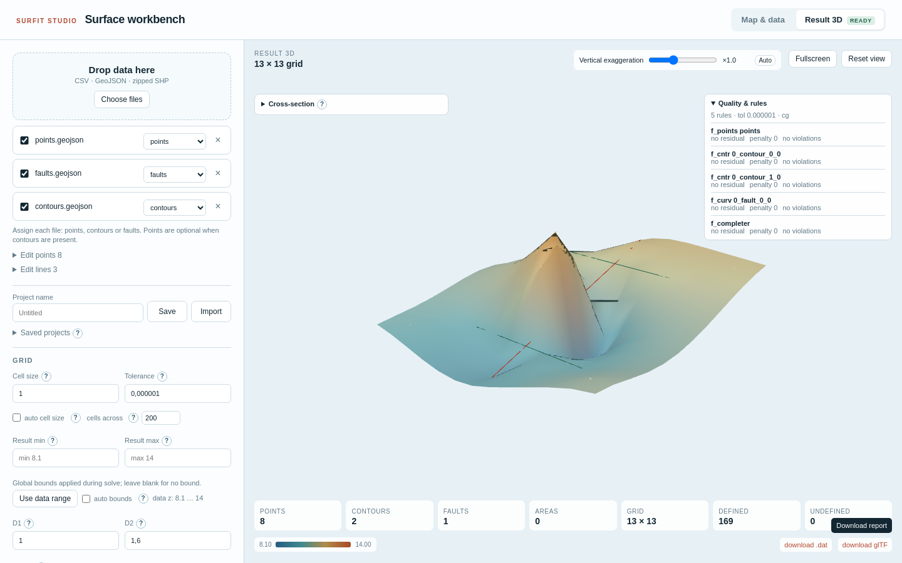

# surfit surface workbench (MVP)

A local, single-user web workbench around the surfit engine.  No QGIS, no
PostGIS, no map server.

```text
points / contours / faults / areas  ->  grid + rules  ->  3D surface
```

## Run

The shortest path is:

```bash
./bootstrap.sh
./run.sh
```

`bootstrap.sh` installs the workbench dependencies into `.site`; `run.sh`
finds `../build-ci/bin` automatically.  Override with
`SURFIT_BIN=/path/to/surfit/build-ci/bin ./run.sh` or `PORT=8080 ./run.sh`.



Manual equivalent:

```bash
export SURFIT_BIN=/path/to/surfit/build-ci/bin
export PYTHONPATH="$PWD:$PWD/.site:$SURFIT_BIN"
python -m uvicorn backend.app:app --host 127.0.0.1 --port 8000
```

Open <http://127.0.0.1:8000>.  Example inputs are in `examples/`.

## Workflow

```text
drop files -> assign role (points / contours / faults / areas)
             -> Map & data previews the sources immediately
             -> set area rules
             -> Solve
             -> Result 3D opens with the surface
```

The map tab is a top-down preview of the source points, contours, faults and
area polygons,
available before solving.  The result tab is the 3D surface; vertical exaggeration is automatic for each
new result (roughly 30% of the longest horizontal extent, never below 1×).
The slider is logarithmic; `Auto` recomputes it after manual changes.
`Fullscreen` expands Result 3D to the whole screen; the same button or `Esc`
exits.  A default A/B cross-section is computed after every solve; on `Map &
data`, drag either endpoint or the line itself to update the profile.

## Projects

`Save` stores the source files, grid settings and, when a solve has completed,
the mesh, metrics, `.dat` and glTF under `~/.local/share/surfit-studio` (or
`SURFIT_STUDIO_WORK`).  `Saved
projects` lists them; loading restores the sources and the result without
re-solving.  Projects are local files, not a database or a user account.

Each saved project can be downloaded as a self-contained `.zip` and imported
on another machine.  Import validates the archive, creates a new project id and
recomputes source URLs; it does not trust stored paths.

The frontend is plain ES modules; three.js is vendored under
`frontend/vendor/`, so there is no build step and no CDN dependency.

While a job runs, the status area shows a stage progress bar and elapsed time.
The C++ solve is one call without progress callbacks, so the bar uses honest
stages (reading, grid, solving, mesh) and animates while the solver is inside
that call; it is not a fabricated ETA.

## Input formats

CSV/XYZ, GeoJSON and optional SHP/GeoPackage are accepted for each input.  The
same file is interpreted by its role: points, faults, contours, areas or
surfaces.

For GeoJSON:

- points: `Point` or `MultiPoint`, with a third coordinate or a `z`/`value`
  property;
- faults: `LineString` or `MultiLineString`;
- contours: `LineString` or `MultiLineString`, with 3D coordinates or a
  `z`/`value` property;
- surfaces: native surfit `.func` or compatible `.dat` grids.

SHP is read by the bundled `pyshp` dependency, without GDAL.  A zipped
`.shp/.shx/.dbf/.prj` keeps attributes and the z/weight fields; a bare `.shp`
works for 3D geometry but has no attribute table.

For SHP or GeoJSON properties, open `Data fields` and choose `x`, `y`, `z` or
`weight` from the detected dropdowns.  Leave x/y empty to use the geometry; z
falls back to coordinate z, then common properties (`z`, `Z`, `elev`,
`elevation`, `value`).  A single contour field is selected automatically.

`From value` / `To value` filter the chosen value inclusively; `exclude values
equal to 0` removes zero rows/lines without touching negative values.  Filters
apply to both preview and solve.  GeoPackage still needs the optional
`requirements-geo.txt`.
`Auto cell size` computes the cell size from the preview extent and the
`cells across` target (20–2000), fills the cell-size field and locks it.
Changing the target updates the value immediately; the mode and target are
saved in the project.

`Result min` / `Result max` set global lower/upper bounds for the solved
surface; leave them blank for no bound.  The preview reports the source Z range
and `Use data range` fills both fields explicitly.  `auto bounds` keeps them in
step with the source range and locks the two inputs; the mode is saved in the
project.

Every setting has a `?` button with a short explanation.  The same help is
available on the rule, data-field, cross-section, project and manual-extent
panels.

Coordinates are used as stored; the workbench does not reproject.

### Points

CSV, whitespace or tab separated:

```text
x y z
x y z weight
```

`#` comments and a non-numeric header row are ignored.  Maximum 200,000 points
and a 25 MB upload.

### Surface rules

Upload a native surfit surface (`.func` or a compatible `.dat`) as the
`surfaces` role.  The panel can add:

- global `mean`;
- weighted `mean` with the selected surface;
- `trend` with weight/order.

Surface rules run after areas and before `completer`.

### Rule order

The `Rule order` panel controls the order of points, contours, faults, area
rules, surface rules, global bounds and `completer`.  Rules are sent to solve in
that order; the default keeps `completer` last.

### Area rules

Polygon areas from GeoJSON/SHP get a row in `Area rules`:

- `constant`: value inside the polygon;
- `bounds`: lower/upper inside the polygon;
- `undef` / mask: leave the polygon undefined;
- `mean`: average inside the polygon;
- `add`: weighted area contribution;
- `none`: no rule.

Rules can be moved up and down; surfit applies them in that order.

Fields are prefilled from polygon properties when possible and can be edited
before solving.  Areas are drawn on the source map.

### Editing points

The `Edit points` table lists points from CSV/XYZ and GeoJSON sources.  The
cross removes a row or a GeoJSON point feature and re-previews immediately; the
next solve uses the edited source.  SHP sources are shown as not editable in
the browser; edit the source file instead.

### Contours

Optional.  Columns are `x y z [contour_id]`; points with the same id form one
3D contour, and `z` is the value carried along it.

### Faults

Optional.  Columns are `x y [fault_id]`; points with the same id form one
polyline.  Blank/missing id means one fault.

## Controls

- cell size, or `auto` (about 200 cells across the longest side);
- tolerance;
- solver: `cg`, `jcg`, `ssor`, `jacobi`, `rf`;
- D1/D2 completer weights;
- optional lower/upper bound;
- optional manual extent; otherwise 5% padding around the data;
- vertical exaggeration in the 3D view.

## Limits and honesty

- one worker by default: the engine has its own thread pool;
- one Session per job;
- maximum 1,000,000 grid cells;
- jobs expire after six hours;
- undefined cells are holes in the mesh, not zero;
- contour-only solves need at least two lines; the current CMOFS completer
  crashes on a single contour, so the workbench rejects it;
- the page reports defined/undefined counts and a Quality & rules panel with
  residual, penalty iterations and violations where the engine exposes them;
- the cross-section panel samples the solved surface along two points; it is a
  nearest-node profile, not a new grid solve;
- `Download report` writes a JSON file with settings, source roles, metrics and
  the last section profile;
- the map has an optional surface overlay; sources remain the default;
- map zoom/pan: buttons or wheel, drag when zoomed, reset button;
- a disabled source is not sent to preview or solve.

## Bundle

```bash
./package.sh
```

It creates `dist/surfit-workbench-<date>.zip` with the app, examples, tests and
any `surfit-*.whl` found in `../wheels-manylinux2014`.  The bundled
`bootstrap.sh` installs the wheel and Python dependencies into the local
`.site`; `run.sh` then finds that directory automatically.

## Test

API test:

```bash
export SURFIT_BIN=/path/to/surfit/build-ci/bin
export PYTHONPATH="$PWD:$PWD/.site:$SURFIT_BIN"
python tests/test_app.py
# or:
make test
```

Browser check (optional; Playwright + Chromium):

```bash
npm_config_cache="$PWD/.npm" npm install
PLAYWRIGHT_BROWSERS_PATH="$PWD/.pw-browsers" \
  npx playwright install chromium
PLAYWRIGHT_BROWSERS_PATH="$PWD/.pw-browsers" node tests/browser_check.js
```

It submits GeoJSON points, faults and contours, edits a source, solves, saves
and reloads a project, opens a cross-section, downloads a report and saves
`tests/screenshots/result.png`.

## Not yet

Users/auth, shared projects, polygon editing, PostGIS, streaming, WASM.
Local projects are implemented; jobs still expire after six hours.
